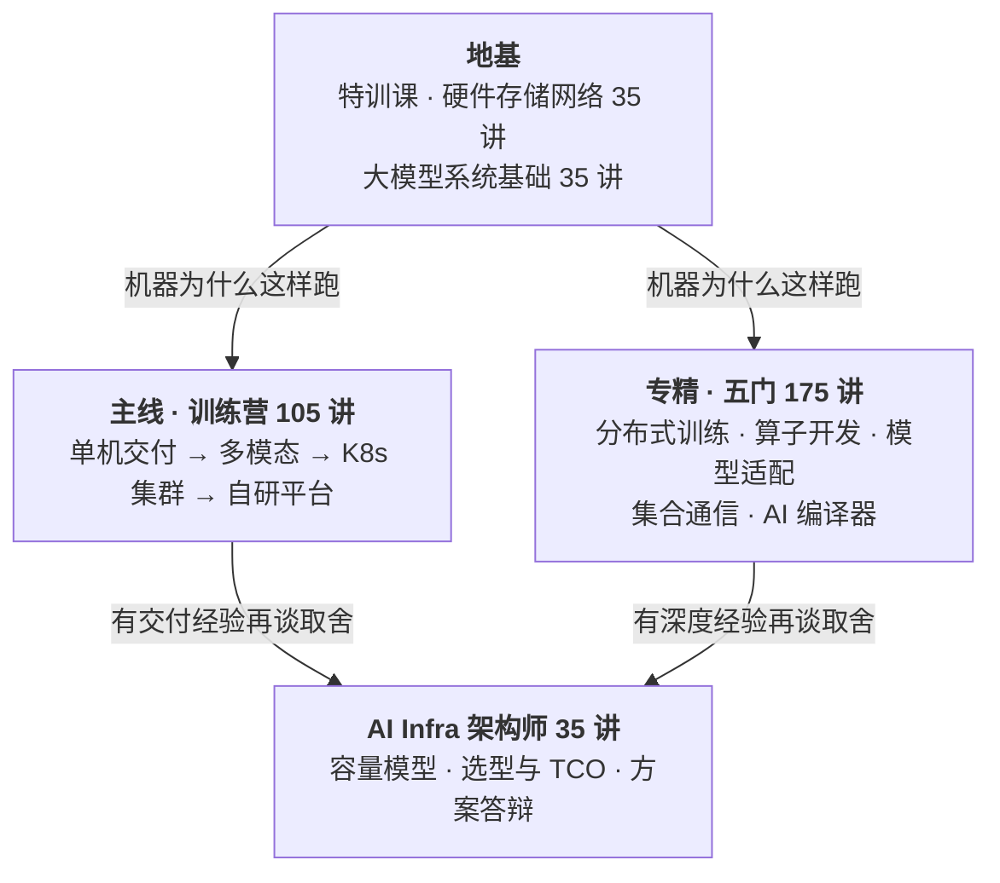

## AI Infra 学院

**面向大模型 AI Infra 工程师的系统课程。** 两条线：一条教你**把大模型服务交付出去并且跑稳**，一条教你**把某一层做到别人做不了的深度**。

三件可以现在就验证的事：

- **逐讲大纲已经全部写完并公开**——每一讲讲什么、做什么实验、结业交什么，点进下面任意一门就能逐条看
- **每门课前 3 讲免费**，完整讲义加实验代码，不用报名也不用加好友 → **[免费试看](免费试看)**
- **7 天无理由退款**，不问原因

**12 门课 · 385 讲 · 每讲 40 分钟。** 箭头是先后顺序，不是必须全买——每门课都能单独学。

> **现在开放报名的是两门**：**特训课**（✅ 正在更新，每周 3 讲）和**训练营阶段一**（🛠️ 筹备录制，可预订）。
> 其余课程的**逐讲大纲已经全部写完并公开，现在就能逐讲看**——下面表格里标的是已经定好的正式价与首发价，不是暂定；
> 早鸟价与具体排期在该门课开课前约 30 天公告，**到那时再报名也不吃亏**（首发价在整门课更新完之前一直有效）。

### 正在讲的两套课

这两套互补不是替代：**特训课讲「为什么」，训练营讲「怎么交付」。** 可以单买，一起学是最顺的路径。

#### 特训课 · 硬件、存储与网络（35 讲，更新中）

从一颗芯片的物理微观世界，讲到万卡集群的无损网络。先算清「算、搬、传」三笔账，再谈框架和调参。

| 课程 | 学完能干什么 | 价格 | 状态 |
|---|---|---|---|
| **[特训课 · 硬件、存储与网络](<基础一课程总纲_从物理底座到万卡集群.md>)** | 看一台机器就知道它能跑什么、瓶颈在哪、再采购该改哪几项规格 | **¥1,999** 首发 ¥1,499 早鸟 ¥1,299 | ✅ 更新中 |

#### 训练营 · 四个阶段（共 105 讲）

**系统越做越大**：单机 → 多模态 → 集群 → 平台。每个阶段交付的都是能直接拿去上班用的东西——部署方案、源码、配置模板、Helm 包。

> 名字里的「训练营」指的是训练你，不是训练模型——这四个阶段讲的是**推理服务的交付与运维**。想学模型训练本身，看下面的《分布式训练》。

| 阶段 | 交付一套什么系统 | 价格 | 状态 |
|---|---|---|---|
| **[阶段一 · 单机生产交付](https://github.com/aiinfra-store/bootcamp-1-single-node)**（25 讲） | 一台 8 卡机上的完整大模型服务：选型 → 引擎内核 → 参数调优 → 容器化 → 压测评测 → Nginx → New-API 统一入口 → 监控日志 | **¥1,499** 首发 ¥1,099 | 🛠️ 筹备录制 |
| **[阶段二 · 多模态与统一接入](https://github.com/aiinfra-store/bootcamp-2-multimodal)**（24 讲） | 语音、视觉、Omni、图像视频生成全部私有化部署，接入 New-API，一个 Key 管全部 | **¥1,799** 首发 ¥1,299 | 🗓️ 排在阶段一之后 |
| **[阶段三 · K8s 集群](https://github.com/aiinfra-store/bootcamp-3-k8s)**（26 讲） | 全部服务迁上 K8s：GPU 切分、Volcano/Kueue、多机推理与 PD 分离、弹性伸缩、高可用，交付整套 Helm 包 | **¥1,999** 首发 ¥1,499 | 🗓️ 排在阶段二之后 |
| **[阶段四 · 自研平台](https://github.com/aiinfra-store/bootcamp-4-platform)**（30 讲） | 手写一套企业 AI 中台：Vue3 + FastAPI 源码、模型交付流水线、压测评测中心、双层网关、多租户计费、故障诊断 Agent | **¥2,699** 首发 ¥1,999 | 🗓️ 排在阶段三之后 |

> **学完阶段一，你就能独立给一家公司把第一批大模型服务交付上线。** 后面三个阶段是业务长大之后的事。

### 按方向深入（学完上面再来找）

这几门是**平行选项不是顺序**，按你想往哪走挑一门就行。它们回答的是「别人解决不了的问题，我能不能解决」。

| 你想往哪走 | 去学哪门 | 价格 | 状态 |
|---|---|---|---|
| 模型侧地基还不扎实 | **[大模型系统基础](https://github.com/aiinfra-store/base-2-llm-system)**（35 讲）——Transformer、显存与算力精算，亲手写出最小推理循环 / 连续批处理 / 训练循环 | **¥1,699** 首发 ¥1,299 | 🗓️ 排期中 |
| 往**训练**走 | **[分布式训练](https://github.com/aiinfra-store/pro-training)**（35 讲）——Scaling law 与成本账、ZeRO / FSDP2 / Megatron、FP8 训练、MFU 调优、断点续训、RL 后训练 | **¥2,599** 首发 ¥1,999 | 🗓️ 排期中 |
| 往**底层性能**走 | **[算子开发与优化](https://github.com/aiinfra-store/pro-kernel)**（35 讲）——CUDA 与 Triton、Tensor Core、Blackwell FP4、GEMM 与 FlashAttention 实现 | **¥2,999** 首发 ¥2,299 | 🗓️ 排期中 |
| | **[集合通信与高性能网络](https://github.com/aiinfra-store/pro-collective)**（35 讲）——NCCL 内核与调优、GPUDirect、AlltoAll 与 DeepEP、组网设计与集群验收 | **¥2,999** 首发 ¥2,299 | 🗓️ 排期中 |
| | **[AI 编译器](https://github.com/aiinfra-store/pro-compiler)**（35 讲）——torch.compile、图优化与算子融合、MLIR 与自定义 Dialect、给新硬件写后端 | **¥2,999** 首发 ¥2,299 | 🗓️ 排期中 |
| 往**国产化**走 | **[模型适配](https://github.com/aiinfra-store/pro-porting)**（35 讲）——国产算力软件栈、算子补齐、精度对齐、性能调优、训练迁移 | **¥2,599** 首发 ¥1,999 | 🗓️ 排期中 |
| 往**上**走 | **[AI Infra 架构师](https://github.com/aiinfra-store/advanced-architect)**（35 讲）——系统设计、容量模型、选型与 TCO、安全合规与演进、架构面试 | **¥3,299** 首发 ¥2,499 | 🗓️ 排期中 |

> **架构师课先修**：至少学完训练营阶段三或一门专精课，并且有实际工程经验。这门课评的是取舍，没有真实项目背景收获会小很多。

**开课节奏**：特训课正在更新（每周 3 讲），之后是训练营阶段一，再按阶段顺序往下走；专精课在训练营推进过程中穿插开。**所有课程的逐讲大纲都已经写完并公开**——状态只表示什么时候能看到视频，不表示内容还没想好。每讲 40 分钟。

### 结业项目：每门课到底交什么

结业交作品，不发证书。验收只看三条：**一个能 clone 下来跑的仓库、一条一键复现的命令、一份数字能追溯的报告。**

而且**不是「全讲完再做一个大作业」**：每门课的每个模块结束，仓库里都会多一个能单独拿出去的东西——测算脚本、跑分套件、故障注入脚本、自己写的 kernel、自己的 MLIR Dialect……结业项目是把这些装起来，不是从零开始写。每门课 README 里都有一张「**交付物清单**」，列清每个模块结束时手上多了什么，**报名前就能看**。

| 课程 | 结业要交的东西 |
|---|---|
| 特训课 | 给一台机器出一份「它能跑什么」的评估报告：实测算 / 搬 / 传三项能力与标称达成率，画出 Roofline 并标上真实负载的位置 |
| 训练营阶段一 | 一台机器上跑通「硬件选型 → 官方镜像 → 参数调优 → 多模型混部 → 压测评测 → Nginx 与 New-API 统一入口 → 监控告警」全链路 |
| 训练营阶段二 | 语音 / 视觉 / 图像视频生成服务全部上线，统一挂在一个 OpenAI 兼容入口上，含适配层源码 |
| 训练营阶段三 | 整套服务的 Helm 部署包 + GPU 切分与调度配置 + 多机推理与 PD 分离部署 + 故障预案手册 |
| 训练营阶段四 | 一套自己写的 LLMOps 中台（Vue3 + FastAPI 源码）+ 双层网关对接 + 压测评测中心 + 故障诊断 Agent |
| 大模型系统基础 | 一个能跑的最小大模型系统：注意力可在 MHA / GQA / MLA 间切换，自己写的 KV Cache、连续批处理、训练循环 |
| 分布式训练 | 训练工程仓库：并行方案测算脚本、故障注入脚本、一张 MFU 归因表——损耗分别去了哪里 |
| 算子开发与优化 | 自己的 kernel 仓库，接进 vLLM / SGLang 真跑起来。**达标线：GEMM 做到 cuBLAS 的八成、注意力做到官方实现的七成** |
| 模型适配 | 适配仓库 + 自补的算子与单测 + 回归套件 + **给上游提一个补丁**（没被合并也算） |
| 集合通信 | 一个换个集群也能直接跑的体检工具：分层测出通信能力，并指出瓶颈卡在哪一层 |
| AI 编译器 | 自己的一条编译路线（Inductor 路或 MLIR 路），端到端跑通并给出加速比归因 |
| AI Infra 架构师 | 完整架构方案文档 + 一段 15 分钟自述答辩录像。产出是文档不是仓库，这是故意的——架构师面试考方案不考代码量 |

### 正在更新 · 特训课《从物理底座到万卡集群》

| 讲次 | 主题 | |
|---|---|---|
| 第 00 讲 | 全景导学：从物理底座到万卡集群 | [免费看](<免费试看/基础一/第00讲_全景导学/第00讲_全景导学.md>) |
| 第 01 讲 | 范式革命与另一套底层规则 | [免费看](<免费试看/基础一/第01讲_范式革命与另一套底层规则/第01讲_范式革命与另一套底层规则.md>) |
| 第 02 讲 | 别把 GPU 当 CPU 调度：AI Infra 的五道技术鸿沟 | [免费看](<免费试看/基础一/第02讲_别把GPU当CPU调度/第02讲_别把GPU当CPU调度.md>) |
| 第 03 讲 | 从第一性原理看大模型算力系统：一把尺子量清算、搬、传 | 报名可见 |
| 第 04 讲 | CPU 与 GPU 微架构哲学与物理晶圆剖面 | 报名可见 |

全课共 35 讲，内容持续更新中。完整的逐讲大纲见[特训课课程总纲](<基础一课程总纲_从物理底座到万卡集群.md>)。想最快判断这门课适不适合你，跑一下第 02 讲的 `lab-kind-gang`——在自己笔记本上真的复现一次 gang 调度死锁，不需要 GPU。

### 怎么选

**先问一句：你是想「能交付」，还是想「做得深」？**

| 你现在是 | 建议路径 |
|---|---|
| K8s / 运维 / SRE | 训练营阶段一 → 阶段三（这条线最贴你现在的活） |
| 后端开发（Go / Java / Python） | 训练营阶段一 → 阶段四（阶段四是真写代码的那一阶段） |
| 算法 / 算法工程 | 分布式训练 → 训练营阶段一（先把训练做深，再补交付） |
| C++ / 网络 / HPC | 集合通信 → 分布式训练 |
| C++ / 图形 / 嵌入式 | 算子开发与优化 → 模型适配 或 AI 编译器 |
| 测试 / 数据工程 | 训练营阶段一 → 阶段三 |
| 在校生 / 应届 | 特训课 → 训练营阶段一（先有能跑的东西，再谈深度） |
| 已经在做 AI Infra，想往上走 | 任一专精课 → AI Infra 架构师 |

**特训课什么时候学？** 任何时候都可以，它是所有课的物理地基。想尽快有产出就先上训练营阶段一，想把原理吃透再动手就先学特训课。

> **在校生注意**：实验要花的钱差得很远——训练营阶段一需要一台多卡机（按量租几小时），阶段四开发阶段本地 K8s 就够，而集合通信必须租 RDMA 机型、是全部课程里最贵的一门。先看[实验要花多少钱](#实验要花多少钱)那一节。

### 我们怎么讲

- **从物理出发**：先算清「算、搬、传」三笔账，再谈框架和调参。知道瓶颈在哪，而不只是记住参数
- **每讲都要动手**：笔记本上就能跑的小实验，加上真卡实验，结论全部用实测数据说话，不用「据说」和「一般来说」
- **结业交作品，不发证书**：验收标准是别人能不能复现你的结果。只是跑通了不算完
- **贴近工作与面试**：每讲都有企业落地场景、面试深挖题和一分钟答法
- **不劝你多买**：每门课的 README 开头都写清了「这门课不教什么、该去学哪门」，边界说在前面

### 这门课不适合谁

说在前面，省得花冤枉钱：

- **想速成、想要「三个月包转岗」的**：这里没有。一门课 35 讲、每讲都要动手，结业还要交项目
- **只想要面试题和八股的**：面试题每讲都有，但它们是课程的副产品，主线是把原理算清楚
- **完全没写过代码的**：特训课能跟，但训练营和专精课的结业项目都是要写东西的
- **想学大模型算法、训练技巧、提示词的**：这是 Infra 课，讲的是机器和系统怎么跑，不讲模型怎么调

### 关于讲师

「**AIOps 架构师 · AI Infra**」公众号创始人，**曾在一线大厂担任架构师**。

国内最早一批 Kubernetes 实践者之一，做过多年容器平台与 K8s 二次开发，后来从容器平台一路转到 GPU 集群与 AI Infra——这门课讲的，就是这条路上真正要解决的问题。

关于这门课的讲法，有三条是写死的：

- **能上真机的一律上真机**：拓扑、NUMA、ECC 与行重映射、Xid 日志这些，都在 **8 卡 RTX PRO 6000 / 6000D 生产 PCIe 机型**上做只读演示，输出脱敏
- **手上没有的环境不装有**：NVLink、NVSwitch、多机 RDMA 这类环境，用官方资料、公开实测数据和课程日志样例讲，**讲义里标明哪一部分是实测、哪一部分是推演**
- **数字必须有出处**：讲义里每个数字都能追溯到一个公式或一次实测，说不出来处的数字一律不写

| 公众号「AIOps 架构师 · AI Infra」 | 咨询与报名 |
|:---:|:---:|
|  |  |
| 课程进度、开课公告、技术文章 | 扫码加微信，备注**课程名** |

### 免费试看与退款

- **每门课前 3 讲免费**（特训课是第 00～02 讲，含全景导学），完整讲义 + 实验代码，不用报名也不用加好友，直接看 → **[免费试看](免费试看)**
- **7 天无理由退款**：报名后 7 天内不满意，直接退，不问原因

### 形式与服务

**都是视频课（录播）**，可以反复看、按自己的节奏学。

**报名后你拿到什么**：

| | 内容 |
|---|---|
| 视频 | 全部 35 讲，**每讲 40 分钟，合计约 23 小时**，采用 Web 递进式动态图解课件录制 |
| 讲义 | 每讲一份完整 Markdown 讲义，可以 clone 走、可以全文搜索 |
| 实验代码 | 每讲配套的 lab 包（脚本 + 配置 + 样例输出），和讲义放在同一个目录 |
| 仓库权限 | 该门课的课程仓库，报名后开通访问，内容持续更新你一直能看到最新版 |
| 答疑 | 学员群内随时提问 |
| 周答疑视频 | 每周五统一收集本周没弄懂的问题，整理后以视频图解形式集中讲一次——不是打字回复，是把问题画出来讲清楚。学员写的代码、抓的包、出的方案，也会挑有代表性的在这里讲评 |
| 有效期 | **3 年**，从该门课全部更新完毕之日起算 |

不提供直播。

**价格**：每门课的价格就标在上面的[课程表](#正在讲的两套课)里，**单门售卖，不强制打包**。

- **组合包｜入门包 ¥2,299**：**特训课 + 训练营阶段一**（首发价单买合计 ¥2,598）。这是最顺的第一笔——先用特训课把「机器为什么这样跑」算清楚，再用阶段一把第一套能交付的服务做出来
- **组合包｜训练营四阶段联报 ¥4,999**：四个阶段一起拿下（首发价单买合计 ¥5,896），有效期从四个阶段全部更新完毕之日起算。其他组合包等相应课程开讲时再上
- **老学员**：买过任意一门，之后每门立减 ¥300；已单买过的课要补成组合包，按已付金额全额抵扣，只补差价
- **三档价格，越早越便宜**：
  - **早鸟价**——开课时放出，一般两周左右，过期不补
  - **首发特惠价**——早鸟结束起算，**只要这门课还在更新中，就一直是这个价**
  - **正式价**——课程 35 讲全部更新完毕之后
  - 上面表格里标的就是每门课的正式价与首发价
- 价格含上面「报名后你拿到什么」的全部内容，一次购买不再另收费

> **特训课已经开课并在更新中**：现在是早鸟 **¥1,299**（限期）→ 首发特惠 ¥1,499（更新期间一直是这个价）→ 正式 ¥1,999。其余课程的早鸟价与截止时间，在该门课开课前约 30 天公告。

### 实验要花多少钱

**地基课基本不花钱**：特训课的必做实操全部零硬件（计算推导、日志与抓包分析、画图），《大模型系统基础》绝大部分笔记本就能跑。

**训练营**：阶段一需要一台多卡机（课程演示用 8 卡 RTX PRO 6000D / 4 卡 RTX PRO 6000），按量租用即可；参数、镜像、Nginx、New-API、监控这些部分单卡或普通云主机就能做。阶段四的开发阶段本地 K8s 就够，是花钱最少的一阶段。

**专精课**按硬件门槛从低到高大致是：AI 编译器（单卡）→ 模型适配（单卡到多卡）→ 分布式训练、算子（多卡）→ 集合通信（必须租 RDMA 机型，最贵）。

**每门课的 README 都有「实验环境与成本」一节**，写清哪些实验必须真机、哪些能用模拟替代、按量租大概多少钱，报名前可以先看。

### 正在关注的新方向

**Agent / RL Infra** —— agent 运行时与沙箱、Agentic RL 的采样与训练调度。这是 2026 年新冒出来的方向，国内岗位还集中在头部几家，暂不单独开课：推理侧的部分放在训练营的场景调优里，训练侧的部分已放进《分布式训练》（Agentic RL 采样与训练调度）。等岗位起量再独立成课。

### 常见问题

**对数学和算法要求高吗？**
除非你要搞算法，Infra 考的是「会算账」不是「会推公式」。整门课真正用到的式子就三个：参数量 × 每个参数几字节 = 显存、数据量 ÷ 带宽 = 时间、实测 ÷ 理论 = 利用率——初中算术。但你得养成**每一步先算一遍再动手**的习惯，这才是课程要练的东西。推理优化和训练这两块的难点在 Linux、网络、容器和调参上，不在数学。

**那门槛到底是什么？**
会写代码、会用 Linux。基础课对语言要求很低，Python 能读能改就行；算子和编译器那两门要 C++，但卡住人的是语言和工具链，不是数学。

**没有 GPU 能学吗？要花多少钱租卡？**
特训课的必做实操全部零硬件（计算推导、日志与抓包分析、画图），大模型系统基础绝大部分笔记本就能跑。训练营和专精课差别很大：阶段四本地 K8s 就够，集合通信必须租 RDMA 机型、是最贵的一门。每门课的 README 都有「实验环境与成本」一节，写清哪些必须真机、哪些能模拟、按量租大概多少钱——**报名前就能看**。

**零基础转行能学吗？学完能投什么岗位？**
能学，但别指望速成。转行最快的路是走训练营——学完阶段一你手上就有一套能跑、能压测、有监控的服务，这是面试里能直接讲的东西。有 K8s / 运维 / 后端底子的人转过来最快；完全没碰过服务器的，先把特训课啃下来。

**网上资料那么多，凭什么收费？**
网上不缺单点资料，缺的是**能把一件事从头做到交付的完整链路**，以及「这个数字从哪来」的追溯。课程里每个结论都有实测或公式支撑，说不出来处的数字一律不写。不信的话前 3 讲免费，看完再决定。

**内容会过时吗？**
框架版本一定会变，所以课程讲的是原理加当前版本的实操，并且**持续更新、学员一直能看到最新版**。涉及具体框架的部分会标明版本基线，生态演进时同步修订。

**讲 NVIDIA 还是国产卡？**
主线用 NVIDIA 讲透，国产卡单独有一门《模型适配》，以昇腾为主线讲一套、其他栈做对照——方法论是通用的，换一家栈照样能用。训练营阶段三也有一个模块专讲国产算力的云原生纳管。

**多久能学完？**
每讲 40 分钟，一门课 35 讲约 23 小时。按一周看 3 讲的节奏，一门课约 12 周。有效期 3 年，不用赶。

**买了不满意怎么办？**
每门课前 3 讲免费试看，报名后 7 天内无理由退款，不问原因。

### 有问题去哪问

课程内容、学习顺序、先修怎么定、哪门课适合自己的背景——都可以在本仓库开 issue：

**[提一个问题](https://github.com/aiinfra-store/aiinfra-store/issues/new)** · [看看已有的讨论](https://github.com/aiinfra-store/aiinfra-store/issues)

发现大纲里有讲错、讲漏、技术口径过时的地方，也欢迎开 issue 指出来，这些会直接改进大纲。

**报名、付款、开发票这类事**，扫[上面](#关于讲师)的微信二维码，备注课程名。
