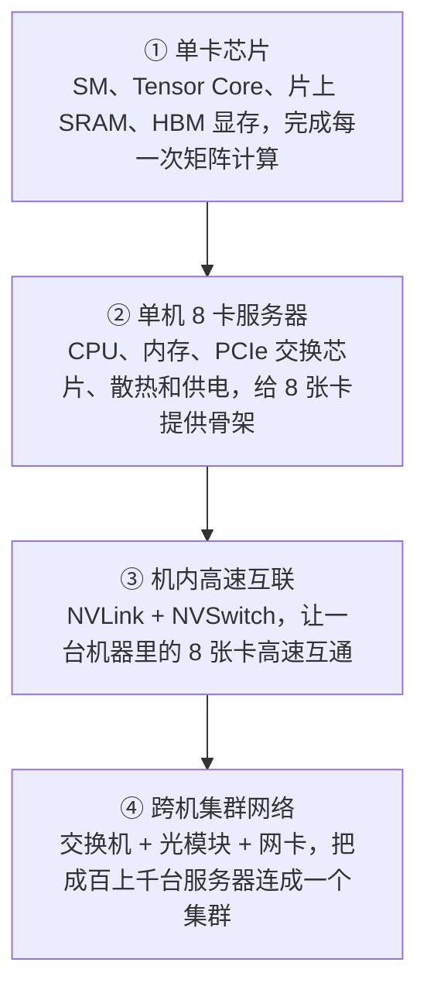
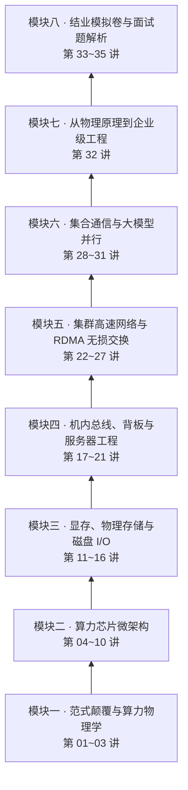
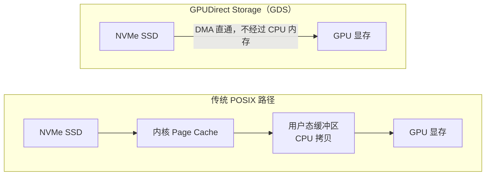
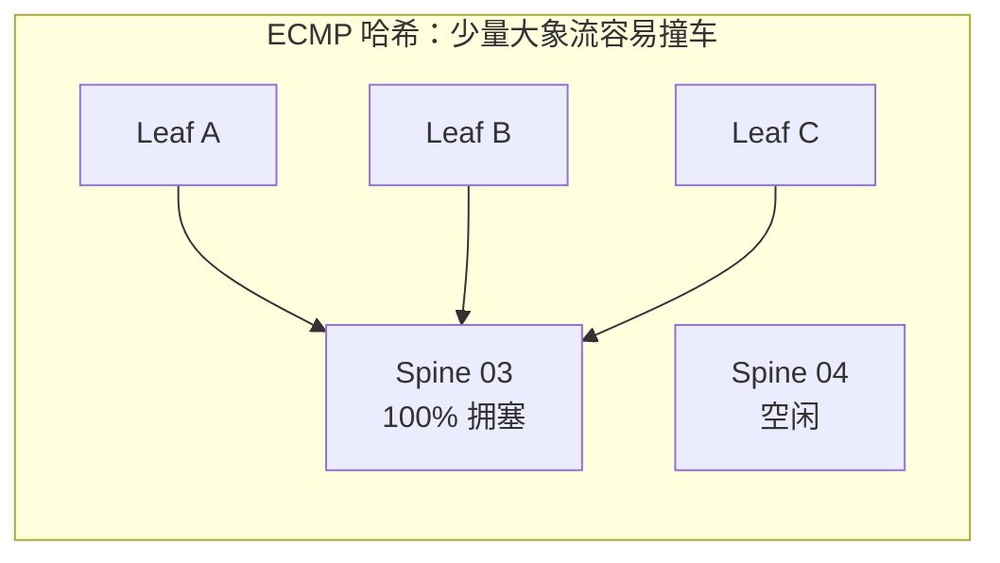
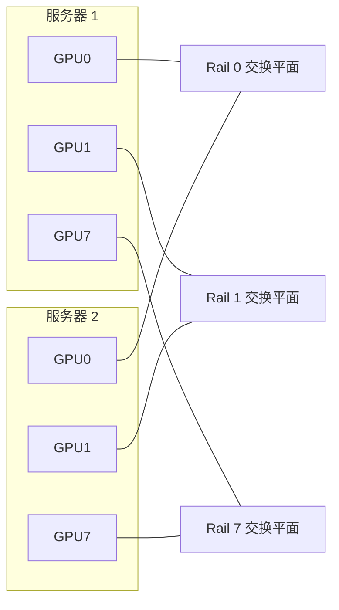

# 第 00 讲：全景导学 —— 从物理底座到万卡集群

> **本讲信息**：《从物理底座到万卡集群：大模型 AI Infra 硬件、存储与网络第一性原理特训课》开篇导学｜后续：第 01 讲《范式革命与另一套底层规则》
>
> **这份讲义怎么用**：这一讲是整门课的地图。先用真实岗位要求说明为什么要学物理底座，再用五个典型场景，把整门课要讲的「算力、显存与存储、机内拓扑、集群网络、集合通信」各走一遍。每个场景末尾都标了对应的讲次，后面学到时可以回来对照。

---

## 目录

| 部分 | 内容 |
|---|---|
| 一、本讲目标 | 学完能做到的 5 件事 |
| 二、为什么要学物理底座 | 四级物理基石、岗位要求的两部分能力、不懂拓扑会踩的坑 |
| 三、课程地图 | 八个模块的顺序和讲次，五个物理层次各解决什么问题 |
| 四、场景一：算力 | CPU vs GPU、SM 结构、Warp 锁步、Roofline |
| 五、场景二：显存与存储 | HBM、存储金字塔、GDS、异步 Checkpoint |
| 六、场景三：机内拓扑与硬件故障 | NUMA 亲和、4090 vs H100、Xid 与坏道排查 |
| 七、场景四：万卡集群网络 | TCP vs RDMA、ECMP 撞车、Rail 导轨网络、PFC 死锁 |
| 八、场景五：集合通信与 3D 并行 | Ring 的两笔账、NVLS、TP / PP / DP 怎么摆 |
| 九、这门课怎么学 | 每讲结构、实操四类环境、学完能做到什么、这门课在课程体系里的位置 |
| 十、自测题 | 8 道题，标注对应讲次 |

---

## 一、本讲目标

学完本讲，你应该能做到：

1. **说清大模型算力的四级物理基石**：单卡芯片、单机 8 卡服务器、机内高速互联、跨机集群网络，各自解决什么问题；
2. **看懂 AI Infra 岗位要求的结构**：高薪岗位都由「下层物理底座」和「上层调度、训练、推理与 LLMOps 平台」两部分组成；
3. **对整门课有一张地图**：知道八个模块分别讲什么、为什么按这个顺序讲；
4. **记住五个场景里的核心结论**：每个场景都是后面某个模块的缩影；
5. **知道这门课怎么学**：每讲的课后实操分哪几类环境，哪些不需要 GPU。

---

## 二、为什么要学物理底座

### 1. 大模型算力的四级物理基石

从一张卡到一万张卡，大模型算力是一级一级搭起来的：

| 层级 | 代表硬件 | 关键事实 | 对应模块 |
|---|---|---|---|
| ① 单卡芯片 | NVIDIA H100 SXM5 | 132 个 SM（流式多处理器）；每个 SM 有 4 个 Tensor Core、256 KB 寄存器堆、228 KB 片上 SRAM；80 GB HBM3 显存，带宽约 3.35 TB/s | 模块二、三 |
| ② 单机服务器 | 戴尔 PowerEdge XE9680（6U） | 双路 CPU、NUMA 双插槽内存、PCIe 交换芯片；8 张 H100 每张约 700 W，光 GPU 就是 5600 W，散热和供电是硬约束 | 模块四 |
| ③ 机内高速互联 | HGX H100 8-GPU 基板 | 4 颗 NVSwitch 让 8 张卡两两全连通；每张卡 NVLink 双向 900 GB/s，8 张卡合计 7.2 TB/s；普通 PCIe 5.0 x16 双向约 128 GB/s | 模块四、六 |
| ④ 跨机集群网络 | 400G / 800G 交换机与光模块，例如 InfiniBand 的 Quantum-2（64 个 400Gb/s 端口）、以太网的 Spectrum-4（64 个 800Gb/s 端口） | 单机 8 卡装不下超大模型，必须把成百上千台机器用高速无损网络连起来 | 模块五、六 |

**为什么少一层都不行？** 一颗芯片跑不了大模型，要装进服务器；8 张卡之间如果只走 PCIe，卡与卡互相等数据；单机再强也装不下万亿参数的模型，必须跨机组网。这四层，正是整门课自下而上的主线。

### 2. 高薪岗位要的是两部分能力

从招聘网站上截取三个在招岗位：

| 岗位 | 底层物理相关的要求 | 上层平台相关的要求 |
|---|---|---|
| AI Infra 系统工程师 | GPU / NPU 计算、通信和显存管理；千卡训练优化；CUDA、Triton；RDMA、RoCE、NVLink、InfiniBand | PyTorch；DeepSpeed、Megatron、FSDP、NCCL；Ray、Slurm、K8s；vLLM、SGLang；MLOps 平台 |
| 高级 AI Infra 工程师 | 基于 Benchmark 和 Profiling 分析训练效率、显存、通信、I/O 瓶颈；结合集群拓扑优化方案；CUDA、Triton、CUTLASS 算子优化 | DP、TP、EP、CP 并行策略与 NCCL；推理部署与量化 |
| AI Infra 平台与调度工程师 | InfiniBand、RoCE 高性能网络、存储与 NCCL 疑难排障 | K8s、Ray、Slurm 调度与资源隔离；DeepSpeed、Megatron 并行策略、Checkpoint 与容灾；vLLM、SGLang、KV Cache 优化；MLOps / LLMOps 工具链 |

把三份要求放在一起看：**每个岗位都由「下层物理底座」和「上层调度、训练、推理与平台」两部分组成。** 这门特训课负责下层物理底座；上层按岗位分成八门方向课，各自讲各自那一块。

### 3. 不懂物理拓扑会踩什么坑

很多人习惯在 K8s 里随手给任务分 8 张卡。看一个具体的例子：

- 一台双路 CPU 的 8 卡服务器，GPU0 挂在 CPU0 下面，GPU7 挂在 CPU1 下面；
- 如果这台机器没有 NVLink，两张卡传梯度就要经过两颗 CPU 之间的 UPI 总线。UPI 的本职是在两颗 CPU 之间同步内存和缓存，带宽有限，还要和 CPU 自己的流量共享；
- 就像八车道高速突然汇进一座窄桥，通信变慢，GPU 算完了只能空等数据，利用率显示很高，实际进度很慢。

不知道物理拓扑，遇到这种问题除了重启机器，几乎没有办法。

### 4. 为什么大模型对硬件这么苛刻

| | 微服务 | 大模型训练 |
|---|---|---|
| 依赖关系 | 请求彼此独立，一个 Pod 挂了，负载均衡几毫秒内把流量切到别的 Pod | 每一步反向传播后都要做 AllReduce，所有卡必须到齐 |
| 一个节点出问题 | 用户几乎无感 | 一张卡因为过热降频慢了一点，所有卡都要等它 |
| 比喻 | 外卖骑手，各送各的 | 几千人绑腿赛跑，最慢的人决定全队速度 |

**万卡集群的速度，取决于最慢的那一张卡、那一根线。** 这一点在第 01 讲会展开讲。

---

## 三、课程地图：八个模块，自下而上

### 1. 为什么按这个顺序讲

顺序跟着数据在系统里的流动路径走：先在一张卡里算（芯片），再从显存和磁盘里取数据（存储），然后在一台机器的卡之间传（机内互联），再跨机器传（网络），最后看分布式训练怎么把这些用起来（集合通信与并行）。每一层都是上一层的地基。

### 2. 五个物理层次，各解决什么问题

| 物理层次 | 核心物理实体 | 要回答的问题 | 对上层平台的影响 |
|---|---|---|---|
| 计算微观层 | SM、Warp 调度器、Tensor Core、MFU | GPU 为什么算矩阵快？分支分化为什么让算力暴跌？千卡算力损耗在哪？ | vLLM CUDA Graph、批处理 Token 预算、算子优化 |
| 数据载体层 | HBM、NVMe SSD、Page Cache、`mmap`、GPUDirect Storage | 显存带宽墙怎么突破？内核怎么搬运百 GB 权重？GDS 怎么绕过 CPU？ | Safetensors 加载、JuiceFS 缓存加速、冷启动 |
| 机内互联层 | PCIe 交换芯片、UPI、NVLink、NVSwitch、显存行重映射 | 跨 CPU 访问为什么慢？4090 为什么不适合跨卡张量并行？显存坏道怎么诊断？ | K8s NUMA 亲和调度、拓扑感知、坏卡自愈 |
| 跨机通信层 | 800G 光模块、ConnectX-7 网卡、Spine-Leaf、Rail-Optimized、RoCEv2 | TCP 为什么扛不住？导轨网络怎么减少拥塞？PFC 死锁怎么形成？ | 多网络隔离、GPUDirect RDMA 部署、网络排障 |
| 并行算法层 | AllReduce、Ring、Tree、NVLS、3D 并行 | Ring 算法的带宽开销为什么几乎与卡数无关？各并行维度对网络有什么要求？ | 成组调度、多机推理、NCCL 排错 |

下面五个场景，就是这五个层次各取一个最典型的问题。

---

## 四、场景一：算力 —— GPU 为什么快，又为什么会慢

### 1. CPU 和 GPU 的设计取舍

CPU 主频五点几 GHz，GPU 只有一两 GHz，为什么算大模型 GPU 快成百上千倍？

| | CPU | GPU（H100） |
|---|---|---|
| 设计目标 | 单个任务尽快完成（低延迟） | 海量相同计算同时完成（高吞吐） |
| 芯片面积花在哪 | 大量面积用于分支预测、乱序执行等控制逻辑和大缓存 | 绝大部分面积给了 132 个 SM 和上万个并行计算单元 |
| 适合 | 复杂的 if-else、串行逻辑 | 矩阵乘法这类规整的大规模并行计算 |

### 2. 一个 SM 里有什么

| 部件 | 数量 / 容量（H100，每个 SM） | 作用 |
|---|---|---|
| Warp 调度器 | 4 组 | 在线程束之间零开销切换 |
| 寄存器堆 | 256 KB | 线程的私有高速存储 |
| CUDA Core（FP32） | 128 个 | 标量计算，单周期一次乘加，像泥瓦匠一块块砌砖 |
| Tensor Core | 4 个（第四代） | 矩阵块计算，单周期处理一整块矩阵，像冲压机一次压出一整块 |
| 片上 SRAM（共享内存 / L1） | 228 KB | 比 HBM 快得多的片上存储 |

FlashAttention 快的秘密就在这里：把注意力计算分块，让中间结果留在片上 SRAM 里算完，避免反复读写慢得多的 HBM。

### 3. Warp 锁步：分支让算力减半

同一个 Warp 里的 32 个线程，必须同时执行同一条指令。如果代码里有细粒度的 if-else：

1. 硬件先执行分支 A，走 else 的那 16 个线程被挂起；
2. 再执行分支 B，走 if 的那 16 个线程被挂起；
3. 原本一个周期能做完的事，变成了两个周期，这段代码的硬件利用率直接减半。

这叫**分支分化**（Warp Divergence），是写高性能算子时要避开的坑。

### 4. Roofline：算力墙还是访存墙

Roofline（屋顶）模型用一个指标判断程序被什么卡住：**算术强度** = 计算量（FLOP）÷ 访存量（字节）。

- **机器拐点** = 峰值算力 ÷ 显存带宽。H100 SXM：BF16 稠密峰值约 989 TFLOPS，显存带宽约 3.35 TB/s，拐点约 **295 FLOP/字节**；
- 算术强度高于拐点：算力吃满，属于**计算受限**（Prefill 阶段通常在这里）；
- 算术强度低于拐点：显存带宽先到顶，属于**访存受限**。

例子：推理的 Decode 阶段，batch=1 时每生成一个 Token，都要把全部权重从显存读一遍，每个参数（BF16 两字节）只做一次乘加（2 次浮点运算），算术强度约 **1 FLOP/字节**，远低于 295，深陷访存墙。

这也解释了为什么连续批处理、PagedAttention、量化能把推理吞吐提升好几倍：它们本质上都在提高算术强度，或者减少要搬的字节数。

**对应讲次**：第 04 讲（CPU vs GPU 微架构）、第 05 讲（SM 剖面）、第 06 讲（Warp 锁步与分支分化）、第 07 讲（CUDA Core vs Tensor Core）、第 08 讲（Roofline 与 MFU/HFU）、第 09 讲（Decode 访存墙）、第 10 讲（国产芯片微架构）。

---

## 五、场景二：显存与存储 —— 第二堵墙

### 1. 为什么显存要做成 3D 堆叠

| | GDDR（平面走线） | HBM（3D 堆叠） |
|---|---|---|
| 连接方式 | 显存颗粒摆在芯片周围，靠 PCB 走线连接 | 多层 DRAM 叠在一起，靠硅通孔（TSV）垂直打通，和 GPU 封装在一起 |
| 位宽 | 走线长、寄生电容大，位宽通常在 384 bit 左右 | 每个堆栈 1024 bit，H200 有 6 个堆栈，合计 6144 bit |
| 带宽 | 约 1 TB/s 量级（如 RTX 4090） | H200 约 4.8 TB/s |

### 2. 存储金字塔：越近越快

| 层级 | 位置 | 访问延迟（数量级） |
|---|---|---|
| 寄存器 | SM 内部 | 约 1 个时钟周期 |
| 共享内存 / L1 | SM 内部 | 几十个时钟周期 |
| L2 缓存 | 芯片上，所有 SM 共享 | 两三百个时钟周期 |
| HBM 显存 | 芯片旁边 | 几百个时钟周期 |
| 本地 NVMe SSD | 通过 PCIe 连接 | 微秒到几十微秒，比显存慢几个数量级 |

**核心洞察**：FlashAttention 不是减少了乘法次数，而是用分块（Tiling）把数据留在片上 SRAM 里算，减少了对 HBM 的往返读写。很多优化的本质，都是让数据待在更近的那一层。

### 3. 权重从磁盘到显存：传统路径 vs GDS

- **传统路径**：数据先进内核 Page Cache，再拷到用户态缓冲区，最后拷进显存，多次拷贝都要 CPU 参与，几百 GB 的权重加载慢，CPU 也被占满；
- **GDS**：用 DMA 直接把数据从 NVMe 搬进显存，不经过 CPU 内存中转。NVMe 和 GPU 挂在同一个 PCIe 交换芯片下时效果最好。

### 4. Checkpoint：别让几千张卡停下来等存盘

万卡训练要定期保存检查点（Checkpoint），一次可能是几 TB 到上百 TB。同步写盘时，所有 GPU 都要停下来等。常见的做法是改成**异步分阶段**：

1. **快照**：把显存里的模型和优化器状态拷到主机内存，拷完训练立刻继续；
2. **落本地盘**：后台把快照写到本地 NVMe；
3. **上传**：后台再把本地文件流式上传到对象存储，做持久化和容灾。

GPU 只在第一步短暂停顿，后面两步都和训练并行。

**对应讲次**：第 11 讲（HBM 与 TSV）、第 12 讲（存储金字塔）、第 13 讲（浮点格式）、第 14 讲（服务器存储与磁盘 I/O）、第 15 讲（Linux I/O 路径、`mmap` 与 GDS）、第 16 讲（分布式存储与 Checkpoint 风暴）。

---

## 六、场景三：机内拓扑与硬件故障

### 1. NUMA 亲和：别让数据跨 CPU 绕路

- GPU0 挂在 CPU0 的 PCIe 交换芯片下，训练进程或网卡却被分到了 CPU1；
- 数据就要跨过两颗 CPU 之间的 UPI 总线，UPI 带宽有限，还和 CPU 自己的流量共享；
- 解决办法：先读懂机器拓扑（第 01 讲的 `nvidia-smi topo -m`、`numactl -H`），再让 GPU、网卡、进程、内存落在同一个 NUMA 节点。方向课 ② 第 10 讲会讲 K8s 怎么做拓扑感知调度和 NUMA 亲和的硬绑定。

### 2. 为什么不用 8 张 4090 搭训练集群

| | RTX 4090（消费级） | HGX H100（数据中心） |
|---|---|---|
| 卡间互联 | 没有 NVLink，只能走主板 PCIe 4.0 x16，双向约 64 GB/s | 4 颗 NVSwitch 全互联，每卡 NVLink 双向 900 GB/s |
| 差距 | — | 卡间带宽高出十几倍 |
| 后果 | 张量并行每层都要通信，算得快、等得久 | 8 卡张量并行通信开销小 |

看懂这层差距，做集群选型和并行策略时才不会踩大坑。

### 3. 硬件故障排查：先找证据，别急着重启

训练突然崩溃时，排查的顺序是：

| 步骤 | 命令 | 看什么 |
|---|---|---|
| 1. 查内核日志 | `dmesg -T \| grep -iE "xid\|aer"` | `Xid 79: GPU has fallen off the bus` 表示 GPU 从 PCIe 总线上掉了，常见原因是供电或 PCIe 链路问题；`AER` 是 PCIe 的硬件错误报告 |
| 2. 查显存坏道 | `nvidia-smi -q -d ROW_REMAPPER` | 行重映射（Row Remapping）计数：显存出现坏行时，硬件用备用行替换。计数持续增加或备用行耗尽，就要考虑换卡 |
| 3. 查拓扑 | `nvidia-smi topo -m` | 卡与卡之间是 NVLink 还是跨 CPU 的 `SYS` |

**对应讲次**：第 17 讲（8 卡服务器背板拆解）、第 18 讲（NUMA 与 UPI）、第 19 讲（NVLink）、第 20 讲（NVSwitch 与硬件故障：ECC、行重映射、Xid）、第 21 讲（功耗、配电与液冷）。

---

## 七、场景四：万卡集群网络

### 1. TCP 为什么扛不住集合通信

| | TCP 内核协议栈 | RDMA |
|---|---|---|
| 数据路径 | 要经过内核，多次内存拷贝，网卡收包就打断 CPU 处理中断 | 网卡直接读写对方机器的内存，绕过操作系统内核 |
| 延迟 | 几十微秒到毫秒级，丢包重传更慢 | 微秒级 |
| 面对几百 GB 的集合通信 | CPU 先被拷贝和中断占满，带宽跑不满 | CPU 几乎不参与 |

第 02 讲会用 NCCL 日志判断训练到底走的是哪条路。

### 2. 普通胖树网络的问题：大象流撞车

- 微服务时代是成千上万条短小的「老鼠流」，交换机按五元组做哈希（ECMP），能把流量摊得比较均匀；
- 大模型训练里，每张 GPU 只产生一两条几百 GB 的「大象流」，流的数量少，哈希很容易让几条大象流挤到同一条链路上：这条链路 100% 拥塞，旁边的链路却空着。

### 3. Rail-Optimized 导轨网络

把每台机器的 GPU0 都接到第 0 号导轨（Rail 0）的交换平面，GPU1 都接到 Rail 1……8 张卡对应 8 个独立平面：

跨机做数据并行的 AllReduce 时，同号 GPU 之间的流量留在各自的导轨里，大幅减少了跨 Spine 的哈希冲突。这是万卡组网的核心设计思路。

### 4. PFC 死锁：无损网络的代价

RoCE 网络为了不丢包，会开启 PFC：接收端缓冲快满时，向上游发送暂停帧（Pause Frame）。可是暂停会一级级向上游扩散，如果暂停关系形成环路，整片网络都会卡住，这就是 **PFC 死锁**。

排查时常用的几条命令（具体计数器名称和工具因网卡、交换机厂商而异）：

| 命令 | 看什么 |
|---|---|
| `tcpdump -i <网卡> -e ether proto 0x8808` | 抓 PFC 暂停帧（以太网类型 0x8808 是 MAC 控制帧）；暂停时长字段（quanta）最大是 65535。很多网卡会自己消化暂停帧，抓不到时要在交换机镜像端口上抓 |
| `ethtool -S <网卡> \| grep -i pause` | 网卡上每个优先级队列收发了多少暂停帧，持续暴涨就是在被反压 |
| `mlnx_qos -i <网卡>` | Mellanox / NVIDIA 网卡的 PFC 和优先级配置 |

预防的思路是配合 **ECN 和 DCQCN** 拥塞控制：在缓冲区打满之前，就通过标记让发送端提前降速，少触发 PFC。

**对应讲次**：第 22 讲（TCP 内核协议栈的极限）、第 23 讲（光模块与线缆）、第 24 讲（Spine-Leaf 与 Rail-Optimized）、第 25 讲（InfiniBand vs RoCEv2）、第 26 讲（PFC 与死锁）、第 27 讲（ECN 与 DCQCN）。

---

## 八、场景五：集合通信与 3D 并行

### 1. Ring AllReduce：带宽和延迟两笔账

N 张卡排成环，每张卡的数据（大小 S）切成 N 块，先 N−1 步累加（Reduce-Scatter），再 N−1 步分发（All-Gather），一共 2(N−1) 步：

| 账目 | 公式 | 含义 |
|---|---|---|
| 带宽项 | 每张卡发送量 = 2(N−1)/N × S ≈ 2S | 卡再多，每张卡要发的数据量基本不变，所以 Ring 的带宽开销几乎与卡数无关 |
| 延迟项 | 2(N−1) × α（α 是每一步的固定延迟） | 卡越多，步数越多，延迟线性增长 |

所以万卡集群不能拉一个一万张卡的大环：延迟项会很大，而且环上任何一张卡抖动一下，所有人都要等。实际会用 Tree、分层等算法。

### 2. NVLS：让交换芯片帮忙做加法

| | 传统软件归约 | NVLS（NVLink SHARP） |
|---|---|---|
| 加法在哪做 | GPU 的 SM 上，中间结果反复读写显存 | NVSwitch 芯片内部 |
| 代价 | 占用 SM 算力和显存带宽 | 释放 SM，减少数据搬运，AllReduce 更快 |

### 3. 3D 并行：每种并行放在合适的网络上

| 并行方式 | 怎么切 | 通信特点 | 应该放在哪 |
|---|---|---|---|
| 张量并行（TP） | 把每一层的矩阵切到多张卡上 | 每层前向、反向都要做 AllReduce，通信最频繁、量最大 | 单机 8 卡的 NVLink 域内，不要跨机 |
| 流水线并行（PP） | 按层切成几段，放在不同机器上 | 只在段与段之间传激活值，点对点、量小 | 可以跨机、跨机柜 |
| 数据并行（DP） | 每组卡各拿一份模型，处理不同数据 | 反向传播后同步梯度，量大但一步一次 | 跨机，正好走 Rail 导轨网络 |

结合模型和集群拓扑决定这三种并行怎么摆，是高薪岗位要求里最值钱的一条能力。

**对应讲次**：第 28 讲（集合通信算子）、第 29 讲（Ring AllReduce 推导）、第 30 讲（Tree 拓扑与 NVLS）、第 31 讲（3D 并行与流量特征）。

---

## 九、这门课怎么学

### 1. 每讲的固定结构

每一讲都会有：原理讲解（配动态图解）、搭建或实操步骤、看到什么才算对的判断标准、一道大厂面试深挖题，以及配套的学员讲义。需要动手的讲次，会额外附实验包（比如第 02 讲的 `lab-kind-gang/` 和 `lab-gpu-k8s/`）。

### 2. 课后实操分四类环境

| 类别 | 内容举例 | 需要什么 |
|---|---|---|
| **必做 · 零硬件** | 计算推导、日志 / 抓包 / 配置分析、画图 | 一台笔记本 |
| **选做 · 普通云主机** | `fio`、`mmap`、`iperf3`、JuiceFS、Soft-RoCE | 按量租用 1~2 台普通 Linux 云主机 |
| **选做 · 单卡租用** | 矩阵乘基准、`cudaDeviceProp`、`ncu` | 租任意一张 NVIDIA 显卡几个小时 |
| **后续真机演示** | 拓扑、NUMA、ECC / 行重映射、Xid 日志、NVLink、多机 RDMA | 眼下 GPU 暂时还没有资源，课上先讲原理和判断标准，后续在真机上演示 |

**不要求自备 GPU 集群。** 能模拟的实验会教你用模拟环境做（比如第 02 讲用 kind 在笔记本上模拟 GPU 集群）。

### 3. 学完能做到什么

按课程大纲，学完这门课你应该能：

- 讲清 GPU 芯片微架构和 Tensor Core 的计算机制；
- 用 Roofline 和 MFU/HFU 模型量化千卡集群的算力损耗；
- 讲清 Linux 内核 I/O 路径、`mmap` 零拷贝和 GDS 直通的原理；
- 读懂 8 卡服务器的主板架构、PCIe 交换芯片、NUMA 亲和，会诊断显存坏道；
- 设计 Spine-Leaf CLOS 和 Rail-Optimized 导轨网络；
- 掌握 RDMA（RoCEv2 / InfiniBand）协议栈，能分析 PFC 死锁和丢包；
- 推导 Ring AllReduce 和 Tree 算法，理解 3D 并行的网络流量特征；
- 用一套结业模拟卷检验自己，掌握大厂面试的答题思路。

### 4. 这门课在课程体系里的位置

这门特训课是**基础一**，回答「机器怎么跑」。整个体系是两门基础课打底，再按岗位分成八门方向课：

| | 这门课（基础一） | 八门方向课 |
|---|---|---|
| 层次 | 下层物理底座 | 上层按岗位分工 |
| 内容 | GPU 芯片、显存与存储、机内互联、RDMA 网络、NCCL 集合通信的原理和排障 | ① 推理、② 集群调度与运维、③ 算力平台研发、④ 分布式训练、⑤ 算子开发与优化、⑥ 模型适配、⑦ 集合通信与高性能网络、⑧ AI 编译器 |
| 关系 | 打底：把底层的「为什么」讲透 | 落地：**一门方向课对应一个岗位**，学完知道自己能投什么 |

另一门基础课是「基础二 · 大模型系统基础」，回答「模型怎么跑」（Transformer 结构、训练与推理流程、显存与算力精算、PyTorch 速成）。两门基础课打完底，再按自己的背景挑方向课。

第 02 讲里用模拟环境做的调度、存储和 GPU 切分，完整的生产实战在 **② GPU 集群调度与运维**里。

---

## 十、自测题

学完这一讲，试着回答下面几个问题。答不上来没关系，后面对应的讲次会讲透，学完再回来对照：

1. 一台 8 卡服务器，如果 8 张卡之间只走 PCIe、没有 NVLink，对张量并行有什么影响？（第 01、19 讲）
2. 为什么 Decode 阶段的 GPU 利用率往往很低？用 Roofline 模型解释。（第 08、09 讲）
3. FlashAttention 快在哪里？它减少的是计算量还是访存量？（第 12 讲）
4. GDS 和传统的文件读取路径相比，省掉了哪几步？（第 15 讲）
5. 为什么大模型训练的流量在普通 ECMP 胖树网络里容易拥塞？Rail-Optimized 是怎么缓解的？（第 24 讲）
6. PFC 是为了解决什么问题？它又会带来什么新问题？（第 26 讲）
7. Ring AllReduce 的带宽开销为什么几乎与卡数无关？那为什么万卡集群不用一个大环？（第 29 讲）
8. 张量并行为什么要放在单机内，而数据并行可以跨机？（第 31 讲）

---

## 十一、下一讲

第 01 讲《范式革命与另一套底层规则》：从真实岗位要求讲起，分清控制面和数据面，讲清楚训练为什么必须同步，并上手读懂一台 GPU 服务器的拓扑。
