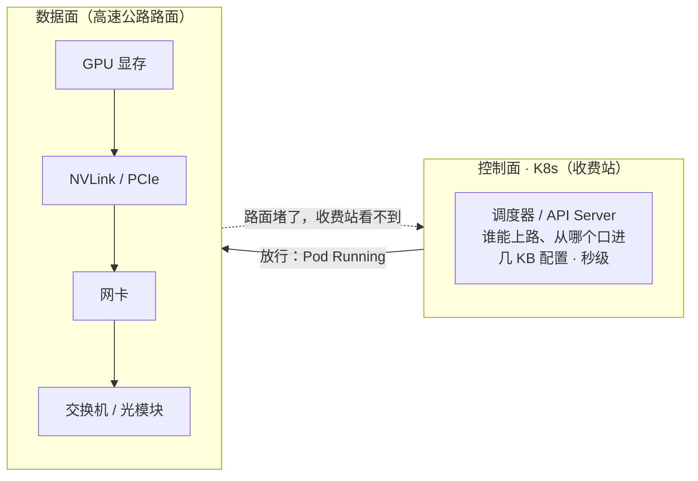
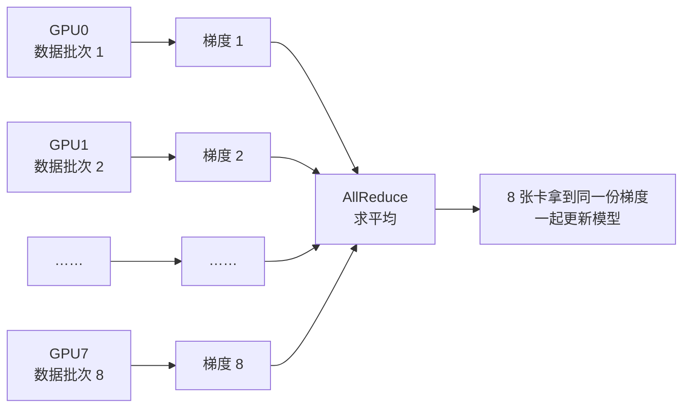
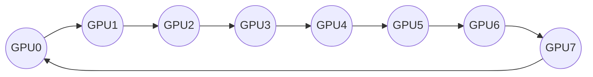
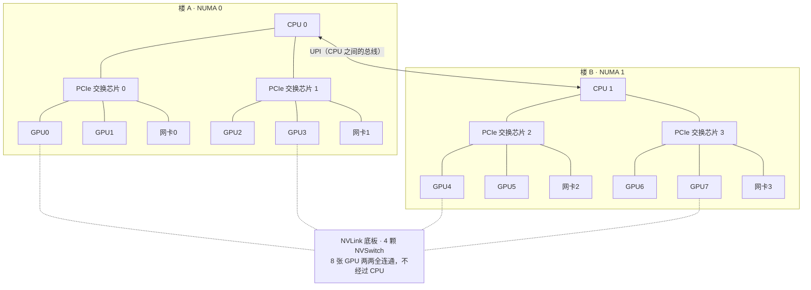
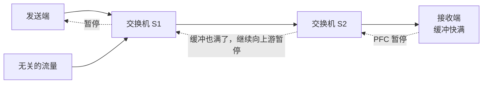

# 第 01 讲：范式革命与另一套底层规则

> **本讲信息**：特训课第一期 · 模块一「范式颠覆篇」｜后续：第 02 讲《别把 GPU 当 CPU 调度》｜本讲没有代码包，课后实操是三条系统命令，照着讲义就能做
>
> **这份讲义怎么用**：讲义比视频更细。每个概念都配了例子和图；课后实操的三条命令，逐行讲怎么读输出、看到什么算正常。

---

## 目录

| 部分 | 内容 | 需要什么 |
|---|---|---|
| 一、本讲目标 | 学完能做到的 5 件事 | — |
| 二、岗位要求 | 岗位要求的共同点、两套底层规则、四级能力 | — |
| 三、误区：装个驱动不等于 AI Infra | 控制面与数据面、K8s 看不见的东西、四个生产问题 | — |
| 四、为什么一张卡慢，所有卡都慢 | 数据并行、Ring AllReduce、木桶公式、故障时间线 | — |
| 五、读懂 nvidia-smi topo -m | 服务器拓扑、缩写的含义、两张完整矩阵的读法 | — |
| 六、面试深挖 | 千分之一的丢包为什么能拖垮千卡训练：三层答案 | — |
| 七、课后实操 | 三条命令：安装、示例输出逐行解读、判断标准、课后作业 | GPU 机器（选做；必做题不需要硬件） |
| 八、本讲小结 | 六条核心结论 | — |
| 九、下一讲预告 | 五道技术鸿沟与本讲的对应关系 | — |

---

## 一、本讲目标

学完本讲，你应该能做到：

1. **说清 AI Infra 岗位到底考什么**：从真实招聘要求里看出共同点——不是会不会写 YAML，而是数据在卡与卡、机器与机器之间怎么流动，堵住了怎么查；
2. **分清控制面和数据面**：知道 K8s 能看到什么、看不到什么，为什么「装好 GPU Operator」不等于做了 AI Infra；
3. **讲清训练为什么必须同步**：从数据并行和 AllReduce 讲起，解释为什么一张卡慢，所有卡都慢；
4. **读懂一台 GPU 服务器的拓扑**：会读 `nvidia-smi topo -m`、`numactl -H`、`nvbandwidth` 的输出，回答「卡与卡走什么路、卡和网卡离多远、任务怎么摆放」；
5. **答好一道高频面试题**：千分之一的丢包，为什么微服务几乎无感，千卡训练却会吞吐暴跌，按「依赖结构 → 放大效应 → 协议特性」三层作答。

---

## 二、岗位要求：大厂在考什么能力？

### 1. 同样懂 Linux 和 K8s，差距从哪来？

很多云原生工程师都有同一个困惑：K8s 很熟，Linux 也懂，但一到 AI 集群的问题就接不上手。

差距来自面对的对象不同：

| | 传统运维 / 云原生 | AI Infra |
|---|---|---|
| 面对的资源 | 被虚拟化层包装好的资源，硬件是个黑盒 | 成千上万张 GPU 绑在一起做同一件事 |
| 出了问题 | 重启一个 Pod，通常就能恢复 | 一张卡、一根光纤出问题，整个任务变慢甚至卡住，重启解决不了 |
| 需要的能力 | 编排、部署、自动恢复 | 看懂底层，准确定位到哪张卡、哪根线 |

所以这类岗位真正在筛的，是能不能看懂底层、准确定位到具体哪张卡、哪根线。

### 2. 三个真实在招岗位，考的是同一件事

我们从招聘网站上截取了三个正在招的岗位：

| 岗位 | 反复出现的要求 |
|---|---|
| AI Infra 系统工程师 | GPU 计算、通信与显存管理；NCCL、Megatron、DeepSpeed；千卡训练 / MoE 多机优化；RDMA、RoCE、NVLink、InfiniBand |
| 高级 AI Infra 工程师 | 定位显存、通信、I/O 瓶颈；数据并行、张量并行等策略；CUDA、Triton 算子优化；推理部署与量化 |
| AI Infra 平台与调度工程师 | K8s、Ray、Slurm 调度；Checkpoint 与容灾；vLLM、SGLang 推理优化；InfiniBand、RoCE 网络与 NCCL 排障 |

把三份要求放在一起看，**没有哪一家在考你会不会写 YAML**。它们关心的是数据在卡与卡、机器与机器之间怎么流动，堵住了该怎么查。这正是这门课要讲的。

### 3. 两个世界，两套底层规则

为什么老经验会失灵？因为两个世界的底层规则不一样：

| 资源 | 云原生世界：用软件把硬件的不完美藏起来 | 大模型训练：硬件的限制直接暴露出来 |
|---|---|---|
| 计算 / 显存 | CPU 可以超卖，时间片轮转，慢一点用户无感 | 显存是硬上限：多用一点就显存溢出（OOM），进程直接退出 |
| 内存 / 同步 | 内存不够就换到磁盘，变慢但进程还活着 | 几千张卡每一步都要同步，最慢的那张决定所有人的速度（本讲第四部分） |
| 网络 | 丢了包 TCP 自动重传，业务基本无感 | 对丢包极其敏感：千分之一的丢包就可能让通信吞吐掉一大截（本讲第六部分面试题） |

举个例子：一台 32 核的机器，可以给 Pod 分出去 64 核，因为大家不会同时跑满；可是一张 80 GB 的卡，模型和中间结果要 81 GB，就是跑不起来，没有任何「超卖」的余地。

### 4. AI Infra 工程师的四级能力

看清了规则的变化，成长路径也就清楚了：

| 级别 | 名称 | 能力 |
|---|---|---|
| L1 | 能用起来 | 装驱动、配 GPU Operator，让卡能被调度 |
| L2 | 吃透一台机器 | NVLink 和 PCIe 的区别、NUMA 亲和、显存怎么算 |
| L3 | 吃透一个集群 | RDMA 网络、集合通信、丢包与拥塞排查 |
| L4 | 万卡架构 | 设计与调优万卡规模的整体架构 |

这一讲的目标，是带你从 L1 迈向 L2：先破除一个常见误区（第三部分），再讲清楚卡与卡为什么必须同步（第四部分），然后读懂一台 8 卡服务器（第五部分），最后用一道面试题把它们串起来（第六部分）。

---

## 三、误区：给 K8s 装个驱动，不等于 AI Infra

### 1. K8s 是收费站，不是高速公路

很多同学会觉得：AI Infra 不就是在 K8s 上装好 GPU Operator，在 YAML 里申请 8 张 GPU 吗？

打个比方：K8s 是高速公路的**收费站**。它决定哪辆车能上路、从哪个口进，处理的是几 KB 的配置和状态，节奏是秒级。真正的运输发生在收费站之后的**路面**上，也就是 GPU、NVLink、PCIe 和网卡组成的数据面，每秒上百 GB 的数据在上面跑，节奏是微秒级。

路面上出了事故，比如某一段堵死了，收费站是看不到的，它的屏幕上依然显示：已放行，Running。



**控制面管的是谁能上路，管不了路上跑得怎么样。**

### 2. 在 K8s 眼里，GPU 只是一个数字

通过 GPU 的设备插件，K8s 看到的只是一个数字：

```text
$ kubectl describe node gpu-node-01
Capacity:
  nvidia.com/gpu:  8      ← 这台机器有 8 张 GPU，还剩几张可用
```

它看不到的东西要多得多：

| 看不到的 | 具体问题 | 本讲哪里讲 |
|---|---|---|
| 卡间互联 | 8 张卡之间是 NVLink 全互联，还是只能走 PCIe？ | 第五部分 |
| 亲和关系 | 哪张卡和哪块网卡挂在同一颗 CPU 下面？ | 第五部分 |
| 链路健康 | 网卡到交换机的链路有没有在丢包？ | 第六部分 |
| 实际带宽 | 卡与卡之间实际能跑出多少带宽？ | 第七部分 `nvbandwidth` |

可偏偏训练快不快、稳不稳，几乎全由这些看不到的东西决定。调度器把资源分对只是起点，真正的功夫在数据面。

### 3. 四个常见生产问题：K8s 上一切正常

这四个问题有一个共同点：`kubectl get pod` 全是 Running。

**问题一：利用率 100%，训练却很慢。** `nvidia-smi` 的利用率只统计「有没有程序在 GPU 上运行」。NCCL（NVIDIA 的多卡通信库）在等数据的时候，也算在运行。真正该看的是 DCGM 里的张量核心活跃度，以及每秒处理的样本数。

**问题二：同一台机器上的两个任务互相拖慢。** cgroup 能限制 CPU 和内存，却限制不了 PCIe 交换芯片和网卡的带宽。一个任务在大量读数据、写检查点，另一个任务的通信就被挤慢了。

**问题三：GPU 和网卡跨了 CPU。** 分给任务的 GPU 挂在 CPU 0 下面，用来跨机通信的网卡却挂在 CPU 1 下面。数据要绕道两颗 CPU 之间的互联总线，GPU 直通网卡的 GPUDirect RDMA 也可能用不上，跨机带宽明显下降。

**问题四：一个光模块拖慢整个训练。** 某个光模块的误码率升高，开始零星丢包，这台机器的通信变慢，而其他所有机器每一步都要等它。整个任务慢了三成，所有 Pod 依然是 Running。

这四个问题，没有一个能靠重启 Pod 解决，都要到数据面去找证据：

| 数据面要看的 | 含义 | 对应问题 |
|---|---|---|
| 拓扑 | 卡、网卡、CPU 怎么连 | 问题三 |
| 带宽 | 谁和谁在抢同一条路 | 问题二 |
| 链路健康 | 误码、丢包、重传 | 问题四 |
| 同步 | 所有卡每一步都要等齐 | 问题一 |

**小结**：K8s 是控制面，负责分配和编排，它很重要，但它不懂物理拓扑，也看不见数据面的健康状况。做 AI Infra，就是要把视线从控制面一直延伸到数据面。

---

## 四、外卖骑手 vs 赛艇：为什么一张卡慢，所有卡都慢

### 1. 微服务像外卖骑手：各送各的，互不依赖

微服务像一支外卖骑手队伍，每个骑手各送各的单。2 号骑手的车坏了，平台把他的订单转给别人，其他人照常送。

对应到系统里，就是无状态的 Pod：一个 Pod 挂了，负载均衡把流量切走，K8s 再拉起一个新的，整体服务几乎不受影响。**微服务的容错能力，正是来自这种松耦合。**

### 2. 训练为什么必须同步：数据并行与 AllReduce

大模型训练为什么做不到松耦合？要从**数据并行**说起：

1. 假设用 8 张卡训练同一个模型，每张卡都存一份完整的模型，各自拿一批不同的数据去算；
2. 算完之后，每张卡都得到一份**梯度**，也就是模型参数该往哪个方向改、改多少；
3. 8 份梯度各不相同，如果各改各的，8 份模型很快就不一样了；
4. 所以每一步，都必须先把 8 份梯度求平均，让所有卡拿到同一个结果，再一起更新。

这个「大家把数据加起来，每人拿回同一份结果」的操作，就叫 **AllReduce**。

以一个 70 亿参数的模型为例，按 BF16 精度（每个参数 2 字节）算，每一步要同步的梯度大约有 7B × 2 字节 = **14 GB**。



### 3. Ring AllReduce：每一轮都要等邻居

AllReduce 最经典的实现叫 **Ring AllReduce**：

1. 8 张卡首尾相连成环，每张卡的数据切成 8 块；
2. 每一轮，每张卡只把一块数据发给下一个邻居，同时从上一个邻居收一块；
3. 前 7 轮，把各块数据**累加**起来（Reduce-Scatter）；
4. 后 7 轮，把累加结果**分发**给所有人（All-Gather）。



| | 说明 |
|---|---|
| **好处** | 每张卡发送的数据量约为 2(N−1)/N × 数据量，卡再多也不会成倍增加 |
| **代价** | 每一轮每张卡都必须等邻居把数据送到，才能继续下一轮 |

这就像一条 8 人赛艇，所有人必须同时下桨，只要一个人慢了，整条船都得等他。

### 4. 木桶公式：取的是最大值，不是平均值

把这个过程写成公式：

```text
每一步耗时 ≈ max(每张卡的计算时间) + 通信时间
通信时间   同样由最慢的那条链路决定
```

注意，这里取的是**最大值**，不是平均值。

例子：1000 张卡里，999 张健康，每步 100 毫秒；只有 1 张因为过热降频慢了 30%，要 130 毫秒。整个任务每一步都是 130 毫秒，慢了 30%。

而且规模越大，出现一张慢卡的概率就越高。假设每张卡在一段时间内出状况的概率是 0.1%：

| 卡数 | 至少有一张慢卡的概率 |
|---|---|
| 8 | 0.8% |
| 64 | 6.2% |
| 512 | 40.1% |
| 1024 | 64.1% |
| 4096 | 98.3% |

（计算方法：1 − 0.999^N）

这就是为什么大规模训练对每一张卡、每一根线都极其敏感。

### 5. 时间线：给 GPU 3 注入一个故障

- **正常情况**：一步训练用时 100 毫秒，70 毫秒计算，30 毫秒通信。
- **注入故障**：GPU 3 的网卡开始丢包重传，通信多花了 45 毫秒。其他 7 张卡早就算完了，只能停下来等它。
- **结果**：这一步变成 145 毫秒，吞吐只剩原来的 69%（100 ÷ 145），下降三成多。

更麻烦的是，在等待的这段时间里，`nvidia-smi` 显示的利用率依然是 100%。

**结论：大模型网络追求的不只是带宽高，更是稳定、可预期。**

---

## 五、读懂 nvidia-smi topo -m

### 1. 一条命令，亲眼看见数据面

拿到一台新的 GPU 服务器，有经验的工程师往往第一件事就是敲：

```bash
nvidia-smi topo -m
```

它会打印一张矩阵，告诉你每两张 GPU 之间、GPU 和网卡之间，数据要走什么样的物理路径。新机器上手第一件事：先看这张图，再跑任务。

### 2. 矩阵背后的硬件：两栋楼 + 一块 NVLink 底板

这是一台典型 8 卡 H100 服务器的简化结构（网卡数量与连线因机型而异）：



把它想象成两栋楼：

| 部件 | 作用 | 数字 |
|---|---|---|
| **两栋楼 = 两颗 CPU** | 每颗 CPU 管 4 张 GPU 和 2 块网卡，这样一栋楼在系统里叫一个 **NUMA 节点** | — |
| **PCIe 交换芯片** | GPU、网卡通过它接到 CPU 上 | 第五代 PCIe x16 每个方向约 64 GB/s |
| **UPI：CPU 之间的总线** | 本职是在两颗 CPU 之间同步内存和缓存，不适合大批量搬运 GPU 数据 | 英特尔平台叫 UPI（老平台叫 QPI） |
| **NVLink + 4 颗 NVSwitch** | 8 张 GPU 两两连通，完全不经过 CPU | 每卡双向合计 900 GB/s，约 PCIe 的 7 倍 |

（图里 NVLink 底板只画了 4 条虚线示意，实际 8 张 GPU 都接在底板上。）

### 3. 缩写 = 距离：从近到远

矩阵里的缩写表示两个设备之间的距离，从近到远：

| 缩写 | 含义 | 在上面这台机器上的例子 |
|---|---|---|
| `NV#` | 走 NVLink，# 是链路条数（H100 上是 NV18），不经过 CPU | GPU0 ↔ GPU1 |
| `PIX` | 中间最多经过一颗 PCIe 交换芯片，路径最短 | GPU0 ↔ 网卡0 |
| `PXB` | 经过多颗 PCIe 交换芯片，但不经过 CPU | 交换芯片级联的机型才有 |
| `PHB` | 经过 CPU 上的 PCIe 主桥 | 设备直连 CPU 根端口时出现 |
| `NODE` | 同一颗 CPU 内，穿过不同的 PCIe 主桥 | GPU0 ↔ 网卡1 |
| `SYS` | 跨过两颗 CPU 之间的 UPI 总线 | GPU0 ↔ 网卡3 |

**原则：越往后，路径越长，带宽和延迟越没有保障。**

### 4. 真实输出怎么读：GPU 之间全是 NV18，关键看网卡这几列

上面这台 8 卡 H100 服务器的 `nvidia-smi topo -m` 输出（简化）：

```text
        GPU0  GPU1  GPU2  GPU3  GPU4  GPU5  GPU6  GPU7  NIC0  NIC1  NIC2  NIC3  CPU Affinity  NUMA Affinity
GPU0     X    NV18  NV18  NV18  NV18  NV18  NV18  NV18  PIX   NODE  SYS   SYS   0-55          0
GPU1    NV18   X    NV18  NV18  NV18  NV18  NV18  NV18  PIX   NODE  SYS   SYS   0-55          0
GPU2    NV18  NV18   X    NV18  NV18  NV18  NV18  NV18  NODE  PIX   SYS   SYS   0-55          0
GPU3    NV18  NV18  NV18   X    NV18  NV18  NV18  NV18  NODE  PIX   SYS   SYS   0-55          0
GPU4    NV18  NV18  NV18  NV18   X    NV18  NV18  NV18  SYS   SYS   PIX   NODE  56-111        1
GPU5    NV18  NV18  NV18  NV18  NV18   X    NV18  NV18  SYS   SYS   PIX   NODE  56-111        1
GPU6    NV18  NV18  NV18  NV18  NV18  NV18   X    NV18  SYS   SYS   NODE  PIX   56-111        1
GPU7    NV18  NV18  NV18  NV18  NV18  NV18  NV18   X    SYS   SYS   NODE  PIX   56-111        1

NIC Legend:
  NIC0: mlx5_0
  NIC1: mlx5_1
  NIC2: mlx5_2
  NIC3: mlx5_3
```

按这个顺序读：

1. **GPU 之间（左边 8×8）**：两两之间全是 `NV18`，跨了两颗 CPU 也一样，因为 GPU 之间的数据走 NVLink 底板，根本不经过 CPU。这对**张量并行**最关键：张量并行是把同一层的计算拆到多张卡上，每算完一层，卡之间就要交换一次数据，所以对卡间带宽最敏感。在这种机器上，8 卡张量并行没问题。
2. **GPU 和网卡（NIC 这几列）**：这才是要细看的。GPU0 到网卡0 是 `PIX`，挂在同一颗交换芯片下，跨机通信时，数据可以直接从显存送进网卡，这叫 **GPUDirect RDMA**。而 GPU0 到网卡3 是 `SYS`，要绕过两颗 CPU。如果调度时把 GPU0 和网卡3 配在一起，跨机带宽会明显下降。
3. **最后两列**：GPU0~3 的 CPU 亲和是 0~55 号核、NUMA 节点 0；GPU4~7 是 56~111 号核、NUMA 节点 1。给 GPU 喂数据的进程，要绑在对应的核和节点上。
4. **NIC Legend**：NIC0 对应的设备名是 `mlx5_0`。后面给 NCCL 指定用哪块网卡（`NCCL_IB_HCA`）时，填的就是这个名字。

### 5. 对比：没有 NVLink 的 8 卡 PCIe 服务器

再看一台没有 NVLink 的机器，比如 8 张 L40S 的 PCIe 服务器（结构同上，只是没有 NVLink 底板）：

```text
        GPU0  GPU1  GPU2  GPU3  GPU4  GPU5  GPU6  GPU7
GPU0     X    PIX   NODE  NODE  SYS   SYS   SYS   SYS
GPU1    PIX    X    NODE  NODE  SYS   SYS   SYS   SYS
GPU2    NODE  NODE   X    PIX   SYS   SYS   SYS   SYS
GPU3    NODE  NODE  PIX    X    SYS   SYS   SYS   SYS
GPU4    SYS   SYS   SYS   SYS    X    PIX   NODE  NODE
GPU5    SYS   SYS   SYS   SYS   PIX    X    NODE  NODE
GPU6    SYS   SYS   SYS   SYS   NODE  NODE   X    PIX
GPU7    SYS   SYS   SYS   SYS   NODE  NODE  PIX    X
```

GPU 之间不再是 `NV`，而是 `PIX`、`NODE` 和 `SYS`：

- ✗ **张量并行横跨 8 张卡**：每一层的通信都走 PCIe，有的还要跨过 UPI（`SYS`），速度会被严重拖慢；
- ✓ **限制在同一交换芯片 / 同一颗 CPU 内**：比如 GPU0–1（`PIX`）做 2 卡张量并行，或 GPU0–3（同一颗 CPU）做 4 卡张量并行。

读懂这张矩阵，你就能回答三个关键问题：**卡与卡之间走什么路？卡和网卡离多远？任务应该怎么摆放？**

---

## 六、面试深挖：千分之一的丢包，为什么能拖垮千卡训练？

> **题目**：在微服务集群里，某块网卡有千分之一的丢包，业务几乎感觉不到；可是在千卡训练里，同样千分之一的丢包，为什么会让整个任务的吞吐掉一大截，甚至卡住不动？
>
> 建议先自己说一分钟，再看下面的答案。

| | 微服务集群 | 千卡训练 |
|---|---|---|
| 某块网卡丢包 0.1% | 几条请求重试，业务几乎感觉不到 | 整个任务吞吐掉一大截，甚至卡住不动 |

只回答「因为训练要同步」是不够的。高分答案分三层：

### 第一层：依赖结构不同

- 微服务的请求彼此独立，一个请求失败只影响它自己（请求 A 失败，请求 B、C 照常）；
- 训练的每一步都需要所有卡完成 AllReduce，任何一张卡的通信变慢，都会卡住所有人。

### 第二层：放大效应

```text
每一步耗时 ≈ max(每张卡) + 通信时间
```

- 耗时取决于最慢的那张卡；
- 规模越大，出现慢卡的概率越高（见第四部分第 4 节的概率表）；
- 一个局部问题，就这样被放大成了全局问题。

### 第三层：网络协议本身的特点（最能拉开差距）

| 要点 | 解释 |
|---|---|
| **RDMA 丢包代价大** | 训练通信通常跑在 RDMA 上：网卡直接读写另一台机器的内存，绕过操作系统内核，一次通信只要几微秒；RoCE 就是跑在以太网上的 RDMA。很多 RoCE 网卡丢一个包，要把这个包之后已经发出的数据全部重传，而且重传超时是毫秒级的，对微秒级的通信来说代价巨大 |
| **所以开 PFC** | 交换机缓冲区快满时，通知上游暂停发送，从源头避免丢包：用「暂停」代替「丢包」，数据晚一点到，但不会丢 |
| **PFC 的副作用** | 暂停会沿着链路向上游扩散，拖累无关的流量；暂停形成环路时，就是 PFC 死锁 |
| **生产上怎么办** | ECN 拥塞控制（拥塞初期就让发送端降速，少触发 PFC）+ PFC 看门狗（发现端口长时间被暂停，自动隔离，防止死锁蔓延）+ 持续监控网卡和交换机的丢包、重传、PFC 暂停计数 |

丢一个包为什么要重传一大串？看这个例子：

```text
第一次发送：  1   2   ✗3   4   5   6   7   8
重传：                3   4   5   6   7   8     ← 4~8 明明已经送到，也要再发一遍
一次通信：微秒级          一次重传超时：毫秒级
```

PFC 暂停为什么会扩散：



无关的流量也经过 S1、S2，会被一起堵住。

能把「依赖结构 → 放大效应 → 协议特性」三层讲清楚，面试官就知道你是真的理解数据面。

---

## 七、课后实操：三条命令，看懂每一行输出

> **关于实验环境**：这门特训课现在是第一期，眼下 GPU 暂时还没有资源。下面三条命令先用一台双卡机器的**示例输出**讲清楚怎么读、看到什么算正常；后续真机演示时会在真卡上实际跑一遍。你手上有 GPU 机器的话（云上租的单卡、双卡实例也可以），可以直接照着做。

### 1. 三条命令，三个问题

| # | 命令 | 回答的问题 | 来源 |
|---|---|---|---|
| 1 | `nvidia-smi topo -m` | 卡与卡、卡与网卡之间走什么路？ | 装好 NVIDIA 驱动就有 |
| 2 | `numactl -H` | 每张卡、每块网卡归哪颗 CPU 管？ | 系统包 `numactl` |
| 3 | `nvbandwidth` | 卡与卡之间实际能跑出多少带宽？ | NVIDIA 开源工具，需要自己编译 |

光会敲命令不够，关键是看懂输出。下面用一台**双卡 L40S 云实例**的示例输出，一条一条来读。单卡机器的话，矩阵里只有 GPU0，重点看最后两列。

### 2. 准备

```bash
nvidia-smi                       # 能列出卡，说明驱动正常
sudo apt install -y numactl      # Ubuntu / Debian；CentOS / RHEL 用 sudo yum install -y numactl
```

编译 `nvbandwidth`（需要 CUDA 工具包，也就是能用 `nvcc`；还需要 CMake 和 Boost 的 program_options 库）：

```bash
sudo apt install -y cmake libboost-program-options-dev
git clone https://github.com/NVIDIA/nvbandwidth
cd nvbandwidth && cmake . && make
./nvbandwidth -l                 # 列出所有测试项，能打印出来就说明编译成功
```

### 3. 第一条：nvidia-smi topo -m 怎么读

示例输出：

```text
$ nvidia-smi topo -m
        GPU0    GPU1    NIC0    CPU Affinity    NUMA Affinity
GPU0     X      SYS     NODE    0-31            0
GPU1    SYS      X      SYS     32-63           1
NIC0    NODE    SYS      X

Legend:
  X    = Self
  SYS  = Connection traversing PCIe as well as the SMP interconnect between NUMA nodes (e.g., QPI/UPI)
  NODE = Connection traversing PCIe as well as the interconnect between PCIe Host Bridges within a NUMA node
  NV#  = Connection traversing a bonded set of # NVLinks

NIC Legend:
  NIC0: mlx5_0
```

按这个顺序看：

1. **GPU ↔ GPU**：GPU0 和 GPU1 是 `SYS`，说明两张卡分属两颗 CPU，中间没有 NVLink，这两张卡不适合拆开跑张量并行。如果你看到的是 `NV` 加数字，记下这个数字，它是 NVLink 的链路条数。
2. **GPU ↔ 网卡**：GPU0 到 NIC0 是 `NODE`，GPU1 到 NIC0 是 `SYS`，所以 GPU1 跨机通信要绕过两颗 CPU。
3. **最后两列**：GPU0 的 CPU 亲和是 0~31 号核，NUMA 节点是 0。这是下一条命令要对照的。
4. **NIC Legend**：NIC0 对应的设备名是 `mlx5_0`，后面给 NCCL 指定用哪块网卡时，填的就是这个名字。

### 4. 第二条：numactl -H 怎么读

示例输出：

```text
$ numactl -H
available: 2 nodes (0-1)
node 0 cpus: 0 1 2 3 ... 31
node 0 size: 257612 MB
node 0 free: 201345 MB
node 1 cpus: 32 33 34 ... 63
node 1 size: 258018 MB
node 1 free: 230112 MB
node distances:
node   0   1
  0:  10  21
  1:  21  10
```

1. **几个节点**：第一行 `available: 2 nodes`，说明这台机器有两个 NUMA 节点，也就是两颗 CPU 各管一块内存。如果云主机只显示一个节点，可能是虚拟化把拓扑藏起来了，这本身也是一个发现。
2. **每个节点有哪些核**：node 0 是 0~31 号核，正好对上上一条命令里 GPU0 的 CPU 亲和，所以 GPU0 归 node 0 管。
3. **节点距离**：本节点是 10，跨节点是 21，访问另一颗 CPU 的内存，代价大约翻倍。
4. **网卡归谁**：读一下 sysfs 里的 `numa_node` 文件：

```bash
cat /sys/class/infiniband/mlx5_0/device/numa_node    # RDMA 网卡
cat /sys/class/net/eth0/device/numa_node             # 普通网卡，eth0 换成你的网卡名（ip link 查看）
```

输出 `0` 就是 node 0；输出 `-1` 表示系统没有上报。

**结论：给 GPU 喂数据的进程，要绑在 GPU 所在的那个节点上**。比如训练进程用 GPU0：

```bash
numactl --cpunodebind=0 --membind=0 python train.py
```

- `--cpunodebind=0`：进程只在 node 0 的 CPU 核上跑；
- `--membind=0`：内存只从 node 0 分配，不跨节点访问。

### 5. 第三条：nvbandwidth 怎么读

`nvbandwidth` 默认会跑全部测试，可以用 `-t` 只跑其中一项。

**主机 → GPU：**

```text
$ ./nvbandwidth -t host_to_device_memcpy_ce
memcpy CE CPU(row) -> GPU(column) bandwidth (GB/s)
           0         1
 0     26.14     26.09
```

每张卡大约每秒 26 GB。这台机器是第四代 PCIe，理论值每个方向每秒 32 GB，实测能到八成左右，就算正常。

**GPU → GPU：**

```text
$ ./nvbandwidth -t device_to_device_memcpy_read_ce
memcpy CE GPU(row) <- GPU(column) bandwidth (GB/s)
           0         1
 0       N/A     20.37
 1     20.41       N/A
```

对角线上的 `N/A` 是卡自己对自己；其余大约每秒 20 GB，因为两张卡之间隔着两颗 CPU。同样的测试放到 NVLink 机器上，结果是每秒几百 GB。

**判断标准：实测 ≈ 理论值的八成算正常。**

| 链路 | 理论（单向，GB/s） | 实测正常（GB/s） |
|---|---|---|
| PCIe 4.0 x16 | 32 | ≈ 25 |
| PCIe 5.0 x16 | 64 | ≈ 50+ |
| H100 NVLink | 450 | 数百 |

如果只剩一半，先查 PCIe 链路是不是降了代数或通道数。**要在测试运行时查**，空闲时 GPU 会自动降速，查出来的数字不准：

```bash
nvidia-smi --query-gpu=pcie.link.gen.current,pcie.link.width.current,pcie.link.gen.max,pcie.link.width.max --format=csv
```

`current`（当前）比 `max`（最大）低，比如应该是 Gen4 x16 却显示 Gen3 或 x8，就是链路降级了，常见原因是卡没插好、转接线或主板插槽的问题。

数字不要背，要自己测出来。

### 6. 课后作业

| 档位 | 内容 |
|---|---|
| **必做 · 零硬件** | 对照第五部分第 4 节的 8 卡 H100 矩阵，回答：① GPU5 跨机通信应该配哪块网卡？为什么？② 如果把 GPU2 和网卡2 配在一起，数据要经过哪些部件？ |
| **必做 · 零硬件** | 对照第五部分第 5 节的 8 卡 PCIe 矩阵，给一个 4 卡张量并行任务选 4 张卡，并说明理由 |
| **选做 · 有 GPU 机器** | 跑一遍第七部分的三条命令，按讲义的顺序读出自己机器的输出：卡与卡走什么路、每张卡归哪个 NUMA 节点、实测带宽是理论值的几成 |
| **口述** | 把第六部分的面试题按三层（依赖结构 → 放大效应 → 协议特性）录一段一分钟的口述，录完对照讲义检查有没有漏掉的地方 |

---

## 八、本讲小结

| 主题 | 一句话 |
|---|---|
| 岗位要求 | 这类岗位考的不是 YAML，而是数据在卡与卡、机器与机器之间怎么流动，堵住了怎么查 |
| 两套规则 | 云原生用软件把硬件的不完美藏起来；大模型训练让硬件的限制直接暴露出来 |
| 控制面 vs 数据面 | K8s 管谁能上路，管不了路上跑得怎么样；AI Infra 要把视线延伸到数据面 |
| 同步与木桶 | 每一步都要 AllReduce，耗时取最大值不取平均值，规模越大越容易出现慢卡 |
| 读拓扑 | `nvidia-smi topo -m` 回答三个问题：卡与卡走什么路、卡和网卡离多远、任务怎么摆放 |
| 面试三层 | 依赖结构 → 放大效应 → 协议特性 |

---

## 九、下一讲预告：别把 GPU 当 CPU 调度

这一讲的结论是：AI Infra 不能只看控制面。真要搭一套大模型平台，这个结论会落成五道具体的技术鸿沟。每一道鸿沟，都是这一讲某个结论在生产里的直接后果：

| 鸿沟 | 这一讲的伏笔 | 生产里撞上的问题 | 下一讲讲什么 |
|---|---|---|---|
| 调度 | 每一步都要所有卡到齐（第四部分） | 逐个打分放置，只起来一部分 Worker，互相等待，资源锁死 | 成组调度 All-or-Nothing |
| 网络 | 千分之一的丢包就能拖垮训练（第六部分） | TCP 内核栈多次拷贝加中断，扛不住每秒上百 GB 的集合通信 | RDMA 无损网络、PFC |
| 存储 | 读数据、写检查点会挤占带宽（第三部分问题二） | 几百 GB 权重同时冷启动，打爆网络与磁盘，超时雪崩 | JuiceFS、P2P 分发 |
| 虚拟化 | cgroup 管不住 PCIe 和网卡（第三部分问题二） | 显存带宽同样管不住，同机邻居把延迟拖高好几倍 | GPU 隔离的真相 |
| 可观测性 | 利用率 100% 也可能在空等（第三部分问题一、第四部分第 5 节） | 看着很忙，真实计算却在挨饿 | DCGM 立体监控 |

**思考题（下一讲揭晓）**：K8s 的 cgroup 为什么能把 CPU 和内存管得很好，却管不住 GPU 的显存带宽和计算核心？
