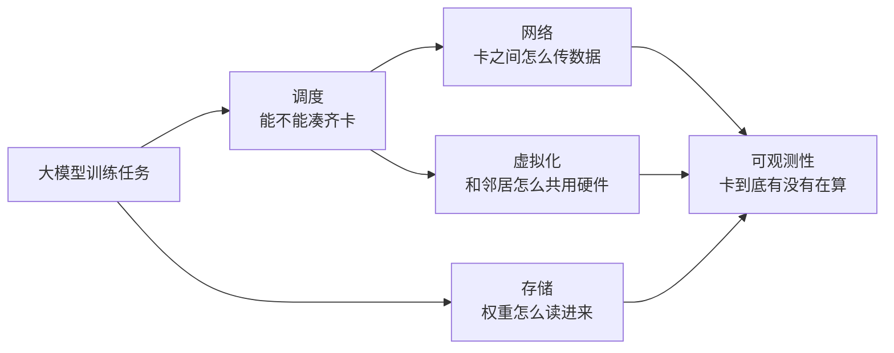
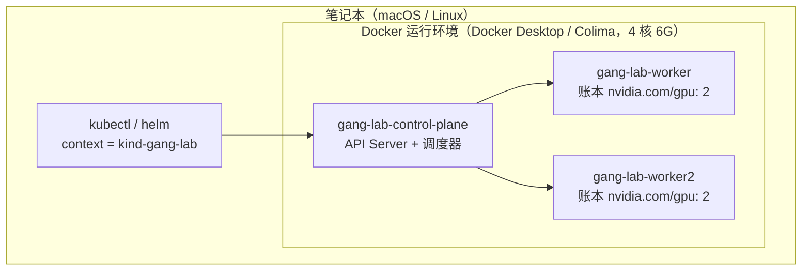
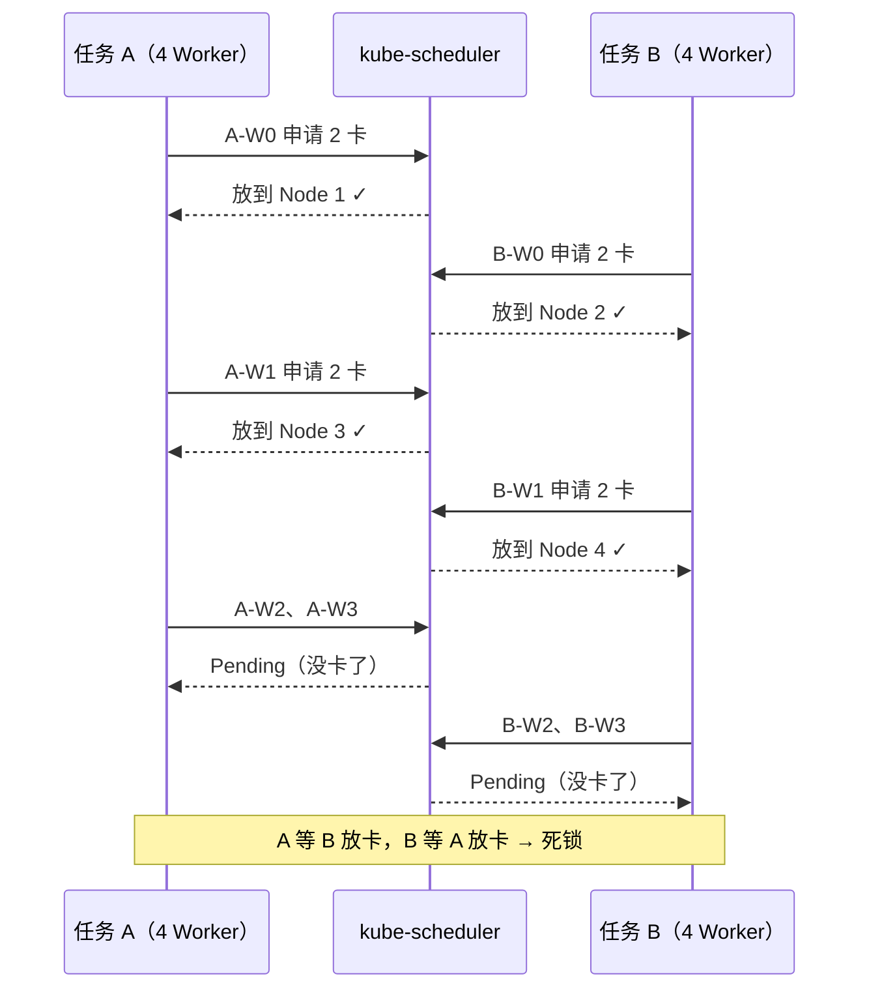
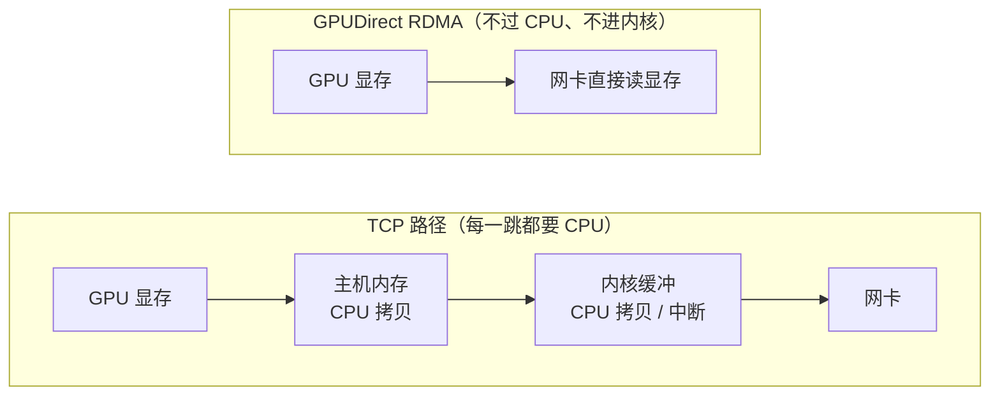
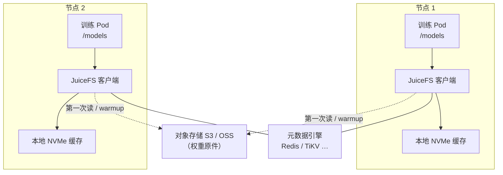
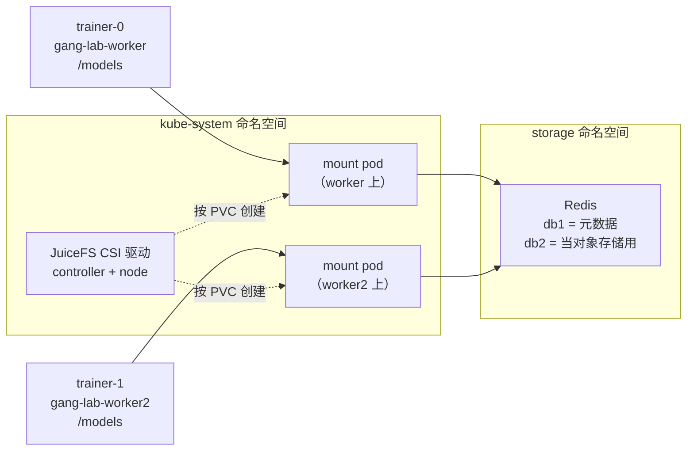
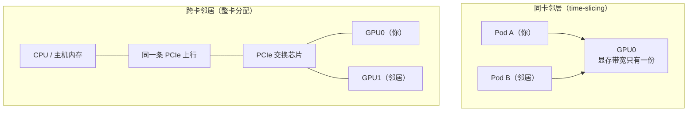
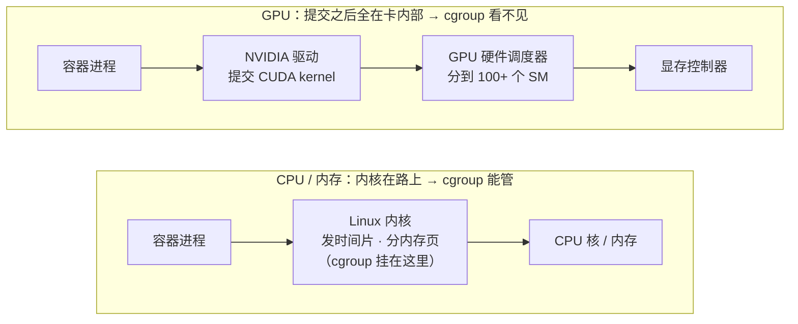

# 第 02 讲：别把 GPU 当 CPU 调度 —— AI Infra 的五道技术鸿沟

> **本讲信息**：特训课第一期 · 模块一｜前置：第 01 讲（控制面与数据面）｜配套实验包：`lab-kind-gang/`（笔记本 kind 模拟）、`lab-gpu-k8s/`（真机实验，后续演示）
>
> **这份讲义怎么用**：讲义比视频更细。每个实验都给出完整的文件内容、逐条命令、每个字段的含义、本机实测的输出和常见报错的处理办法。手上没有实验包，照着讲义从零建文件也能把实验做完；有实验包的话，直接运行对应脚本，再对照讲义看每一步在做什么。

---

## 目录

| 部分 | 内容 | 需要什么 |
|---|---|---|
| 一、本讲目标 | 学完能做到的 7 件事 | — |
| 二、实验总览 | 两类实验、两个实验包、环境要求、实验目录 | — |
| 三、为什么不能把 GPU 当 CPU 调度 | 云原生的三条老规则为什么失效，五道鸿沟一览 | — |
| 四、实验一：用 kind 搭模拟 GPU 集群 | 从装 Docker 到登记假 GPU，逐步搭建 | 笔记本 |
| 五、调度鸿沟 | 部分调度与死锁、Volcano 成组调度；**实验二**；读死锁日志练习 | 笔记本 |
| 六、网络鸿沟 | TCP 与 RDMA、NCCL 日志判断路径 | 原理（真机部分见十一） |
| 七、存储鸿沟 | 冷启动雪崩、JuiceFS 与 P2P；**实验三** | 笔记本 |
| 八、虚拟化鸿沟 | 两种邻居、topo 判断距离；**实验四**（账本实验） | 笔记本 |
| 九、可观测性鸿沟 | 利用率虚高、DCGM 指标、找慢卡 | 原理（真机部分见十一） |
| 十、面试深挖 | cgroup 为什么管不住 GPU：三层答案和三个追问 | — |
| 十一、真机实验手册 | 实验 A~G：邻居对照、GPU Operator、time-slicing、DCGM、NCCL、双机 RDMA | 两卡 GPU 机（后续真机演示） |
| 十二、回集群自查 | 六条只读命令 | 已有集群 |
| 十三~十五 | 本讲小结、课后作业、后续实战安排 | — |
| 附录 A~C | 一键脚本、常见问题汇总、实验包文件清单 | — |

---

## 一、本讲目标

学完本讲，你应该能做到：

1. **说清五道技术鸿沟**：调度、网络、存储、虚拟化、可观测性，每一道都能讲出「云原生的老办法为什么在大模型训练上失效」；
2. **亲手搭一套模拟 GPU 集群**：用 kind 在笔记本上起一个三节点 K8s，并给节点登记假 GPU；
3. **复现并解开调度死锁**：用默认调度器复现部分调度死锁，再用 Volcano 的 `minAvailable` 解开；
4. **搭一个带缓存的权重卷**：用 JuiceFS 把权重挂进 Pod，并验证节点本地缓存和预热确实生效；
5. **会用日志和指标判断问题**：用 NCCL 日志判断走的是 RDMA 还是 TCP，用 DCGM 指标识破利用率虚高；
6. **答好一道高频面试题**：cgroup 为什么管得住 CPU 和内存，却管不住 GPU，按「机制 → 资源模型 → 补救」三层作答；
7. **回自己的集群做一次体检**：用六条只读命令，十分钟查一遍这五道鸿沟。

---

## 二、实验总览

### 1. 两类实验、两个实验包

这门特训课现在是第一期，眼下 GPU 暂时还没有资源，所以本讲的实验分成两类，**要完整做完本讲的实验，需要用到两个实验包**：

| 类别 | 内容 | 用哪个实验包 | 本讲怎么做 |
|---|---|---|---|
| **kind 模拟 · 课上演示** | 搭 kind 模拟集群、调度死锁与 Volcano 成组调度、JuiceFS 权重卷、time-slicing 分卡效果（账本实验） | `lab-kind-gang/`：一台笔记本即可，不需要 GPU | 笔记本上就能完整复现，课上有终端演示 |
| **必须真卡 · 后续真机演示** | NCCL 走卡间直连还是 Socket、邻居抢掉多少带宽、DCGM 张量核心忙不忙、GPU Operator 与 time-slicing 真机版 | `lab-gpu-k8s/`：需要一台两卡 GPU 机 | 本讲先讲原理、步骤和判断标准；真机实战后面找时间补上，到时照着这个包复现 |

建议的顺序：先用 `lab-kind-gang/` 把模拟部分全部跑通（本讲义实验一到实验四，对应课后作业第一档）；等后续真机演示补上后，再用 `lab-gpu-k8s/` 做真卡部分（本讲义第十一部分「真机实验手册」，对应课后作业第三档）。

为什么调度相关的实验可以用假卡？因为 K8s 调度器并不认识 GPU，它只认节点上登记的一个数字 `nvidia.com/gpu`。节点登记几张，调度器就按几张来分。这就像酒店前台排房，只看登记簿上还剩几间空房，不会跑到每间房里去检查。

> **说明**：本讲用模拟环境做的调度、存储和 GPU 切分，完整的生产实战在 **04 · 训练营阶段二 · K8s 大模型集群**里。这里先用模拟环境把原理跑通。

### 2. kind 模拟实验的环境要求

| 项目 | 要求 |
|---|---|
| 系统 | macOS（Apple 芯片或 Intel 均可）或 Linux |
| CPU / 内存 | 给 Docker 至少 4 核、6 GB 内存 |
| 磁盘 | Docker 可用空间 10 GB 以上（节点镜像、Volcano、JuiceFS 镜像加起来约 3~4 GB） |
| 网络 | 需要能拉 Docker Hub 镜像、访问 GitHub 和 helm 仓库；网络不稳时先配好镜像加速或代理 |
| GPU | 不需要 |
| 总时长 | 第一次约 30~40 分钟（主要花在拉镜像），之后每个实验几分钟 |

本讲义的实测环境（版本不必完全一致；遇到行为不一样时，以这里为准）：

| 组件 | 实测版本 |
|---|---|
| Colima | 0.8.1（Docker 客户端 26.1.2） |
| kind | v0.33.0 |
| 节点镜像 kindest/node | v1.37.0 |
| kubectl | v1.30.1 |
| helm | v3.15.2 |
| Volcano helm chart | 1.16.0 |
| JuiceFS CSI helm chart | 0.33.2 |

### 3. 实验目录

下面所有 kind 实验都在同一个目录里进行。有实验包就直接进入 `lab-kind-gang/`；没有的话，新建一个同名目录，讲义里每一步都会给出要创建的文件：

```bash
mkdir -p ~/lab-kind-gang && cd ~/lab-kind-gang
mkdir -p manifests/deadlock manifests/gang manifests/ledger storage
```

做完全部实验后，目录长这样：

```text
lab-kind-gang/
├── kind-config.yaml               # 实验一：集群配置
├── manifests/
│   ├── gpu-2.json                 # 实验一：登记 2 张假卡的补丁
│   ├── deadlock/                  # 实验二：默认调度死锁
│   │   ├── 0-train-script.yaml
│   │   ├── 0-headless-svc.yaml
│   │   └── 1-a-w0.yaml  2-b-w0.yaml  3-a-w1.yaml  4-b-w1.yaml
│   ├── gang/                      # 实验二：Volcano 成组调度
│   │   └── gang-a.yaml  gang-b.yaml
│   └── ledger/                    # 实验四：账本实验
│       └── gpu-8.json  gpu-2-restore.json  share-8.yaml
└── storage/                       # 实验三：JuiceFS 权重卷
    └── backend.yaml  juicefs-pvc.yaml  trainer-1.yaml
```

> 实验包 `lab-kind-gang/` 里已经按这个目录放好了全部文件，内容和讲义一致；另外还有一键脚本 `00-up.sh` 到 `06-juicefs.sh`，见附录 A。

---

## 三、为什么不能把 GPU 当 CPU 调度

### 1. 云原生帮我们藏起来的三件事

过去十年，云原生一直在把硬件的不完美藏起来：

| 云原生的做法 | 举例 | 到了大模型训练 |
|---|---|---|
| CPU 可超卖 | 32 核的机器给 Pod 分出 64 核，大家不会同时跑满 | 显存是硬上限：模型要 80G、卡只有 80G，多一点就 OOM，没有换页 |
| 内存可换页 | 内存不够把冷页换到磁盘，慢一点但不会挂 | 几千张卡每步同步，最慢的那张决定全体：1000 张里一张慢两成，整个训练慢两成 |
| 丢包靠 TCP 重传 | 丢了包自动重传，应用几乎无感 | 集合通信对丢包极度敏感：丢一个包，所有卡一起等重传 |

如果还用老一套（调度器逐个打分放 Pod、cgroup 限配额、nvidia-smi 看利用率），表面上集群很忙，实际上训练在空转、资源被锁死、共用硬件的任务在互相抢。这些问题追下去，都落在五个地方。

### 2. 五道技术鸿沟一览

| 鸿沟 | 一句话 | 后果 | 本讲给你的工具 |
|---|---|---|---|
| 调度 | 默认调度器逐个放 Pod，常常只放下任务的一部分 | 占着卡零进展，几个任务互相卡死 | Volcano `minAvailable` |
| 网络 | 内核 TCP 扛不住每秒上百 GB 的集合通信 | 丢包被放大到全局 | NCCL 日志里的 `NET/IB` |
| 存储 | 成百个节点同时冷启动拉权重 | 源站被打满、超时雪崩 | JuiceFS PVC + 预热 |
| 虚拟化 | cgroup 管不住显存带宽和 PCIe 带宽 | 被吵闹的邻居拖慢 | `nvidia-smi topo` + 邻居对照实验 |
| 可观测性 | 利用率 100%，卡可能正在空等 | 监控数字好看，有效算力在挨饿 | DCGM `PIPE_TENSOR_ACTIVE` |



---

## 四、实验一：用 kind 搭一个模拟 GPU 集群

### 1. 四个名词

| 名词 | 是什么 | 为什么用它 | 要注意什么 | 例子 |
|---|---|---|---|---|
| **kind**（Kubernetes in Docker） | 用 Docker 容器充当 K8s 节点，容器里跑 kubelet 和 containerd | 一台笔记本几十秒起一个多节点集群，用完一条命令删掉 | 节点只是容器：没有真 GPU，网络和磁盘性能也不真实 | `kind create cluster --config …` |
| **节点容器** | 每个节点在 `docker ps` 里就是一个 `kindest/node` 容器 | 出问题可以 `docker exec` 进去看 | 重启电脑后容器不会自己起来 | `gang-lab-worker` |
| **扩展资源**（节点账本） | 节点登记的自定义资源数量，名字带域名 | 调度器只看这个数字分卡 | 生产上由设备插件根据真卡上报，别手改 | `nvidia.com/gpu: 2` |
| **kubeconfig 上下文**（context） | 决定 kubectl 连的是哪个集群 | 多个集群之间切换 | 敲命令前先确认 context，否则可能改到别的集群 | `kind-gang-lab` |

### 2. 架构



对调度器来说，这就是一个两台机器、四张卡的 GPU 集群；容器里实际上没有任何 GPU。

### 3. 第一步：准备 Docker 运行环境

kind 的节点都是容器，所以必须先有 Docker。

**macOS 用 Colima（轻量，推荐）：**

```bash
brew install colima docker          # colima 提供虚拟机，docker 是命令行客户端
colima start --cpu 4 --memory 6 --disk 40
docker info | head -5                # 能打印出 Server 信息就说明可用
```

- `--cpu 4 --memory 6`：给 Docker 虚拟机 4 核、6 GB 内存。给少了，Volcano 和 JuiceFS 的组件会起不来或被 OOM。
- `--disk 40`：虚拟机磁盘 40 GB，避免后面拉镜像时磁盘满。

**macOS 用 Docker Desktop：** 安装后在 Settings → Resources 里把 CPU 调到 4、内存调到 6 GB 以上。

**Linux：** 按 Docker 官网安装 Docker Engine，并把当前用户加进 docker 组（`sudo usermod -aG docker $USER`，重新登录生效）。

### 4. 第二步：调高 inotify 上限（必做，否则 JuiceFS 会反复重启）

inotify 是 Linux 内核用来监听文件变化的机制。kind 的每个节点、每个插件都要占用几个 inotify 实例，默认上限（通常 128）不够用。上限不够时，JuiceFS 的 CSI 插件会报 `too many open files`，然后一直重启。

**Colima：** inotify 要在 Colima 的虚拟机里调：

```bash
colima ssh -- sudo sysctl -w fs.inotify.max_user_instances=512 fs.inotify.max_user_watches=524288
```

这样改，重启 Colima 后会失效。要永久生效，编辑 `~/.colima/default/colima.yaml`，找到 `provision:` 这一项，改成：

```yaml
provision:
  # kind 多节点 + JuiceFS CSI 需要更高的 inotify 上限，否则报 too many open files
  - mode: system
    script: sysctl -w fs.inotify.max_user_instances=512 fs.inotify.max_user_watches=524288
```

**Linux：**

```bash
sudo sysctl -w fs.inotify.max_user_instances=512 fs.inotify.max_user_watches=524288
# 永久生效
echo -e "fs.inotify.max_user_instances=512\nfs.inotify.max_user_watches=524288" | sudo tee /etc/sysctl.d/99-kind.conf
```

**Docker Desktop：** 它的虚拟机默认上限一般够用；如果 JuiceFS 报 `too many open files`，参考 Docker Desktop 文档进入虚拟机调整。

### 5. 第三步：安装 kind、kubectl、helm

```bash
brew install kind kubectl helm      # macOS
# Linux：按 kind / kubectl / helm 各自官网的安装方式

kind version                        # 实测：kind v0.33.0 go1.27.0 darwin/arm64
kubectl version --client            # 实测：Client Version: v1.30.1
helm version --short                # 实测：v3.15.2+g1a500d5
```

三条命令都能打印出版本号，就说明装好了。

### 6. 第四步：写集群配置

```bash
cat > kind-config.yaml <<'EOF'
kind: Cluster
apiVersion: kind.x-k8s.io/v1alpha4
name: gang-lab           # 集群名
nodes:
  - role: control-plane  # API Server + 调度器
  - role: worker         # 放训练任务
  - role: worker         # 两台才能复现「凑不齐」
EOF
```

逐行看：

- `kind` 和 `apiVersion`：固定写法，告诉 kind 这是一份集群配置。
- `name: gang-lab`：集群名。节点容器会叫 `gang-lab-control-plane`、`gang-lab-worker`、`gang-lab-worker2`，kubectl 的 context 会叫 `kind-gang-lab`。
- `nodes`：每一项是一个节点。一个 `control-plane` 跑 API Server 和调度器；两个 `worker` 放训练任务。

为什么要两个 worker？调度鸿沟要复现的，正是一个任务的几个 Worker 被分到不同机器上、凑不齐卡的情况，只有一个节点看不出来。

### 7. 第五步：建集群

```bash
kind create cluster --config kind-config.yaml
kubectl wait --for=condition=Ready nodes --all --timeout=180s
```

实测输出：

```text
Creating cluster "gang-lab" ...
 ✓ Ensuring node image (kindest/node:v1.37.0) 🖼️
 ✓ Preparing nodes 📦 📦 📦
 ✓ Writing configuration 📜
 ✓ Starting control-plane 🕹️
 ✓ Installing CNI 🔌
 ✓ Installing StorageClass 💾
 ✓ Joining worker nodes 🚜
Set kubectl context to "kind-gang-lab"
You can now use your cluster with:

kubectl cluster-info --context kind-gang-lab
node/gang-lab-control-plane condition met
node/gang-lab-worker condition met
node/gang-lab-worker2 condition met
```

`kind create cluster` 依次做了这几件事：

1. **Ensuring node image**：准备节点镜像 `kindest/node`。第一次要下载约 1 GB，会慢一些；之后用本地镜像。
2. **Preparing nodes**：为每个节点起一个容器，三个 📦 就是三个节点。
3. **Writing configuration / Starting control-plane**：在控制面节点上用 kubeadm 初始化集群。
4. **Installing CNI**：装容器网络插件，Pod 之间才能互通。
5. **Installing StorageClass**：装一个默认的本地存储类。
6. **Joining worker nodes**：让两个 worker 加入集群。
7. **Set kubectl context**：把 kubectl 的当前 context 切到 `kind-gang-lab`。

镜像已在本地时，整个过程约半分钟。

检查节点容器和集群状态：

```bash
docker ps --format 'table {{.Names}}\t{{.Image}}\t{{.Status}}'
kubectl config current-context
kubectl get nodes -o wide
```

实测输出：

```text
NAMES                    IMAGE                  STATUS
gang-lab-control-plane   kindest/node:v1.37.0   Up 1 minute
gang-lab-worker2         kindest/node:v1.37.0   Up 1 minute
gang-lab-worker          kindest/node:v1.37.0   Up 1 minute

kind-gang-lab

NAME                     STATUS   ROLES           AGE   VERSION   INTERNAL-IP   ...   CONTAINER-RUNTIME
gang-lab-control-plane   Ready    control-plane   46s   v1.37.0   172.19.0.6    ...   containerd://2.3.4
gang-lab-worker          Ready    <none>          36s   v1.37.0   172.19.0.5    ...   containerd://2.3.4
gang-lab-worker2         Ready    <none>          36s   v1.37.0   172.19.0.4    ...   containerd://2.3.4
```

三个节点都是 `Ready`，集群就建好了。

### 8. 第六步：登记假 GPU

集群建好了，但节点上还没有 GPU。这一步在两个 worker 的账本上各登记两张假卡。

先写补丁文件：

```bash
cat > manifests/gpu-2.json <<'EOF'
[
  {"op": "add", "path": "/status/capacity/nvidia.com~1gpu", "value": "2"},
  {"op": "add", "path": "/status/allocatable/nvidia.com~1gpu", "value": "2"}
]
EOF
```

再对两个 worker 各打一次补丁：

```bash
for n in gang-lab-worker gang-lab-worker2; do
  kubectl patch node "$n" --subresource=status --type=json --patch-file manifests/gpu-2.json
done
```

逐个参数看：

| 参数 | 含义 |
|---|---|
| `kubectl patch node <节点名>` | 修改一个节点对象 |
| `--subresource=status` | 改的是节点的**状态部分**。平时这部分由 kubelet 和设备插件来写，这里手动写。不加这个参数，对 status 的修改会被忽略 |
| `--type=json` | 补丁用 JSON Patch 格式（RFC 6902），由一组操作组成 |
| `"op": "add"` | 新增一项 |
| `"path": "/status/capacity/nvidia.com~1gpu"` | `capacity` 是这台机器总共有多少资源。**`~1` 是斜杠的转义**：`nvidia.com/gpu` 这个名字本身带斜杠，不转义的话，JSON Patch 会把它理解成 capacity 下面的 `nvidia.com`、再下面的 `gpu`，路径就错了 |
| `"path": "/status/allocatable/nvidia.com~1gpu"` | `allocatable` 是能分给 Pod 的数量，调度器看的是它。只改 capacity 的话，kubelet 也会在几秒内把 allocatable 同步成一样的值；两个一起改，立刻生效 |
| `"value": "2"` | 两张卡，注意是字符串 |

验证：

```bash
kubectl get nodes -o custom-columns='NODE:.metadata.name,GPU:.status.allocatable.nvidia\.com/gpu'
docker exec gang-lab-worker sh -c 'ls /dev/nvidia* 2>&1'
```

实测输出：

```text
NODE                     GPU
gang-lab-control-plane   <none>
gang-lab-worker          2
gang-lab-worker2         2

ls: cannot access '/dev/nvidia*': No such file or directory
```

- 第一条：两个 worker 的 GPU 列都是 2，控制面是 `<none>`。一个模拟的四卡集群就搭好了。custom-columns 里的 `nvidia\.com` 要转义点号，并且整个参数要用单引号包起来。
- 第二条：进到节点容器里看，根本没有 `/dev/nvidia*` 设备。这个数字只存在于 K8s 的账本里。

> **注意**：生产集群上千万别这样手改。真卡的数字应该交给 NVIDIA 设备插件去上报，手改会让账本和真卡对不上。

> 实验包里 `00-up.sh` 把第四到第六步写在了一起，可以直接 `./00-up.sh`。

### 9. 验收清单

| # | 命令 | 看到什么才算成功 |
|---|---|---|
| 1 | `kind get clusters && docker ps` | 能看到 `gang-lab`，三个节点容器都是 Up |
| 2 | `kubectl config current-context && kubectl get nodes` | context 是 `kind-gang-lab`，三个节点都 Ready |
| 3 | `kubectl get nodes -o custom-columns='NODE:.metadata.name,GPU:.status.allocatable.nvidia\.com/gpu'` | 两个 worker 显示 `2`，控制面显示 `<none>` |

### 10. 日常维护

**重启电脑或 Colima 以后怎么恢复？** 节点容器不会自己起来：

```bash
colima start                                                      # Docker Desktop 用户打开 Docker Desktop 即可
docker start $(docker ps -aq --filter label=io.x-k8s.kind.cluster=gang-lab)
for i in $(seq 1 60); do kubectl get --raw /readyz >/dev/null 2>&1 && break; sleep 2; done
kubectl wait --for=condition=Ready node --all --timeout=180s
```

`--filter label=io.x-k8s.kind.cluster=gang-lab` 只挑出属于 gang-lab 集群的节点容器；`/readyz` 循环是在等 API Server 就绪。

> 节点重启后，手动登记的假 GPU 通常还在。如果 GPU 列变回 `<none>`，重新执行第六步即可。

**切换集群：**

```bash
kubectl config get-contexts                  # 看有哪些集群，带 * 的是当前
kubectl config use-context kind-gang-lab     # 切过去
```

**删除集群：**

```bash
kind delete cluster --name gang-lab          # 节点容器和 context 一起删（实验包 99-down.sh）
```

删除后当前 context 会被清空，`kubectl config current-context` 会报 `current-context is not set`，需要 `use-context` 切到别的集群。

---

## 五、调度鸿沟

### 1. 两种完全相反的调度思路

| | 微服务 | 大模型训练 |
|---|---|---|
| 放置方式 | 给每个 Pod 打分、逐个放 | 每一步 AllReduce 要求所有 Worker 到齐 |
| 局部失败 | 换节点重试，其他 Pod 照常服务 | 少一个 Worker，已经起来的只能干等 |
| 例子 | 下单服务 50 个副本有 2 个没起来，剩下 48 个照样接单 | 任务要 4 个 Worker 起来 3 个，进度不是 75%，而是 0：三个 Worker 占着六张卡，一步都不会往前走 |
| 目标 | 尽快把 Pod 铺开 | 整组同时开始，或整组都不占 |

### 2. 四个名词

| 名词 | 是什么 | 为什么需要 | 不用会怎样 / 局限 | 例子 |
|---|---|---|---|---|
| **kube-scheduler** | K8s 默认调度器：先筛掉放不下的节点，再打分选最高 | 成百上千个 Pod 要自动、均衡地铺到机器上 | 一次只看一个 Pod，不知道 4 个 Worker 是一伙的 → 只放下一部分（**部分调度**） | W0/W1 Running · W2/W3 Pending |
| **Worker / rank** | 一个训练进程（通常一个 Pod），rank 是编号 | 一台机器算不完，要拆到多卡多机 | 拆开后缺任何一个，整组都跑不动 | `torchrun --nnodes=4` → rank 0~3 |
| **AllReduce** | 所有 rank 把梯度加总，再发回每个人 | 每张卡算的是一部分数据，要合并成同一份梯度 | 缺一个 rank，其余人在这一步原地等 | 像四个人一起算总账，四份都到才能算下一笔 |
| **NCCL 建组**（rendezvous） | 启动时所有 rank 交换地址、建立通信组 | AllReduce 之前得知道同组有谁 | 有人没到就一直挂着，直到超时 | 日志 `Waiting for workers to join` |

### 3. 逐个放置如何造成部分调度

一个 8 卡任务要 4 个 Worker，每个 Worker 要 2 张卡。集群还剩 5 张空闲卡，散落在三台机器上（2 + 2 + 1）。默认调度先放能放下的：W0、W1 Running 并占住显存；W2、W3 拼不出完整的 2 卡，一直 Pending。表面上「已经起了两个」，其实任务永远开不了工。

### 4. 两个任务互相等：调度死锁

集群刚好空出 8 张卡，同时来了两个一样的 8 卡任务 A 和 B。打分调度不知道谁和谁是一伙的，于是 A、B 各拿到两个 Worker、各占 4 张卡。A 等 B 放卡，B 等 A 放卡，谁都凑不齐，谁都不释放。这和操作系统里两个线程各拿一把锁、互相等对方是同一回事。

等超时重启也没用：任务失败、重新排队，默认调度照样逐个放，大概率又是一半对一半。而这期间 GPU 利用率可能还不低，因为初始化和空转等待都算「忙」。



### 5. 解决办法：成组调度（Gang Scheduling）

成组调度也叫 All-or-Nothing：要么整组都放，要么一个都不放。在 K8s 里用 Volcano 实现：

```yaml
apiVersion: batch.volcano.sh/v1alpha1
kind: Job
metadata:
  name: llm-pretrain-8gpu
spec:
  schedulerName: volcano      # 别走默认 kube-scheduler
  minAvailable: 4             # 4 Worker 一起放，否则都不占
  queue: gpu-train
  tasks:
  - name: worker
    replicas: 4
    template:
      spec:
        containers:
        - name: trainer
          resources:
            limits:
              nvidia.com/gpu: "2"
```

- `schedulerName: volcano`：Pod 才会交给 Volcano 调度。
- Volcano 会给这批 Pod 建一个 **PodGroup**，相当于一份花名册，告诉调度器这几个 Pod 是一伙的。
- `minAvailable: 4`：至少 4 个能同时放下，才开始放任何一个。比如集群只剩 6 张空卡，任务一共要 8 张，Volcano 就一个都不放，这 6 张卡继续留给别的任务。
- `queue`：任务进哪个队列，队列之间可以设配额和优先级。
- 同类方案 **Kueue** 用的是排队加准入：配额够了才把整个 Job 放行。

> **面试提示**：别只说一句「用 Volcano」，要讲清 `minAvailable` 防的是什么——防止一个任务只被调度上去一部分。

同一批资源（5 张空闲卡）放进两种调度器：默认调度下 W0、W1 各占两卡进入 Running，W2、W3 Pending，四张卡被占死，训练零进展，Node C 剩下的一张卡也派不上用场；`minAvailable: 4` 的 Gang 下，八张卡凑不齐，四个 Worker 一个都不放，五张空闲卡原样留着，一个只要一卡的推理服务、一个两卡的小实验可以立刻用上。

Gang 不是让大任务更快，而是**不让凑不齐的任务把集群锁死**。凑不齐时谁先上、能不能抢占，靠队列和优先级，属于调度的进阶内容。

### 6. 实验二：笔记本上复现死锁，再用 Volcano 解开

**目标**：在实验一的集群上（两个 worker 各 2 张假卡，共 4 张），提交两个任务 A、B，每个任务 2 个 Worker、每个 Worker 要 2 张卡。按 A-W0、B-W0、A-W1、B-W1 的顺序交错提交，复现「各拿一半、互相等」；再换成 Volcano，验证整组调度。

**用时**：约 20 分钟（含安装 Volcano）。

#### 第一步：准备「训练程序」

真实训练里，NCCL 要等所有 rank 都上线才能开始算。这里用一个 shell 脚本模拟：rank0 一直等对端 Pod 的域名能被解析，等到了才开始「训练」。

```bash
cat > manifests/deadlock/0-train-script.yaml <<'EOF'
# 模拟的「训练程序」：真实训练里，NCCL 要等所有 rank 都上线才能开始算
# 这里用 DNS 代替：rank0 一直等对端 Pod 能被解析，等到了才开始「训练」
apiVersion: v1
kind: ConfigMap
metadata: { name: worker-script }
data:
  worker.sh: |
    i=0
    until nslookup "$PEER" >/dev/null 2>&1; do
      i=$((i+1))
      echo "[$(hostname)] NCCL rendezvous: waiting for $PEER ... ${i}0s (GPU 已占住，没有在算)"
      sleep 10
    done
    echo "[$(hostname)] all ranks joined, training started"
    while true; do echo "[$(hostname)] step ok"; sleep 10; done
EOF
```

为什么用 DNS 能模拟建组？对端 Pod 没被调度上去，就没有 IP，它的域名解析不出来，`nslookup` 一直失败；对端起来了，域名能解析，循环结束。

#### 第二步：每个任务一个 headless Service

同组 Pod 之间要能用域名找到对方，靠的是 headless Service：

```bash
cat > manifests/deadlock/0-headless-svc.yaml <<'EOF'
# 每个任务一个 headless Service：同组 Pod 之间用 <pod>.job-<x> 这样的域名找到对方
apiVersion: v1
kind: Service
metadata: { name: job-a }
spec:
  clusterIP: None                 # headless：不分配虚拟 IP，域名直接解析到 Pod IP
  publishNotReadyAddresses: true  # Pod 还没 Ready 也发布域名，进程起来就能被找到
  selector: { job: a }
---
apiVersion: v1
kind: Service
metadata: { name: job-b }
spec:
  clusterIP: None
  publishNotReadyAddresses: true
  selector: { job: b }
EOF
```

#### 第三步：四个 Worker Pod

文件名前的数字决定 `kubectl apply -f 目录` 的提交顺序（按文件名排序），这样就能交错提交。

```bash
cat > manifests/deadlock/1-a-w0.yaml <<'EOF'
# 任务 A 的第 0 号 Worker
apiVersion: v1
kind: Pod
metadata:
  name: a-w0
  labels: { job: a }               # 属于任务 A
spec:
  hostname: a-w0
  subdomain: job-a                 # 域名 a-w0.job-a，给同组 Worker 找
  restartPolicy: Never
  terminationGracePeriodSeconds: 1
  containers:
  - name: trainer
    image: busybox:1.36
    command: ["sh", "/script/worker.sh"]
    env:
    - name: PEER                   # 要等的同组 Worker
      value: a-w1.job-a.default.svc.cluster.local
    resources:
      limits: { nvidia.com/gpu: 2 }  # 每个 Worker 要 2 张卡
    volumeMounts: [{ name: s, mountPath: /script }]
  volumes: [{ name: s, configMap: { name: worker-script } }]
EOF

cat > manifests/deadlock/2-b-w0.yaml <<'EOF'
# 任务 B 的第 0 号 Worker
apiVersion: v1
kind: Pod
metadata:
  name: b-w0
  labels: { job: b }
spec:
  hostname: b-w0
  subdomain: job-b
  restartPolicy: Never
  terminationGracePeriodSeconds: 1
  containers:
  - name: trainer
    image: busybox:1.36
    command: ["sh", "/script/worker.sh"]
    env:
    - name: PEER
      value: b-w1.job-b.default.svc.cluster.local
    resources:
      limits: { nvidia.com/gpu: 2 }
    volumeMounts: [{ name: s, mountPath: /script }]
  volumes: [{ name: s, configMap: { name: worker-script } }]
EOF

cat > manifests/deadlock/3-a-w1.yaml <<'EOF'
# 任务 A 的第 1 号 Worker
apiVersion: v1
kind: Pod
metadata:
  name: a-w1
  labels: { job: a }
spec:
  hostname: a-w1
  subdomain: job-a
  restartPolicy: Never
  terminationGracePeriodSeconds: 1
  containers:
  - name: trainer
    image: busybox:1.36
    command: ["sh", "/script/worker.sh"]
    env:
    - name: PEER
      value: a-w0.job-a.default.svc.cluster.local
    resources:
      limits: { nvidia.com/gpu: 2 }
    volumeMounts: [{ name: s, mountPath: /script }]
  volumes: [{ name: s, configMap: { name: worker-script } }]
EOF

cat > manifests/deadlock/4-b-w1.yaml <<'EOF'
# 任务 B 的第 1 号 Worker
apiVersion: v1
kind: Pod
metadata:
  name: b-w1
  labels: { job: b }
spec:
  hostname: b-w1
  subdomain: job-b
  restartPolicy: Never
  terminationGracePeriodSeconds: 1
  containers:
  - name: trainer
    image: busybox:1.36
    command: ["sh", "/script/worker.sh"]
    env:
    - name: PEER
      value: b-w0.job-b.default.svc.cluster.local
    resources:
      limits: { nvidia.com/gpu: 2 }
    volumeMounts: [{ name: s, mountPath: /script }]
  volumes: [{ name: s, configMap: { name: worker-script } }]
EOF
```

关键字段：

| 字段 | 作用 |
|---|---|
| `labels: { job: a }` | 标明属于哪个任务，Service 靠它选中同组 Pod |
| `hostname` + `subdomain` | 和 headless Service 配合，生成域名 `a-w0.job-a.default.svc.cluster.local` |
| `env.PEER` | 告诉训练脚本要等谁 |
| `limits: { nvidia.com/gpu: 2 }` | 每个 Worker 要 2 张卡。扩展资源只写 limits 即可，requests 会自动等于 limits |
| `restartPolicy: Never` | 失败不重启，方便观察 |
| `terminationGracePeriodSeconds: 1` | 删除时 1 秒内结束，实验时不用干等 |

#### 第四步：用默认调度器提交，复现死锁

```bash
kubectl apply -f manifests/deadlock/
kubectl get pods -l job -o wide -w        # 看 15 秒左右，按 Ctrl-C 退出
```

实测输出：

```text
service/job-a created
service/job-b created
configmap/worker-script created
pod/a-w0 created
pod/b-w0 created
pod/a-w1 created
pod/b-w1 created

NAME   READY   STATUS    RESTARTS   AGE   IP            NODE               ...
a-w0   1/1     Running   0          4s    10.244.1.44   gang-lab-worker2   ...
a-w1   0/1     Pending   0          4s    <none>        <none>             ...
b-w0   1/1     Running   0          4s    10.244.2.45   gang-lab-worker    ...
b-w1   0/1     Pending   0          4s    <none>        <none>             ...
```

`a-w0` 和 `b-w0` 各占一台 worker 的 2 张卡，`a-w1` 和 `b-w1` 没卡可分，Pending。a-w0 落在哪台 worker 由调度器打分决定，你那里可能和这里相反，不影响结论。

看 Pending 的原因：

```bash
kubectl describe pod a-w1 | grep FailedScheduling
```

```text
  Warning  FailedScheduling  39s   default-scheduler  0/3 nodes are available: 1 node(s) had untolerated taint(s), 2 Insufficient nvidia.com/gpu. preemption: 0/3 nodes are available: 1 Preemption is not helpful for scheduling, 2 No preemption victims found for incoming pod.
```

读法：3 个节点都放不下。`1 node(s) had untolerated taint(s)` 是控制面节点（默认不放业务 Pod）；`2 Insufficient nvidia.com/gpu` 是两个 worker 的卡都被占了；抢占也帮不上忙。

看已经 Running 的 Worker 在干什么：

```bash
kubectl logs a-w0
```

```text
[a-w0] NCCL rendezvous: waiting for a-w1.job-a.default.svc.cluster.local ... 10s (GPU 已占住，没有在算)
[a-w0] NCCL rendezvous: waiting for a-w1.job-a.default.svc.cluster.local ... 20s (GPU 已占住，没有在算)
[a-w0] NCCL rendezvous: waiting for a-w1.job-a.default.svc.cluster.local ... 30s (GPU 已占住，没有在算)
[a-w0] NCCL rendezvous: waiting for a-w1.job-a.default.svc.cluster.local ... 40s (GPU 已占住，没有在算)
```

a-w0 占着两张卡一直在等 a-w1，b-w0 也一样在等 b-w1。A 等 B 放卡，B 等 A 放卡，**死锁复现成功**。这个状态会一直持续，不会自己解开。

清掉这组 Pod（Service 和 ConfigMap 留着无妨）：

```bash
kubectl delete pod -l job
```

#### 第五步：安装 Volcano

```bash
helm repo add volcano-sh https://volcano-sh.github.io/helm-charts
helm repo update volcano-sh
helm upgrade --install volcano volcano-sh/volcano --version 1.16.0 \
  -n volcano-system --create-namespace --wait --timeout 10m
```

- `upgrade --install`：没装就装，装过就升级，重复执行不会报错。
- `--version 1.16.0`：固定 chart 版本，和讲义实测一致；去掉就装最新版。
- `--wait --timeout 10m`：等所有组件就绪再返回。第一次要拉镜像，可能要几分钟。

验证三件事：

```bash
kubectl get pods -n volcano-system
kubectl get crd | grep -E 'podgroups|jobs.batch.volcano'
kubectl get queue
```

实测输出：

```text
NAME                                   READY   STATUS      RESTARTS   AGE
volcano-admission-ff6d94c98-q6gp4      1/1     Running     0          24s
volcano-admission-init-r9rs7           0/1     Completed   0          50s
volcano-controllers-84bf6664c8-6jxwg   1/1     Running     0          24s
volcano-scheduler-6b77f5f565-kbh5x     1/1     Running     0          24s

jobs.batch.volcano.sh                        Namespaced   v1alpha1(storage)   ...
podgroups.scheduling.volcano.sh              Namespaced   v1beta1(storage)    ...

NAME      PARENT
default   root
root
```

| 组件 | 作用 |
|---|---|
| `volcano-admission` | 准入 Webhook，检查和补全提交的 Volcano Job（`admission-init` 是一次性初始化，Completed 是正常的） |
| `volcano-controllers` | 控制器，把 Volcano Job 展开成 PodGroup 和 Pod |
| `volcano-scheduler` | 调度器本身，按 PodGroup 成组调度 |
| CRD `jobs.batch.volcano.sh` / `podgroups.scheduling.volcano.sh` | 新增的资源类型：Volcano Job 和 PodGroup |
| 队列 `default` | 不写 `queue` 的 Job 进这个默认队列 |

#### 第六步：换成 Volcano Job

同样两个任务、每个 2 个 Worker × 2 卡，改成 Volcano Job：

```bash
cat > manifests/gang/gang-a.yaml <<'EOF'
# 同样是 2 个 Worker × 2 卡，改成 Volcano Job
apiVersion: batch.volcano.sh/v1alpha1
kind: Job
metadata:
  name: gang-a
spec:
  schedulerName: volcano     # 交给 Volcano 调度，不走默认调度器
  minAvailable: 2            # 至少 2 个 Pod 能同时排上，才整组放行
  plugins:
    svc: []                  # 自动建 headless Service，Worker 互相能解析
  tasks:
  - name: worker
    replicas: 2
    template:
      spec:
        restartPolicy: Never
        terminationGracePeriodSeconds: 1
        containers:
        - name: trainer
          image: busybox:1.36
          command: ["sh", "-c", "echo \"[$(hostname)] all ranks joined, training started\"; while true; do echo step ok; sleep 10; done"]
          resources:
            limits: { nvidia.com/gpu: 2 }
EOF

sed 's/gang-a/gang-b/' manifests/gang/gang-a.yaml > manifests/gang/gang-b.yaml
```

和第三步的裸 Pod 相比：

- 不用自己写 Service：`plugins.svc` 会自动建 headless Service，Pod 名是 `gang-a-worker-0`、`gang-a-worker-1`。
- 不用自己写等待逻辑：Volcano 保证两个 Worker 同时被放上去，训练脚本直接开始。
- `minAvailable: 2`：两个 Worker 必须能同时放下，否则一个都不放。

提交并观察：

```bash
kubectl apply -f manifests/gang/
kubectl get pods -l volcano.sh/job-name -o wide -w     # 看 10 秒左右，Ctrl-C 退出
kubectl get vcjob
kubectl get podgroup
```

实测输出：

```text
NAME              READY   STATUS    RESTARTS   AGE   IP           NODE               ...
gang-a-worker-0   1/1     Running   0          20s   10.244.2.4   gang-lab-worker    ...
gang-a-worker-1   1/1     Running   0          20s   10.244.1.6   gang-lab-worker2   ...
gang-b-worker-0   0/1     Pending   0          20s   <none>       <none>             ...
gang-b-worker-1   0/1     Pending   0          20s   <none>       <none>             ...

NAME     STATUS    MINAVAILABLE   RUNNINGS   AGE
gang-a   Running   2              2          20s
gang-b   Pending   2                         20s

NAME                                          STATUS    MINMEMBER   RUNNINGS   AGE
gang-a-8af0344f-4bc2-4db7-98c7-e6c5774bea39   Running   2           2          20s
gang-b-d5a6b8ed-1ef5-4568-80c0-88091cfe86b1   Inqueue   2                      20s
```

和默认调度对比：gang-a 的两个 Worker **一起** Running（分别在两台 worker 上，各占 2 卡）；gang-b 的两个 Worker **一起** Pending，一张卡都没占。PodGroup 名字后面是一串 UID，状态 `Inqueue` 表示已进队列、在等资源。

看 gang-b 为什么 Pending：

```bash
kubectl describe pod gang-b-worker-0 | grep FailedScheduling
```

```text
  Warning  FailedScheduling  18s   volcano  pod group is not ready, 2 Pending, 2 minAvailable; Pending: 2 Unschedulable
```

读法：调度器是 `volcano`；原因是「组没凑齐」——需要 2 个能同时放下，现在 2 个都放不下，所以整组等待，而不是先放一个。

#### 第七步：释放资源，验证整组接上

```bash
kubectl delete vcjob gang-a
kubectl get pods -l volcano.sh/job-name=gang-b -o wide -w   # 看 15 秒左右，Ctrl-C 退出
kubectl logs gang-b-worker-0
```

实测输出：

```text
job.batch.volcano.sh "gang-a" deleted

NAME              READY   STATUS    RESTARTS   AGE   IP           NODE               ...
gang-b-worker-0   1/1     Running   0          40s   10.244.2.5   gang-lab-worker    ...
gang-b-worker-1   1/1     Running   0          40s   10.244.1.7   gang-lab-worker2   ...

[gang-b-worker-0] all ranks joined, training started
step ok
```

gang-a 一释放，gang-b 两个 Worker 同时 Running，训练直接开始。

清理：

```bash
kubectl delete vcjob --all
```

> 实验包里的对应脚本：`01-default-deadlock.sh`（第一到第四步）、`02-install-volcano.sh`（第五步）、`03-gang.sh` + `03-gang-jobs.yaml`（第六、七步）。

#### 验收清单

| # | 看到什么才算成功 |
|---|---|
| 1 | 默认调度：`a-w0`、`b-w0` Running，`a-w1`、`b-w1` Pending；事件 `2 Insufficient nvidia.com/gpu`；a-w0 日志一直 `waiting for a-w1` |
| 2 | Volcano：`gang-a` 两个 Worker 一起 Running；`gang-b` 整组 Pending，PodGroup `Inqueue`，事件 `pod group is not ready, 2 Pending, 2 minAvailable` |
| 3 | 删掉 gang-a 后，`gang-b-worker-0`、`gang-b-worker-1` 整组 Running |

#### 常见问题

| 现象 | 原因与处理 |
|---|---|
| 四个 Pod 全 Pending，事件 `Insufficient nvidia.com/gpu` | 假 GPU 没登记上，或上一个实验的 Pod 没删。用实验一第六步的 custom-columns 命令检查账本，`kubectl get pods -A` 看有没有残留 |
| Pod 一直 `ContainerCreating` / `ImagePullBackOff` | 拉 busybox 镜像失败。检查网络或镜像加速；`kubectl describe pod` 看具体报错 |
| Volcano Job 提交后没有任何 Pod | `kubectl get pods -n volcano-system` 确认三个组件都在跑；`kubectl describe vcjob gang-a` 看事件 |
| helm 安装报 `EOF` 或 `context deadline exceeded` | 从 GitHub 拉 chart 失败或超时，重试；网络不稳时配代理 |

这里的卡是账本上的假卡，但调度器的行为和真卡完全一样。用真卡再跑一遍放在后面的真机实战里；Volcano 在生产集群上的完整落地（队列、优先级、抢占）是《训练营阶段二》第 10～11 讲的内容。

### 7. 练习：读死锁日志（不需要任何硬件）

```text
# Job llm-pretrain-8gpu  声明: 4 workers × 2 GPU
14:02:11  pod/worker-0  Running   node=gpu-a3  nvidia.com/gpu=2  age=6m
14:02:11  pod/worker-1  Running   node=gpu-b1  nvidia.com/gpu=2  age=6m
14:02:18  pod/worker-2  Pending   Insufficient nvidia.com/gpu  (want 2, free 1 on gpu-c2)
14:02:18  pod/worker-3  Pending   0/1 nodes are available: 1 Insufficient nvidia.com/gpu
14:08:02  event         TrainingJob  Waiting for workers to join NCCL uniqueId
```

按这个顺序读：

1. **数并行度**：Running + Pending 够不够声明的 4 个 Worker？——人数够，但只有一半在跑。
2. **看 Pending 原因**：是不是 `Insufficient nvidia.com/gpu`？剩下的空闲卡是不是零散分布、每台只剩一张？
3. **看空转时长**：Running 的 Pod 已经跑了多久，却停在 `Waiting for workers to join`？

能标出构成死锁现场的 Worker 和节点，并解释为什么这时 GPU 利用率可能并不低，这道题就算做对了。

---

## 六、网络鸿沟

### 1. 为什么丢包对训练这么致命

先说范围：网络鸿沟只影响**跨机器**的通信，单机多卡之间走的是机器内部的 PCIe 或 NVLink。

千分之一的丢包，微服务几乎无感，千卡训练却可能吞吐掉一大截。微服务丢一个包，只是这一个请求慢一点；训练每一步都要等所有卡把数据交换完，一千张卡里只要有一条连接在等重传，其余的卡都得陪着等。Linux 默认的超时重传最少要等 200 毫秒，而训练一步可能才几百毫秒，丢一个包，这一步就可能慢上一倍。

更根本的原因是：**TCP 走内核的这条路，天生就扛不住集合通信。**

### 2. 两条路：TCP vs GPUDirect RDMA



AllReduce 每步上百 GB，走 TCP 时 CPU 先被拷贝和中断打满，网卡带宽却跑不满；走 RDMA 时路径短了，CPU 也空了出来。

### 3. 四个名词

| 名词 | 是什么 | 为什么需要 | 不用会怎样 | 怎么查 |
|---|---|---|---|---|
| **TCP 内核协议栈** | 内核负责收发、排序、重传；网卡收包就打断 CPU（中断） | 通用可靠，调 socket 就能用 | 训练流量下 CPU 先满、带宽跑不满 | `top` 里 `si`（软中断）很高 |
| **RDMA** | 网卡直接读写对方机器的内存，不经过对方 CPU 和内核 | 省掉拷贝和中断，延迟到微秒级 | 退回 TCP 路径 | NCCL 日志 `NET/IB` |
| **InfiniBand / RoCE** | 承载 RDMA 的两种网络：IB 是专用网卡 + 交换机，天生不丢包；RoCE 跑在以太网上，便宜但要配成不丢包 | RDMA 需要一张几乎不丢包的网 | RoCE 没配无损 → 丢包重传，毫秒级代价 | `ibv_devinfo` 看 `link_layer` |
| **GPUDirect RDMA** | 网卡直接读写显存，不绕主机内存 | 少一次拷贝，少占一份 PCIe 带宽 | 显存 → 内存 → 网卡，多一跳 | `lsmod \| grep nvidia_peermem` |

打个比方：TCP 像寄快递，包裹要先经过对方小区的收发室登记，再转交到家；RDMA 像拿到了对方仓库的钥匙，直接把货放到指定货架上。

### 4. 配置 RDMA，再用日志验证

```yaml
spec:
  hostNetwork: true                 # 用宿主机网卡，不写只有虚拟网卡
  containers:
  - name: trainer
    resources:
      limits:
        nvidia.com/gpu: "8"
        rdma/rdma_shared_device_a: "1"   # 不申请，容器看不到 RDMA 网卡（资源名以集群插件配置为准）
    env:
    - name: NCCL_IB_HCA             # 用哪几块 RDMA 网卡
      value: "mlx5_0,mlx5_1"
    - name: NCCL_SOCKET_IFNAME      # 用哪个网口建组；多网卡机器不写可能选到管理网或 docker0
      value: "eth0"
    - name: NCCL_DEBUG              # 打印走了哪条路
      value: "INFO"
# 交换机侧：PFC（缓冲区快满时让上游暂停）+ ECN（提前标记，让发送端降速）
```

最关键的是验证。加上 `NCCL_DEBUG=INFO` 看启动日志：

```text
# ✓ 走了 RDMA
NCCL INFO NET/IB : Using [0]mlx5_0:1/RoCE
NCCL INFO Channel 00 : 0[0] -> 8[0] [send] via NET/IB/0/GDRDMA   ← GPUDirect 生效
# ✗ 退回 TCP
NCCL INFO NET/Socket : Using [0]eth0
NCCL INFO Using network Socket
```

> **排查第一步**：只看到 `NET/Socket`，就是在走 TCP，配置写得再漂亮也没生效。

### 5. 实验：用日志判断走了哪条路（后续真机演示）

这部分需要真 GPU，笔记本模拟不了。完整步骤见第十一部分「真机实验手册」的**实验 F（单机 NCCL 换路径）**和**实验 G（双机 RDMA 验收）**。判断标准：

| 验证 | 看到什么才算成功 |
|---|---|
| 默认配置 | Channel 行写着 `via P2P/IPC`（或 SHM），记下 busbw（NCCL 测出的有效通信带宽） |
| 强制走 Socket | 出现 `NET/Socket`，busbw 掉一个量级（一般从十几 GB/s 掉到一两 GB/s） |
| 双机 RDMA | `ibstat` 状态 Active；`ib_write_bw` 接近网卡标称（200Gb ≈ 23GB/s）；`lsmod` 能看到 `nvidia_peermem`；训练日志出现 `NET/IB … GDRDMA` |

---

## 七、存储鸿沟

### 1. 冷启动怎么打满源站

算一笔账：

- 70B 参数 × FP16（2 字节）= **140 GB** 权重
- 100 个节点同时冷启动 = **14 TB**
- 源站出口 100 Gbps（12.5 GB/s）→ 理论最快约 **19 分钟**，还没算重试

实际情况更糟：所有节点抢同一个出口，每个节点都慢，一部分超时重试，流量更集中，最后形成超时雪崩。和调度鸿沟一个道理：每个节点单独看都合理，凑在一起就是灾难。

### 2. 四个名词

| 名词 | 是什么 | 为什么需要 | 不用会怎样 | 例子 |
|---|---|---|---|---|
| **对象存储 + 元数据** | S3、OSS 这类，按桶 + 键存大文件；元数据记录文件在哪、多大 | 便宜、容量几乎无限，适合放权重 | 几百节点同时拉 → 出口带宽和请求数先满 | 140GB × 100 节点 = 14TB |
| **PVC / CSI** | PVC 是 Pod 申请存储的申请单；CSI 是存储厂商接入 K8s 的插件标准 | 训练代码只认 `/models`，换存储不改代码 | 每个镜像自写下载脚本，凭据、路径、缓存各管各 | `claimName: juicefs-llm-weights` |
| **JuiceFS** | 把对象存储包装成文件系统，读过的数据块缓存在节点本地盘 | 第二次启动读本地 NVMe，不打源站 | 每次重启、扩容都全量重拉 | `juicefs warmup /models` |
| **P2P 分发** | 像 BT 下载：节点之间互传分片，源站只发少量种子 | 节点越多总带宽越大 | 源站出口是天花板，节点越多越慢 | Dragonfly；100 节点只回源 1~2 份 |

### 3. 权重怎么挂进 Pod

```yaml
volumes:
- name: weights
  persistentVolumeClaim:
    claimName: juicefs-llm-weights
containers:
- name: trainer
  volumeMounts:
  - name: weights
    mountPath: /models
# 启动前预热到节点本地缓存
# juicefs warmup /models/llama-70b
```



**常见问题：把权重直接打进镜像行不行？** 不行，问题只是换了个地方：一百个节点同时拉一个几百 GB 的镜像，被打爆的就变成了镜像仓库，而且每次换权重都要重新打镜像。这也是 Dragonfly 这类系统最早用来分发镜像的原因。

### 4. 实验三：笔记本上搭 JuiceFS 权重卷

**目标**：在 kind 集群里搭一个 JuiceFS 权重卷，挂到训练 Pod 的 `/models`；在一个节点写入假权重，换到另一个节点验证「第一次读要回源、第二次读命中本地缓存」，最后用 `juicefs warmup` 预热。

**用时**：约 10~15 分钟（首次要拉 JuiceFS 镜像）。

**前提**：实验一的集群在，且已按实验一第二步调高 inotify 上限。

实验架构：



真实生产里，元数据放 Redis / TiKV / MySQL，数据放 S3 / OSS。实验里为了少装组件，让一个 Redis 一身二用：db1 当元数据，db2 当「对象存储」。

#### 第一步：部署后端 Redis

```bash
cat > storage/backend.yaml <<'EOF'
# 实验用后端：一个 Redis，db1 当 JuiceFS 元数据，db2 当「对象存储」
# 生产换成 S3/OSS：只改 juicefs-pvc.yaml 里 Secret 的 storage / bucket 两行
apiVersion: v1
kind: Namespace
metadata: { name: storage }
---
apiVersion: apps/v1
kind: Deployment
metadata: { name: redis, namespace: storage }
spec:
  selector: { matchLabels: { app: redis } }
  template:
    metadata: { labels: { app: redis } }
    spec:
      containers:
      - name: redis
        image: redis:7-alpine
        args: ["--maxmemory", "1gb", "--save", ""]   # 实验后端不落盘，写入不被快照拖慢
        ports: [{ containerPort: 6379 }]
---
apiVersion: v1
kind: Service
metadata: { name: redis, namespace: storage }
spec:
  selector: { app: redis }
  ports: [{ port: 6379 }]
EOF

kubectl apply -f storage/backend.yaml
kubectl -n storage rollout status deploy/redis --timeout=300s
```

- `--maxmemory 1gb`：限制 Redis 最多用 1 GB 内存，防止把笔记本吃满。所以后面假权重只写 300 MB。
- `--save ""`：关闭持久化快照。实验数据不需要落盘，也避免写入时被快照拖慢。
- Service 名 `redis`、命名空间 `storage`，集群内地址就是 `redis.storage:6379`。

看到 `deployment "redis" successfully rolled out` 即可。

#### 第二步：安装 JuiceFS CSI 驱动

```bash
helm repo add juicefs https://juicedata.github.io/charts/
helm repo update juicefs
helm upgrade --install juicefs-csi-driver juicefs/juicefs-csi-driver --version 0.33.2 \
  -n kube-system --wait --timeout 10m
kubectl get pods -n kube-system | grep juicefs-csi
```

实测输出：

```text
juicefs-csi-controller-0                 3/3     Running   0          4m30s
juicefs-csi-controller-1                 3/3     Running   0          40s
juicefs-csi-dashboard-674969d67c-7vtcn   1/1     Running   0          4m30s
juicefs-csi-node-86ftj                   3/3     Running   0          4m30s
juicefs-csi-node-xtqs7                   3/3     Running   0          4m30s
```

| 组件 | 作用 |
|---|---|
| `juicefs-csi-controller` | 收到 PVC 后创建对应的 PV（动态供给） |
| `juicefs-csi-node` | DaemonSet，每个 worker 一个，负责把卷挂到 Pod 里 |
| `juicefs-csi-dashboard` | 可选的 Web 面板，实验里用不到 |

`juicefs-csi-node` 如果一直重启、日志里有 `too many open files`，就是 inotify 上限没调，回到实验一第二步调完后执行 `kubectl -n kube-system rollout restart ds/juicefs-csi-node`。

#### 第三步：创建 Secret、StorageClass、PVC 和训练 Pod

```bash
cat > storage/juicefs-pvc.yaml <<'EOF'
# JuiceFS 卷：Secret 写清后端在哪 → StorageClass → PVC；训练 Pod 只认 /models
apiVersion: v1
kind: Secret
metadata: { name: juicefs-secret, namespace: default }
type: Opaque
stringData:
  name: llm-weights
  metaurl: redis://redis.storage:6379/1
  storage: redis                          # 生产：s3 / oss
  bucket: redis://redis.storage:6379/2    # 生产：https://<bucket>.<endpoint>
  format-options: trash-days=0            # 实验后端只有 1GB：删掉的文件立刻释放，别进回收站
---
apiVersion: storage.k8s.io/v1
kind: StorageClass
metadata: { name: juicefs-sc }
provisioner: csi.juicefs.com
parameters:
  csi.storage.k8s.io/provisioner-secret-name: juicefs-secret
  csi.storage.k8s.io/provisioner-secret-namespace: default
  csi.storage.k8s.io/node-publish-secret-name: juicefs-secret
  csi.storage.k8s.io/node-publish-secret-namespace: default
mountOptions:
  - cache-size=2048        # 本地缓存上限 MiB；生产按 NVMe 大小配
---
apiVersion: v1
kind: PersistentVolumeClaim
metadata: { name: juicefs-llm-weights }
spec:
  accessModes: [ReadWriteMany]
  storageClassName: juicefs-sc
  resources:
    requests: { storage: 10Gi }
---
# 模拟「训练 Pod」：只认 /models，不关心后端
apiVersion: v1
kind: Pod
metadata: { name: trainer-0 }
spec:
  terminationGracePeriodSeconds: 1
  containers:
  - name: trainer
    image: busybox:1.36
    command: ["sleep", "3600"]
    volumeMounts: [{ name: w, mountPath: /models }]
  volumes:
  - name: w
    persistentVolumeClaim: { claimName: juicefs-llm-weights }
EOF

kubectl apply -f storage/juicefs-pvc.yaml
kubectl wait --for=condition=Ready pod/trainer-0 --timeout=600s
```

逐段看：

| 对象 | 字段 | 含义 |
|---|---|---|
| Secret | `name` | JuiceFS 文件系统的名字，`df` 里会显示成 `JuiceFS:llm-weights` |
| | `metaurl` | 元数据引擎地址，这里是 Redis 的 db1 |
| | `storage` / `bucket` | 数据存在哪。实验里是 Redis 的 db2；生产换成 `s3` / `oss` 和桶地址，再加 `access-key`、`secret-key` 两行 |
| | `format-options: trash-days=0` | 关闭回收站，删掉的文件立刻释放空间（实验后端只有 1 GB） |
| StorageClass | `provisioner: csi.juicefs.com` | 由 JuiceFS CSI 驱动来供给卷 |
| | `parameters` 里四行 | 告诉驱动创建卷、挂载卷时去哪读 Secret |
| | `mountOptions: cache-size=2048` | 每个节点本地缓存最多 2048 MiB；生产按本地 NVMe 盘大小配 |
| PVC | `accessModes: [ReadWriteMany]` | 多个节点上的 Pod 可以同时读写同一个卷，权重卷需要这个 |
| | `requests.storage: 10Gi` | 申请的容量。JuiceFS 实际容量取决于后端，这个数主要用于配额 |
| Pod | `volumeMounts.mountPath: /models` | 训练代码只认这个目录，不关心后面是 Redis 还是 S3 |

验证卷已挂上：

```bash
kubectl get pvc juicefs-llm-weights
kubectl exec trainer-0 -- df -h /models
kubectl get pod trainer-0 -o wide
```

实测输出：

```text
NAME                  STATUS   VOLUME                                     CAPACITY   ACCESS MODES   STORAGECLASS   ...
juicefs-llm-weights   Bound    pvc-57eb6758-4114-4f4e-ab4d-3eaf0483c945   10Gi       RWX            juicefs-sc     ...

Filesystem                Size      Used Available Use% Mounted on
JuiceFS:llm-weights       1.0P      4.0K   1024.0T   0% /models

NAME        READY   STATUS    RESTARTS   AGE   IP            NODE              ...
trainer-0   1/1     Running   0          40s   10.244.2.10   gang-lab-worker   ...
```

PVC 是 `Bound`，`/models` 的文件系统是 `JuiceFS:llm-weights`。Size 列是 JuiceFS 报给系统的容量上限，不是真实占用：没设配额时显示 1.0P，设了配额会显示 PVC 申请的 10G，两种都正常。记下 trainer-0 所在的节点，下面要换到另一个节点去读。

#### 第四步：写入 300 MB 假权重

```bash
kubectl exec trainer-0 -- rm -f /models/model-00001.safetensors     # 重做实验时先删旧文件
kubectl exec trainer-0 -- dd if=/dev/urandom of=/models/model-00001.safetensors bs=1M count=300
```

```text
300+0 records in
300+0 records out
314572800 bytes (300.0MB) copied, 1.414182 seconds, 212.1MB/s
```

用随机数据模拟一个 300 MB 的权重分片。

为什么先 `rm -f`？实验后端的 Redis 只有 1 GB。直接覆盖写同一个文件，JuiceFS 会把新数据写成新的分片，旧分片还挂在文件上不释放；重做三四次，Redis 就满了，`dd` 会卡住不动。先删文件再写，旧数据立刻释放（回收站已关）。

#### 第五步：换到另一个节点，第一次读（冷读，要回源）

```bash
cat > storage/trainer-1.yaml <<'EOF'
# 新节点上的训练 Pod：挂同一个权重卷 juicefs-llm-weights 到 /models
apiVersion: v1
kind: Pod
metadata: { name: trainer-1 }
spec:
  nodeName: gang-lab-worker2       # 固定放到 worker2，模拟「扩容出来的新节点」
  terminationGracePeriodSeconds: 1
  containers:
  - name: trainer
    image: busybox:1.36
    command: ["sleep", "3600"]
    volumeMounts: [{ name: w, mountPath: /models }]
  volumes:
  - name: w
    persistentVolumeClaim: { claimName: juicefs-llm-weights }
EOF

kubectl apply -f storage/trainer-1.yaml
kubectl wait --for=condition=Ready pod/trainer-1 --timeout=300s
kubectl exec trainer-1 -- dd if=/models/model-00001.safetensors of=/dev/null bs=1M
```

> 如果你的 trainer-0 落在了 `gang-lab-worker2`，就把这里的 `nodeName` 改成 `gang-lab-worker`。关键是两个 Pod 要在不同节点上。

实测输出：

```text
314572800 bytes (300.0MB) copied, 1.034702 seconds, 289.9MB/s
```

worker2 本地没有缓存，数据要从后端（Redis）拉过来。记下这个耗时。

#### 第六步：重建 Pod 再读（命中本地缓存）

```bash
kubectl delete pod trainer-1
kubectl apply -f storage/trainer-1.yaml
kubectl wait --for=condition=Ready pod/trainer-1 --timeout=300s
kubectl exec trainer-1 -- dd if=/models/model-00001.safetensors of=/dev/null bs=1M
```

实测输出：

```text
314572800 bytes (300.0MB) copied, 0.445962 seconds, 672.7MB/s
```

Pod 删了重建，但 worker2 节点本地的缓存目录 `/var/jfsCache` 还在，这次直接从本地读，明显变快。多次实测：冷读 0.7~3 秒，缓存读 0.2~0.5 秒（笔记本负载不同，数字会有波动，看前后对比即可）。

本地实验的后端就在集群里，差距只有两三倍；换成跨地域的对象存储，差距会是数量级。

#### 第七步：用 warmup 预热

生产上，新节点扩容出来后、训练 Pod 启动前，先把权重预热到本地缓存。JuiceFS 客户端跑在每个节点的 **mount pod** 里，预热要在 mount pod 里执行：

```bash
kubectl get pods -n kube-system -l app.kubernetes.io/name=juicefs-mount
```

```text
NAME                                                                       READY   STATUS    ...
juicefs-gang-lab-worker-pvc-57eb6758-4114-4f4e-ab4d-3eaf0483c945-citmpc    1/1     Running   ...
juicefs-gang-lab-worker2-pvc-57eb6758-4114-4f4e-ab4d-3eaf0483c945-zhvlig   1/1     Running   ...
```

每个用到这个卷的节点各有一个 mount pod，名字是 `juicefs-<节点名>-<PV 名>-<随机后缀>`。Pod 重建时，旧的 mount pod 可能短暂处于 Completed 状态。取出 worker2 上正在运行的那个，再算出卷在它里面的挂载目录：

```bash
MP=$(kubectl get pods -n kube-system -l app.kubernetes.io/name=juicefs-mount \
  --field-selector spec.nodeName=gang-lab-worker2,status.phase=Running \
  -o jsonpath='{.items[0].metadata.name}')
DIR="pvc-${MP##*-pvc-}"          # 挂载目录名 = mount pod 名去掉 "juicefs-<节点名>-" 前缀
echo "$MP  /jfs/$DIR"

kubectl -n kube-system exec "$MP" -- juicefs warmup "/jfs/$DIR/"
kubectl -n kube-system exec "$MP" -- du -sh /var/jfsCache
```

实测输出：

```text
<INFO>: warmup cache: 1 files (300 MiB bytes) [warmup@warmup.go:309]
300.0M  /var/jfsCache
```

- `--field-selector spec.nodeName=…,status.phase=Running`：只挑 worker2 上正在运行的 mount pod。旧的 mount pod 可能处于 Completed 状态，进不去。
- `DIR="pvc-${MP##*-pvc-}"`：mount pod 名是 `juicefs-gang-lab-worker2-pvc-57eb…-zhvlig`，它自己的挂载目录是 `/jfs/pvc-57eb…-zhvlig`，后缀一一对应。`${MP##*-pvc-}` 是 shell 的字符串截取，去掉最后一个 `-pvc-` 及之前的部分。不要用 `ls /jfs` 去取：mount pod 重建过的话，`/jfs` 下会残留旧目录，`ls` 会返回多行，warmup 报 `no such file or directory`。
- 预热完成后，缓存目录里就有这份权重，这个节点上的训练 Pod 再读就直接命中缓存。第一次做是 300M 左右；反复做实验，旧数据块也留在缓存里，看到更大的数字是正常的。

#### 验收清单

| # | 看到什么才算成功 |
|---|---|
| 1 | PVC `Bound`；`df -h /models` 显示 `JuiceFS:llm-weights` |
| 2 | 另一个节点第一次读有明显耗时（冷读，回源） |
| 3 | 重建 Pod 再读明显变快（命中节点本地缓存） |
| 4 | `juicefs warmup` 输出 `warmup cache: 1 files (300 MiB bytes)`，`du` 能看到缓存目录里有数据 |

#### 常见问题

| 现象 | 原因与处理 |
|---|---|
| `juicefs-csi-node` 反复重启，日志 `too many open files` | inotify 上限不够，见实验一第二步，调完 `kubectl -n kube-system rollout restart ds/juicefs-csi-node` |
| trainer Pod 一直 `ContainerCreating` | `kubectl describe pod trainer-0` 看事件；`kubectl -n kube-system logs <mount pod>` 看挂载日志。常见原因：Redis 没起来、Secret 写错 |
| PVC 一直 `Pending` | `kubectl describe pvc juicefs-llm-weights`；确认 StorageClass 名字写对、CSI controller 在跑 |
| 写入报 `No space left`，或 `dd` 卡住不动 | Redis 1 GB 上限写满了，多半是反复覆盖写同一个文件。用 `kubectl -n storage exec deploy/redis -- redis-cli info memory \| grep used_memory_human` 确认。删掉旧文件即可释放；如果删了还是满的，按下一行把卷整体重建 |
| 需要把 JuiceFS 卷整体重建（实验数据可以丢） | 依次执行：`kubectl delete pod trainer-0 trainer-1 --ignore-not-found`；`kubectl -n storage exec deploy/redis -- redis-cli -n 1 flushdb`；`kubectl -n storage exec deploy/redis -- redis-cli -n 2 flushdb`；`kubectl delete pvc juicefs-llm-weights`；`kubectl delete secret juicefs-secret`；然后从第三步重新做 |
| `exec` 报 `cannot exec into a container in a completed pod` | 选到了已经结束的旧 mount pod，用上面带 `status.phase=Running` 的命令重新选 |
| warmup 报 `open control file … no such file or directory` | 挂载目录取错了（比如用 `ls /jfs` 取到了旧目录），按上面 `DIR="pvc-${MP##*-pvc-}"` 的写法重新取 |
| Pod 报 `ImagePullBackOff … no space left on device` | Docker 磁盘满了，`docker builder prune`、`docker image prune` 清理 |

> 实验包里的对应脚本：`06-juicefs.sh`（第一到第七步一次跑完）。

接入真正的对象存储、配上 P2P 分发的完整实战，在《训练营阶段二》第 20～21 讲里做。

---

## 八、虚拟化鸿沟

### 1. 常见误解

```yaml
resources:
  limits:
    nvidia.com/gpu: "1"     # Device Plugin 认这个
# 调度器：这张卡给你了                ✓
# 显存带宽 / SM / PCIe 有没有油门？    ✗
```

这段 YAML 只解决「这张卡分给你了」，管不到你和邻居共用的通路：显存带宽、计算核心、PCIe 链路。所谓**邻居**（noisy neighbor，吵闹的邻居），就是和你共用同一块硬件的其他任务。

例子：两个推理服务各写了 `limits` 一张卡，但集群开了 time-slicing，它们其实被分到了同一张物理卡上。平时各自延迟 100ms，两边同时来请求时，可能都变成 200ms，而 kubectl 里两个 Pod 都是 Running，谁也没超 Limit。

### 2. 四个名词

| 名词 | 是什么 | 为什么需要 | 局限 | 例子 |
|---|---|---|---|---|
| **cgroup** | Linux 内核按进程组限制 CPU 时间、内存用量 | 同机多容器不互相吃光资源 | 账本里没有显存带宽、SM、PCIe | `cpu: "4"` 超了被限流；GPU 无对应 |
| **Device Plugin** | 把 GPU 报给 K8s，按申请把具体哪张卡挂进容器 | 没它 K8s 不知道机器上有 GPU | 只管「给哪张卡」，不管和邻居共用的通路 | 容器里 `nvidia-smi` 只见 1 张 |
| **time-slicing** | 一张物理卡报成多张，多个 Pod 轮流用 | 推理、开发这类任务用不满整卡，几个任务共用一张 | 显存不隔离，带宽和算力互相抢；80G 卡分 4 份，每个 Pod 都看到完整 80G，谁先吃满其他就 OOM | `replicas: 4` |
| **MIG** | 硬件把一张卡切成多个实例，显存 / SM / 显存带宽各自独立 | 真正的硬件隔离 | 只有部分数据中心卡支持 | `nvidia.com/mig-1g.10gb: 1` |

### 3. 两种邻居



- **同卡邻居**：两个 Pod 分到同一张物理卡，显存带宽只有一份，邻居疯狂拷贝，你的有效带宽可以直接腰斩，计算时间也被轮流切走。
- **跨卡邻居**：就算整卡分配，两张卡挂在同一个 PCIe 交换芯片下，往卡里搬数据就要挤同一条上行链路，也就是卡通往 CPU 和内存的那段总线。

两种情况下，`kubectl get pod` 都是 Running、Limit 都没超：cgroup 和 Device Plugin 的账本里，根本没有这几笔。

### 4. 看 topo 判断你和邻居隔多远

`nvidia-smi topo -m` 的图例：

| 标记 | 含义 | 邻居影响 | 类比 |
|---|---|---|---|
| `PIX` / `PXB` | 同一个 PCIe 交换芯片下 | 抢得最凶 | 同一层楼共用一部电梯 |
| `NODE` | 同一颗 CPU、不同 PCIe 根端口 | 影响小一些 | 同一栋楼、走不同的电梯 |
| `SYS` | 跨两颗 CPU 之间的 UPI 互连 | 不抢电梯，但路远 | 穿过两栋楼之间的连廊 |
| `NV#` | NVLink 直连，# 是链路条数 | — | — |

以一台八卡 RTX PRO 6000D 生产机为例：没有 NVLink；服务器有两颗 CPU，每颗 CPU 连着自己就近的内存和设备，这样分出来的区域叫 NUMA 节点。GPU0~3 在 NUMA 0，GPU4~7 在 NUMA 1，跨组全是 SYS；两张网卡贴近 NUMA 0。

- 张量并行（把每层矩阵切到几张卡上一起算，每层都要通信）必须放在最近的卡上，别跨 SYS；
- 跨机流量绑 NUMA 0 侧的网卡；
- 排查邻居问题：先用 topo 看距离，再看带宽数字。

### 5. 邻居对照实验（后续真机演示）

用两组对照实验量一量邻居到底能拖慢多少：

- **3A 同卡邻居**：两个进程都挤在 GPU0 上，一个是受害者 victim，测显存内部的拷贝带宽；另一个是吵闹的邻居 noisy，不停地拷贝数据，模拟 time-slicing 的情况。
- **3B 跨卡邻居**：GPU0 和 GPU1 同时从主机内存往卡里搬数据，抢 PCIe 上行。

每组都先测一次没有邻居时的基准值 baseline，再测一次有邻居的 victim。同一张卡、同一种测法，唯一变量是旁边有没有邻居。完整步骤见第十一部分「真机实验手册」的**实验 B**。判断标准：

| 实验 | baseline → victim | 判断标准 |
|---|---|---|
| 3A 同卡邻居 | ＿＿ → ＿＿ GB/s | 预期接近腰斩，这是 time-slicing 的真实代价 |
| 3B 跨卡邻居 | ＿＿ → ＿＿ GB/s | 看拓扑：PIX/PXB 掉得最多，NODE/SYS 可能只掉一点。掉得少不是实验失败，而是拓扑在帮你 |

测出来的数字记下来，面试时它们就是答案里的证据。

### 6. 实验四：账本实验——把 2 张卡「切」成 8 张（笔记本 kind）

**目标**：time-slicing 的本质，是让一张物理卡在账本上变成好几张。在 kind 里直接把一个 worker 账本上的 2 张卡改成 8 张（相当于 2 张物理卡 × `replicas: 4`），起 8 个各要 1 卡的 Pod，验证它们全部 Running——调度器只认数字，看不出它们其实在抢 2 张卡。

**用时**：约 3 分钟。

**前提**：实验一的集群在；先把实验二留下的 Pod 清掉，免得占着 worker 上的卡（实验三的 trainer Pod 不申请 GPU，可以留着）：

```bash
kubectl delete vcjob --all --ignore-not-found
kubectl delete pod -l job --ignore-not-found
kubectl describe node gang-lab-worker | grep nvidia.com/gpu
```

```text
  nvidia.com/gpu:     2
  nvidia.com/gpu:     2
  nvidia.com/gpu     0             0
```

三行分别是 Capacity（总量）、Allocatable（可分配）和 Allocated resources（已分配的 requests、limits）。现在是 2 张卡、已分配 0。

#### 第一步：把账本改成 8

```bash
cat > manifests/ledger/gpu-8.json <<'EOF'
[
  { "op": "replace", "path": "/status/capacity/nvidia.com~1gpu", "value": "8" },
  { "op": "replace", "path": "/status/allocatable/nvidia.com~1gpu", "value": "8" }
]
EOF

kubectl patch node gang-lab-worker --subresource=status --type=json --patch-file manifests/ledger/gpu-8.json
kubectl describe node gang-lab-worker | grep nvidia.com/gpu
```

```text
node/gang-lab-worker patched
  nvidia.com/gpu:     8
  nvidia.com/gpu:     8
  nvidia.com/gpu     0             0
```

这次用 `replace`（替换已有的值），实验一用的是 `add`（新增）。

#### 第二步：起 8 个各要 1 卡的 Pod

```bash
cat > manifests/ledger/share-8.yaml <<'EOF'
# 8 个副本，每个申请 1 张卡，全部钉在 gang-lab-worker 这台机器上
apiVersion: apps/v1
kind: Deployment
metadata: { name: share }
spec:
  replicas: 8
  selector: { matchLabels: { app: share } }
  template:
    metadata: { labels: { app: share } }
    spec:
      nodeSelector: { kubernetes.io/hostname: gang-lab-worker }
      terminationGracePeriodSeconds: 1
      containers:
      - name: infer
        image: busybox:1.36
        command: ["sleep", "3600"]
        resources:
          limits: { nvidia.com/gpu: 1 }
EOF

kubectl apply -f manifests/ledger/share-8.yaml
kubectl get pods -l app=share -o wide -w     # 看 10 秒左右，Ctrl-C 退出
kubectl describe node gang-lab-worker | grep nvidia.com/gpu
```

`nodeSelector: { kubernetes.io/hostname: gang-lab-worker }` 把 8 个副本全部钉在 gang-lab-worker 上，模拟「同一台机器上的 2 张物理卡被 8 个 Pod 共用」。

实测输出：

```text
NAME                    READY   STATUS    RESTARTS   AGE   IP            NODE              ...
share-c68856c6b-2t4n6   1/1     Running   0          4s    10.244.2.51   gang-lab-worker   ...
share-c68856c6b-6rkqb   1/1     Running   0          4s    10.244.2.48   gang-lab-worker   ...
share-c68856c6b-8q4kk   1/1     Running   0          4s    10.244.2.49   gang-lab-worker   ...
share-c68856c6b-9h7ws   1/1     Running   0          4s    10.244.2.52   gang-lab-worker   ...
share-c68856c6b-hjkb9   1/1     Running   0          4s    10.244.2.54   gang-lab-worker   ...
share-c68856c6b-lphcp   1/1     Running   0          4s    10.244.2.50   gang-lab-worker   ...
share-c68856c6b-rzwtd   1/1     Running   0          4s    10.244.2.55   gang-lab-worker   ...
share-c68856c6b-wkghj   1/1     Running   0          4s    10.244.2.53   gang-lab-worker   ...

  nvidia.com/gpu:     8
  nvidia.com/gpu:     8
  nvidia.com/gpu     8             8
```

8 个 Pod 全 Running，账本显示 8 张、已分配 8 张。在 kubectl 眼里一切正常，它看不出这 8 个 Pod 实际上在抢 2 张卡（真机上开 time-slicing 后就是这样）。这就是面试题第二层说的：K8s 给 GPU 记账，只认一个整数。

#### 第三步：复位

```bash
kubectl delete deploy share
cat > manifests/ledger/gpu-2-restore.json <<'EOF'
[
  { "op": "replace", "path": "/status/capacity/nvidia.com~1gpu", "value": "2" },
  { "op": "replace", "path": "/status/allocatable/nvidia.com~1gpu", "value": "2" }
]
EOF
kubectl patch node gang-lab-worker --subresource=status --type=json --patch-file manifests/ledger/gpu-2-restore.json
```

把账本改回 2，免得影响之后重做调度实验。

> 实验包里的对应脚本：`05-ledger.sh`（跑完会自动复位）。

### 7. time-slicing 真机版（后续真机演示）

在真卡上开 time-slicing，要先装 k3s 和 GPU Operator，再应用一份 time-slicing 配置。完整步骤见第十一部分「真机实验手册」的**实验 C、D**。判断标准：

| 验证 | 看到什么才算成功 |
|---|---|
| Device Plugin 通了 | CUDA 样例 Pod 日志出现 `Test PASSED` |
| 开 time-slicing | 两卡变八卡，标签 `nvidia.com/gpu.replicas=4`，型号后面带 `-SHARED` |
| 看速度 | 先起 1 个 Pod 记下每秒矩阵乘次数，再把槽位填满（每张卡 4 个 Pod），每个只剩约 1/4；kubectl 里全都是 Running |

---

## 九、可观测性鸿沟

### 1. 利用率虚高

这里说的 kernel 是 **CUDA kernel**，即程序一次发到 GPU 上执行的计算函数，不是 Linux 内核。

两张卡做 AllReduce，GPU0 的进程每一步先在 CPU 上睡 400ms，模拟一张慢卡。GPU1 早早把通信 kernel 发出去，然后在卡上原地等。在 nvidia-smi 眼里，有 kernel 在跑就算忙，所以 GPU1 利用率接近 100%；但功耗明显低于真算的时候，业务进度每秒不到 2.5 步。

### 2. 四个名词

| 名词 | 是什么 | 好处 | 局限 | 例子 |
|---|---|---|---|---|
| **GPU Util** | 采样周期内「至少一个 kernel 在跑」的时间占比 | 最容易拿到的「卡闲不闲」信号 | 小 kernel、NCCL 空等也算满：一百多个 SM 只用上一个，照样显示 100% | 空等的 GPU1 显示约 100% |
| **nvidia-smi dmon** | 每秒滚动一行：利用率、功耗、温度 | 看趋势，不被单次截图误导 | — | `dmon -s pu`：Util 高 + 功耗低 = 空等 |
| **DCGM / dcgm-exporter** | NVIDIA 数据中心 GPU 管理工具；exporter 把指标交给 Prometheus | 几百台机器按节点、按 Pod 看 GPU | — | Grafana 按 Pod 画 GPU 面板 |
| **SM_ACTIVE / PIPE_TENSOR_ACTIVE** | SM 真在干活的比例 / 张量核心真在算矩阵的比例 | 区分「有 kernel」和「真在算」 | PROF 指标只有数据中心卡才有 | `DCGM_FI_PROF_PIPE_TENSOR_ACTIVE` |

### 3. 怎么读

**排障顺序**：先看业务吞吐（steps/s、tokens/s）有没有掉 → 再拆是卡在计算还是通信 → 最后才用利用率当旁证。

**找慢卡，按利用率从低往高排。** 千卡训练里有一张慢卡时，其余卡算完就把通信 kernel 发出去干等，利用率全是 100%；反而是那张慢卡，因为在忙别的、来不及发通信，利用率最低。比如八张卡一起训练，七号卡所在的进程每一步都要在 CPU 上多花时间准备数据：其余七张卡利用率都是 100%，七号卡反而最低。

### 4. 实验：复现并抓到利用率虚高（后续真机演示）

完整步骤见第十一部分「真机实验手册」的**实验 E**。判断标准：

| 验证 | 看到什么才算成功 |
|---|---|
| dmon 复现 | GPU1 的 sm 列接近 100，同一行功耗偏低，脚本 steps/s 低于 2.5 |
| dcgm-exporter 空闲时 | 能看到 `GPU_UTIL` 和两个 PROF 指标；PROF 一行都没有 → 卡不支持或清单没生效 |
| dcgm-exporter 制造空等后 | GPU1：`GPU_UTIL` 接近 100，`PIPE_TENSOR_ACTIVE` 接近 0，功耗偏低 |

GPU 监控告警和坏卡自动驱逐的完整做法，在《训练营阶段二》第 24 讲里讲。

---

## 十、面试深挖

> **题目**：K8s 里，cgroup 能管住 CPU 和内存，为什么管不住 GPU 的显存带宽和计算核心？
>
> 面试官考的是三件事：隔离在哪一层发生、K8s 怎么记账、有哪些补救手段及各自边界。建议先自己说一分钟，再看下面的答案。

**常见低分回答**：「GPU 比较特殊」（等于没答）；「NVIDIA 不开放」（只说对了皮毛）；「装了 Device Plugin 就隔离了」（错，邻居问题已经说明）。

### 第一层 · 机制：Linux 内核不在 GPU 的路上



- 进程要 CPU 时间，是内核调度器在发时间片；要内存，是内核在分配内存页。发放的人就是内核，cgroup 挂在内核里，就能计量、限流。就像公司的钱都从财务出，财务设个预算上限，谁也花不超。
- GPU 这边，进程通过驱动把 kernel 提交给 GPU，之后由 GPU 自己的硬件调度器分配到 SM 上，读写显存走 GPU 自己的显存控制器。Linux 内核不在路上，cgroup 自然管不着。相当于员工不走财务、直接刷公司的卡。
- cgroup 对 GPU 唯一能做的，是 devices 控制器决定容器能不能打开 `/dev/nvidia0`。

**一句话：cgroup 管的是「有没有」，不是「用多少」。**

### 第二层 · 资源模型：K8s 只记整数

```text
$ kubectl describe node gpu-01
Capacity:
  cpu:             128
  memory:          1Ti
  nvidia.com/gpu:  8      ← 账本上只有这一个数
```

显存带宽、PCIe 带宽、L2 缓存、CPU 内存带宽都不在账本上，也就没法申请、没法限额。好比租房合同只写了「一间房」，没写水压和网速：楼里其他住户同时洗澡、下载，你的水压和网速照样会掉，合同上挑不出毛病。

time-slicing 更极端：一张物理卡在账本上变成四个「1」，四个 Pod 都显示 Running，实际在同一张卡上轮流跑。实验四的账本实验、虚拟化一节的 3A / 3B 实验就是证据。

### 第三层 · 补救手段与边界

| 手段 | 隔离了什么 | 边界 / 代价 |
|---|---|---|
| 整卡独占 | 卡内全部资源 | 贵；跨卡的 PCIe、CPU 内存仍共享 |
| MIG | 显存容量 + 显存带宽 + SM（硬件切分） | 只有部分数据中心卡支持；固定几种规格；改切法要先清空卡上的任务 |
| MPS | SM 百分比 + 显存容量上限 | 显存带宽不隔离；一个进程崩了可能连累其他进程 |
| time-slicing | 什么都不隔离，只是轮流用 | 唯一的好处是让更多任务共用一张卡 |
| 拓扑感知调度 | 不改隔离，调度时避开同一 PCIe 交换芯片下的邻居 | 要调度器支持 |

### 面试官的三个追问

1. **整卡独占了，还会被邻居拖慢吗？** 会。卡与卡之间还共享 PCIe 交换芯片、CPU 内存和网卡。用 `nvidia-smi topo -m` 看你和邻居是不是 PIX / PXB（3B 实验就是这个场景）。
2. **推理服务该选 MIG 还是 time-slicing？** 看延迟敏不敏感、是不是多租户。在线、对延迟敏感、或不同客户混跑，选 MIG 或整卡；开发环境、低负载内部服务，用 time-slicing 或 MPS 就够了。
3. **线上怎么发现自己被邻居拖慢？** 代码和输入都没变，吞吐却掉了，这是第一信号；接着在 DCGM 里看显存带宽占用和 PCIe 字节计数有没有异常；最后查同一张卡、同一个 PCIe 交换芯片下还有哪些 Pod。

---

## 十一、真机实验手册（后续真机演示）

> 这一部分对应 `lab-gpu-k8s/` 实验包，是本讲标了「后续真机演示」的全部实验。眼下 GPU 暂时没有资源，脚本按官方文档编写，**目前只做过语法检查，还没在真卡上跑过**；后面真机演示时会实际跑一遍，并把实测输出补进讲义。下面的「预期输出」是判断标准，具体数字以你的机器为准。

### 1. 机器要求

| 项目 | 要求 | 原因 |
|---|---|---|
| GPU | 一台机器、**2 张**同型号 GPU | 邻居实验和 NCCL 实验都要两张卡 |
| 卡型 | 做实验 E 的 DCGM 部分需要**数据中心卡**（如 V100 / A10 / L20 / A100 / H100） | `SM_ACTIVE`、`PIPE_TENSOR_ACTIVE` 这类 PROF 指标，消费卡（3090 / 4090）读不到 |
| 实例形态 | 整机或虚拟机，有 root | 普通容器实例装不了 k3s |
| 系统 | Ubuntu 22.04，NVIDIA 驱动已装，`nvidia-smi` 能列出两张卡 | 脚本按这个环境写 |
| 宿主机 Python | Python 3 + 带 CUDA 的 PyTorch | 邻居、利用率虚高、NCCL 三个实验直接在宿主机上跑 |
| 双机 RDMA（实验 G） | 两台带 IB / RoCE 网卡的机器 | 没有就跳过，按验收清单理解即可 |

开始前确认：

```bash
nvidia-smi -L                        # 应列出 GPU 0 和 GPU 1
nvidia-smi topo -m                   # 记下两张卡之间是 PIX / PXB / NODE / SYS 还是 NV#
python3 -c "import torch; print(torch.__version__, torch.cuda.device_count())"   # 应打印出版本号和 2
```

宿主机没有 PyTorch 的话，按 PyTorch 官网选和驱动匹配的 CUDA 版本安装（`pip install torch …`）。

执行顺序：实验 A、B 只用宿主机，不需要 K8s；实验 C → D → E 依次在 k3s 上做；实验 F 回到宿主机；实验 G 需要第二台机器。实验包里 `run_all.sh` 按 C → D → E → F 的顺序一键执行，日志在 `out/` 目录。

### 2. 实验 A：读拓扑

```bash
nvidia-smi topo -m
lscpu | grep -i numa
```

对照第八部分第 4 节的图例，说出两张卡之间是哪种关系，以及每张卡的 `CPU Affinity` / `NUMA Affinity` 列在哪个 NUMA 节点。实验 B 的 3B 结果要拿这个来解释。

### 3. 实验 B：邻居对照（3A / 3B）

脚本 `scripts/neighbor_demo.py`：

```python
import argparse, time, torch

# kind=d2d: copy inside one GPU's memory  -> contends for that GPU's memory bandwidth / SMs
# kind=h2d: pinned host -> GPU copy       -> contends for PCIe uplink / host memory

def make_buffers(kind, mib):
    n = mib * 1024 * 1024 // 4
    dst = torch.empty(n, device="cuda", dtype=torch.float32)
    if kind == "h2d":
        src = torch.empty(n, dtype=torch.float32, pin_memory=True)
    else:
        src = torch.empty_like(dst)
    return src, dst

def bandwidth_gbps(kind, seconds):
    src, dst = make_buffers(kind, 256)
    for _ in range(5):
        dst.copy_(src, non_blocking=True)
    torch.cuda.synchronize()
    n = 0
    t0 = time.time()
    while time.time() - t0 < seconds:
        dst.copy_(src, non_blocking=True)
        torch.cuda.synchronize()
        n += 1
    dt = time.time() - t0
    bytes_moved = n * src.numel() * 4
    return bytes_moved / dt / 1e9, n, dt

def main():
    p = argparse.ArgumentParser()
    p.add_argument("--mode", choices=["baseline", "victim", "noisy"], required=True)
    p.add_argument("--kind", choices=["d2d", "h2d"], default="d2d")
    p.add_argument("--gpu", type=int, default=0)
    p.add_argument("--seconds", type=float, default=3.0)
    args = p.parse_args()
    torch.cuda.set_device(args.gpu)

    if args.mode == "noisy":
        print(f"[noisy] kind={args.kind} GPU{args.gpu} hammering copies", flush=True)
        src, dst = make_buffers(args.kind, 512)
        t0 = time.time()
        while time.time() - t0 < max(args.seconds + 2.0, 6.0):
            dst.copy_(src, non_blocking=True)
        torch.cuda.synchronize()
        print("[noisy] DONE", flush=True)
        return

    gbps, n, dt = bandwidth_gbps(args.kind, args.seconds)
    print(
        f"[{args.mode}] kind={args.kind} GPU{args.gpu}  copy_bw={gbps:.2f} GB/s  iters={n}  time={dt:.2f}s",
        flush=True,
    )

if __name__ == "__main__":
    main()
```

脚本做的事：

- `--kind d2d`：在一张卡的显存内部来回拷贝 256 MB，测的是这张卡的显存带宽。
- `--kind h2d`：从主机的锁页内存（`pin_memory=True`）往卡里拷，测的是 PCIe 上行带宽。
- `--mode baseline / victim`：测几秒，打印带宽。`baseline` 是没邻居时测，`victim` 是有邻居时测，代码完全一样。
- `--mode noisy`：不停地拷贝 512 MB，制造干扰，不打印带宽。
- `CUDA_VISIBLE_DEVICES=0`：让进程只看到 GPU0，用来把 noisy 和 victim 指定到哪张卡上。

运行：

```bash
cd lab-gpu-k8s

# 3A 同卡邻居：先测 baseline，再让 noisy 和 victim 挤在 GPU0 上
python3 scripts/neighbor_demo.py --mode baseline --kind d2d
CUDA_VISIBLE_DEVICES=0 python3 scripts/neighbor_demo.py --mode noisy  --kind d2d --seconds 5 &
sleep 1
CUDA_VISIBLE_DEVICES=0 python3 scripts/neighbor_demo.py --mode victim --kind d2d
wait

# 3B 跨卡邻居：GPU0 测主机→显卡拷贝，GPU1 同时也在拷
python3 scripts/neighbor_demo.py --mode baseline --kind h2d
CUDA_VISIBLE_DEVICES=1 python3 scripts/neighbor_demo.py --mode noisy  --kind h2d --seconds 5 &
sleep 1
CUDA_VISIBLE_DEVICES=0 python3 scripts/neighbor_demo.py --mode victim --kind h2d
wait
```

`sleep 1` 让 noisy 先跑起来再测 victim；`wait` 等后台的 noisy 结束。

预期输出格式：

```text
[baseline] kind=d2d GPU0  copy_bw=<数字> GB/s  iters=…  time=3.00s
[noisy] kind=d2d GPU0 hammering copies
[victim] kind=d2d GPU0  copy_bw=<数字> GB/s  iters=…  time=3.00s
[noisy] DONE
```

判断标准：3A 的 victim 接近 baseline 的一半；3B 掉多少看实验 A 的拓扑，PIX / PXB 掉得最多，NODE / SYS 可能只掉一点。

### 4. 实验 C：装 k3s 和 GPU Operator

**第一步：单节点 k3s**（脚本 `00-k3s.sh`）

```bash
nvidia-smi -L || { echo "先确认驱动可用：nvidia-smi 要能列出卡"; exit 1; }

curl -sfL https://get.k3s.io | INSTALL_K3S_EXEC="--write-kubeconfig-mode 644" sh -
mkdir -p ~/.kube && cp /etc/rancher/k3s/k3s.yaml ~/.kube/config
command -v helm >/dev/null || curl -fsSL https://raw.githubusercontent.com/helm/helm/main/scripts/get-helm-3 | bash

kubectl wait --for=condition=Ready nodes --all --timeout=180s
kubectl get nodes
kubectl describe node | grep -c 'nvidia.com/gpu' || true
```

- k3s 是一个轻量版的 K8s，一条命令装好单节点集群。`--write-kubeconfig-mode 644` 让普通用户也能读 kubeconfig。
- 预期：节点 `Ready`；最后一条输出 `0`，说明此时账本上还没有 `nvidia.com/gpu`（还没装 Device Plugin）。

**第二步：GPU Operator**（脚本 `01-gpu-operator.sh`）

```bash
helm repo add nvidia https://helm.ngc.nvidia.com/nvidia
helm repo update nvidia
helm upgrade --install gpu-operator nvidia/gpu-operator -n gpu-operator --create-namespace \
  --set driver.enabled=false \
  --set toolkit.env[0].name=CONTAINERD_CONFIG \
  --set toolkit.env[0].value=/var/lib/rancher/k3s/agent/etc/containerd/config.toml.tmpl \
  --set toolkit.env[1].name=CONTAINERD_SOCKET \
  --set toolkit.env[1].value=/run/k3s/containerd/containerd.sock \
  --set toolkit.env[2].name=CONTAINERD_SET_AS_DEFAULT \
  --set-string toolkit.env[2].value=true \
  --wait --timeout 15m

# 等 Device Plugin 上报资源
until kubectl get nodes -o jsonpath='{.items[0].status.allocatable.nvidia\.com/gpu}' | grep -q '[1-9]'; do sleep 5; done
```

GPU Operator 一次装好四样东西：容器工具包（让容器能用 GPU）、Device Plugin（把卡报给 K8s）、GFD（自动给节点打型号、显存标签）、dcgm-exporter（GPU 监控）。参数说明：

| 参数 | 含义 |
|---|---|
| `driver.enabled=false` | 驱动已经装在宿主机上，不让 Operator 再装一遍 |
| `CONTAINERD_CONFIG` | k3s 自带的 containerd 配置文件不在默认位置，要显式告诉容器工具包。不同 Operator 版本可能是 `config.toml` 或 `config.toml.tmpl`，装完如果 Pod 里用不了卡，先查这一项 |
| `CONTAINERD_SOCKET` | k3s 的 containerd socket 路径 |
| `CONTAINERD_SET_AS_DEFAULT=true` | 把 nvidia 设为默认运行时，Pod 不用额外写 runtimeClassName |

验证：

```bash
kubectl get pods -n gpu-operator                                   # 各组件 Running 或 Completed
kubectl describe node | grep -E '^\s+nvidia.com/gpu'                # 账本出现 nvidia.com/gpu: 2
kubectl get node -o json | grep -oE '"nvidia.com/gpu\.(product|memory|count)": "[^"]+"'   # GFD 标签
```

再真起一个 CUDA Pod，文件 `manifests/vectoradd.yaml`：

```yaml
apiVersion: v1
kind: Pod
metadata: { name: cuda-vectoradd }
spec:
  restartPolicy: Never
  containers:
  - name: vectoradd
    image: nvcr.io/nvidia/k8s/cuda-sample:vectoradd-cuda12.5.0
    resources:
      limits: { nvidia.com/gpu: 1 }
```

```bash
kubectl apply -f manifests/vectoradd.yaml
kubectl wait --for=jsonpath='{.status.phase}'=Succeeded pod/cuda-vectoradd --timeout=300s
kubectl logs cuda-vectoradd | tail -2
```

预期输出：

```text
[Vector addition of 50000 elements]
Test PASSED
```

出现 `Test PASSED`，说明 Device Plugin 通了，容器里真能用卡。

### 5. 实验 D：time-slicing 把一张卡切成四份

工作负载 `manifests/share-pods.yaml`：每个 Pod 要 1 张卡（文件里写的 `replicas: 4` 只是初始值，脚本里会用 `kubectl scale` 调整），在卡上不停做 4096×4096 矩阵乘，每 5 秒打印一次每秒矩阵乘次数。

```yaml
# 每个 Pod 要 1 张「卡」；开 time-slicing（replicas: 4）后把副本数调到 物理卡数×4，每张物理卡上正好挤 4 个
apiVersion: apps/v1
kind: Deployment
metadata: { name: share }
spec:
  replicas: 4
  selector: { matchLabels: { app: share } }
  template:
    metadata: { labels: { app: share } }
    spec:
      terminationGracePeriodSeconds: 1
      containers:
      - name: burn
        image: nvcr.io/nvidia/pytorch:24.08-py3
        command: ["python", "-c"]
        args:
        - |
          import torch, time, os
          x = torch.randn(4096, 4096, device="cuda")
          t, n = time.time(), 0
          while True:
              x = x @ x; x = x / x.norm(); n += 1
              if time.time() - t > 5:
                  torch.cuda.synchronize()
                  print(f"[{os.environ['HOSTNAME']}] matmul/s = {n/(time.time()-t):.1f}", flush=True)
                  t, n = time.time(), 0
        resources:
          limits: { nvidia.com/gpu: 1 }
```

time-slicing 配置 `manifests/time-slicing.yaml`：

```yaml
# 每张物理卡在账本上变成 4 个 nvidia.com/gpu
apiVersion: v1
kind: ConfigMap
metadata:
  name: time-slicing-config
  namespace: gpu-operator
data:
  any: |-
    version: v1
    flags:
      migStrategy: none
    sharing:
      timeSlicing:
        resources:
        - name: nvidia.com/gpu
          replicas: 4
```

- ConfigMap 的键 `any`：配置名，下面 patch 时用 `default: any` 让所有节点都用这份配置。
- `replicas: 4`：每张物理卡在账本上报成 4 张。

步骤（脚本 `02-time-slicing.sh`）：

```bash
PHYS=$(nvidia-smi -L | wc -l)          # 物理卡数，这里是 2

# 1) 基线：只起 1 个 Pod，记下 matmul/s（首次拉 pytorch 镜像较大，较慢）
kubectl apply -f manifests/share-pods.yaml
kubectl scale deploy/share --replicas=1
kubectl rollout status deploy/share --timeout=900s
sleep 20
kubectl logs deploy/share --tail=2

# 2) 开 time-slicing
kubectl apply -f manifests/time-slicing.yaml
kubectl patch clusterpolicies.nvidia.com/cluster-policy --type merge \
  -p '{"spec":{"devicePlugin":{"config":{"name":"time-slicing-config","default":"any"}}}}'
until [ "$(kubectl get nodes -o jsonpath='{.items[0].status.allocatable.nvidia\.com/gpu}')" = "$((PHYS * 4))" ]; do sleep 5; done

# 3) 验证账本和标签
kubectl describe node | grep -E '^\s+nvidia.com/gpu'
kubectl get node -o json | grep -oE '"nvidia.com/gpu\.(replicas|product)": "[^"]+"'

# 4) 把副本数调到 物理卡数 × 4 = 8，填满所有槽位：每张物理卡上正好挤 4 个 Pod
kubectl scale deploy/share --replicas=$((PHYS * 4))
kubectl rollout status deploy/share --timeout=300s
kubectl get pods -l app=share -o wide
sleep 30

# 5) 宿主机上看每张卡上有几个进程（应为每个 gpu_uuid 4 个）
nvidia-smi --query-compute-apps=gpu_uuid,pid,used_memory --format=csv

# 6) 每个 Pod 的速度
for p in $(kubectl get pods -l app=share -o name); do kubectl logs "$p" --tail=1; done
```

预期：

| 步骤 | 看到什么 |
|---|---|
| 基线 | `[share-…] matmul/s = <基线数字>` |
| 账本 | `nvidia.com/gpu: 8`（2 卡 × 4） |
| 标签 | `nvidia.com/gpu.replicas: "4"`，`nvidia.com/gpu.product` 末尾带 `-SHARED` |
| 8 个 Pod | 全部 Running |
| nvidia-smi | 按 `gpu_uuid` 数，每张物理卡上 4 个进程 |
| 速度 | 每个 Pod 的 matmul/s 约为基线的 1/4 |

为什么是 8 个而不是 4 个？两卡机开了 `replicas: 4` 后账本上有 8 个槽位，只起 4 个 Pod 的话，可能每张卡各分 2 个（每个约 1/2），不一定挤在同一张卡上。起 8 个把槽位填满，每张卡上就正好是 4 个。

kubectl 里八个都是 Running，速度的差别只有日志里看得到。

### 6. 实验 E：利用率虚高——dmon 复现 + DCGM 抓取

**脚本 `scripts/fake_busy.py`：**

```python
import os, time, torch
import torch.distributed as dist

rank = int(os.environ["LOCAL_RANK"])
torch.cuda.set_device(rank)
dist.init_process_group("nccl")

x = torch.randn(4096, 4096, device="cuda")
step = 0
t0 = time.time()
# ~45s is enough for screen recording
deadline = t0 + float(os.environ.get("FAKE_BUSY_SECONDS", "45"))

while time.time() < deadline:
    if rank == 0:
        time.sleep(0.4)
    dist.all_reduce(x)
    step += 1
    if rank == 0 and step % 10 == 0:
        elapsed = time.time() - t0
        print(
            f"steps={step}  elapsed={elapsed:.1f}s  steps/s={step/elapsed:.2f}",
            flush=True,
        )

if rank == 0:
    elapsed = time.time() - t0
    print(
        f"DONE steps={step}  elapsed={elapsed:.1f}s  steps/s={step/max(elapsed,1e-6):.2f}",
        flush=True,
    )
```

rank 0（GPU0）每步先在 CPU 上睡 400ms，再做 AllReduce；rank 1（GPU1）没有 sleep，直接进 AllReduce，然后在卡上等 rank 0。默认跑 45 秒，可用环境变量 `FAKE_BUSY_SECONDS` 修改。

**第一部分：用 dmon 复现（宿主机，开两个终端）**

```bash
# 终端 1
cd lab-gpu-k8s
torchrun --standalone --nproc_per_node=2 scripts/fake_busy.py

# 终端 2（同时运行）
nvidia-smi dmon -s pu -d 1
```

- `torchrun --standalone --nproc_per_node=2`：单机起 2 个进程，自动设置 `LOCAL_RANK`。
- `dmon -s pu -d 1`：每 1 秒打印一行，`p` 是功耗和温度，`u` 是利用率（sm、mem 列）。

预期：终端 1 打印 `steps/s` 约 2.4（每步至少 0.4 秒）；终端 2 里 GPU1 的 `sm` 列接近 100，但 `pwr` 明显低于真算时；GPU0 的 `sm` 列反而低。

**第二部分：用 dcgm-exporter 抓（脚本 `03-dcgm.sh`，接实验 C、D 的 k3s）**

指标清单 `manifests/dcgm-metrics.csv`：

```text
# 字段, Prometheus 类型, 说明
DCGM_FI_DEV_GPU_UTIL,            gauge,   GPU Util（同 nvidia-smi）
DCGM_FI_DEV_POWER_USAGE,         gauge,   功耗 W
DCGM_FI_DEV_FB_USED,             gauge,   显存已用 MiB
DCGM_FI_PROF_SM_ACTIVE,          gauge,   SM 真在干活的比例
DCGM_FI_PROF_PIPE_TENSOR_ACTIVE, gauge,   张量核心真在算的比例
DCGM_FI_PROF_DRAM_ACTIVE,        gauge,   显存带宽占用比例（查邻居）
DCGM_FI_PROF_PCIE_TX_BYTES,      counter, PCIe 发送字节（查邻居）
DCGM_FI_PROF_PCIE_RX_BYTES,      counter, PCIe 接收字节（查邻居）
```

后三个指标就是面试追问三里「查邻居」要看的显存带宽占用和 PCIe 字节计数。

```bash
cd lab-gpu-k8s
kubectl delete deploy share --ignore-not-found      # 先停掉实验 D 的负载

# 1) 指标清单放进 ConfigMap
kubectl -n gpu-operator create configmap metrics-config \
  --from-file=dcgm-metrics.csv=manifests/dcgm-metrics.csv --dry-run=client -o yaml | kubectl apply -f -

# 2) 让 GPU Operator 的 exporter 用这份清单
kubectl patch clusterpolicies.nvidia.com/cluster-policy --type merge -p '{
  "spec":{"dcgmExporter":{
    "config":{"name":"metrics-config"},
    "env":[{"name":"DCGM_EXPORTER_COLLECTORS","value":"/etc/dcgm-exporter/dcgm-metrics.csv"}]}}}'
sleep 10
kubectl -n gpu-operator rollout status ds/nvidia-dcgm-exporter --timeout=300s

# 3) 端口转发，抓指标
kubectl -n gpu-operator port-forward svc/nvidia-dcgm-exporter 9400:9400 >/dev/null 2>&1 &
sleep 3
curl -s localhost:9400/metrics | grep -E '^DCGM_FI_(DEV_GPU_UTIL|DEV_POWER_USAGE|PROF_SM_ACTIVE|PROF_PIPE_TENSOR_ACTIVE)\{'
```

- `--dry-run=client -o yaml | kubectl apply -f -`：生成 ConfigMap 再 apply，重复执行不会报「已存在」。
- `clusterpolicies.nvidia.com/cluster-policy`：GPU Operator 的总配置，改它就能改所有组件。
- `DCGM_EXPORTER_COLLECTORS`：exporter 读哪份指标清单。

空闲时预期：能看到 `DCGM_FI_DEV_GPU_UTIL`、`DCGM_FI_PROF_SM_ACTIVE`、`DCGM_FI_PROF_PIPE_TENSOR_ACTIVE` 这几类行，值接近 0。**PROF 指标一行都没有**：要么这张卡不支持（消费卡），要么清单没生效，看 `kubectl -n gpu-operator logs ds/nvidia-dcgm-exporter`。

制造利用率虚高，40 秒后再抓：

```bash
torchrun --standalone --nproc_per_node=2 scripts/fake_busy.py > /tmp/fake_busy.log 2>&1 &
sleep 40
curl -s localhost:9400/metrics | grep -E '^DCGM_FI_(DEV_GPU_UTIL|DEV_POWER_USAGE|PROF_SM_ACTIVE|PROF_PIPE_TENSOR_ACTIVE)\{'
tail -2 /tmp/fake_busy.log
```

预期：GPU1 的 `DCGM_FI_DEV_GPU_UTIL` 接近 100，`DCGM_FI_PROF_PIPE_TENSOR_ACTIVE` 接近 0，`DCGM_FI_DEV_POWER_USAGE` 偏低。这就是用生产环境的监控指标抓到了利用率虚高。

接进 Prometheus 后，用这条 PromQL 找慢卡（按利用率从低到高排，排在最前的先查；`namespace` / `pod` 标签由 exporter 的 K8s 映射自动带上）：

```promql
sort(avg by (Hostname, gpu) (
  avg_over_time(DCGM_FI_DEV_GPU_UTIL{namespace="train"}[5m])))
```

### 7. 实验 F：单机 NCCL 换路径

脚本 `scripts/allreduce_bw.py`：2 卡 AllReduce 256 MiB，先预热 3 次，再计时 10 次，按 NCCL 的 busbw 口径算带宽。

```python
"""2 卡 AllReduce 带宽：配合 NCCL 环境变量，看「走哪条路」和「快多少」。"""
import os
import time

import torch
import torch.distributed as dist

dist.init_process_group("nccl")
rank = dist.get_rank()
world = dist.get_world_size()
torch.cuda.set_device(rank)

x = torch.ones(256 * 1024 * 1024 // 4, device="cuda")  # 256 MiB
for _ in range(3):
    dist.all_reduce(x)
torch.cuda.synchronize()

iters = 10
t = time.time()
for _ in range(iters):
    dist.all_reduce(x)
torch.cuda.synchronize()
dt = (time.time() - t) / iters

# NCCL busbw 口径：2*(n-1)/n * size / time
busbw = 2 * (world - 1) / world * x.numel() * 4 / dt / 1e9
if rank == 0:
    mode = os.environ.get("LAB_MODE", "default")
    print(f"[{mode}] allreduce 256MiB  time={dt*1000:.1f}ms  busbw={busbw:.1f} GB/s", flush=True)
dist.destroy_process_group()
```

跑两遍（脚本 `04-nccl-path.sh`）：

```bash
cd lab-gpu-k8s && mkdir -p out

# ① 默认：NCCL 自己选路，单机两卡会走卡间直连（P2P）或共享内存（SHM）
LAB_MODE=default NCCL_DEBUG=INFO \
  torchrun --standalone --nproc_per_node=2 scripts/allreduce_bw.py > out/nccl-default.log 2>&1

# ② 关掉 P2P 和共享内存，强制走 Socket（相当于跨机没配好 RDMA）
LAB_MODE=socket NCCL_P2P_DISABLE=1 NCCL_SHM_DISABLE=1 NCCL_SOCKET_IFNAME=lo NCCL_DEBUG=INFO \
  torchrun --standalone --nproc_per_node=2 scripts/allreduce_bw.py > out/nccl-socket.log 2>&1

for m in default socket; do
  echo "---- $m ----"
  grep -E 'NCCL INFO (Channel 00/0|NET/|Using network)' out/nccl-$m.log | head -4
  grep -E '^\[' out/nccl-$m.log
done
```

| 环境变量 | 作用 |
|---|---|
| `NCCL_DEBUG=INFO` | 打印 NCCL 选了哪条路 |
| `NCCL_P2P_DISABLE=1` | 禁用卡间直连 |
| `NCCL_SHM_DISABLE=1` | 禁用共享内存 |
| `NCCL_SOCKET_IFNAME=lo` | Socket 走本机回环网卡 |

预期：

```text
---- default ----
NCCL INFO Channel 00/0 : 0[0] -> 1[1] via P2P/IPC
[default] allreduce 256MiB  time=…ms  busbw=<数字> GB/s
---- socket ----
NCCL INFO NET/Socket : Using [0]lo:127.0.0.1
NCCL INFO Channel 00/0 : 0[0] -> 1[1] via NET/Socket/0
[socket] allreduce 256MiB  time=…ms  busbw=<数字> GB/s
```

默认那一遍是 `via P2P/IPC`（云上虚拟机关掉了 P2P 时会是 `SHM`）；强制 Socket 那一遍出现 `NET/Socket`，busbw 掉一个量级。两个关键字、两个数字都对上，就学会了用日志判断走的是哪条路。

### 8. 实验 G：双机 RDMA 验收清单（有两台 RDMA 机器才做）

| # | 命令 | 合格标准 |
|---|---|---|
| 1 | `ibv_devices` / `ibstat` | 能列出 `mlx5_*`，`State: Active`，`Rate` 与网卡标称一致 |
| 2 | A 机：`ib_write_bw -d mlx5_0`；B 机：`ib_write_bw -d mlx5_0 <A的IP>` | 带宽接近网卡标称（如 200Gb/s ≈ 23 GB/s） |
| 3 | `lsmod \| grep nvidia_peermem` | 有输出 → GPUDirect RDMA 内核模块已加载 |
| 4 | `kubectl describe node \| grep rdma/` | 出现 `rdma/rdma_shared_device_a`（装了 RDMA 设备插件 / Network Operator） |
| 5 | 训练 Pod 日志 `grep NET/` | `NET/IB : Using [0]mlx5_0`，Channel 行 `via NET/IB/0/GDRDMA` |
| 6 | nccl-tests `all_reduce_perf -b 1G -e 1G -g 8`（跨两机） | busbw 接近网卡总带宽；出现 `NET/Socket` 即不合格 |

### 9. 清理

```bash
kubectl delete deploy share --ignore-not-found
kubectl delete pod cuda-vectoradd --ignore-not-found
helm uninstall gpu-operator -n gpu-operator
/usr/local/bin/k3s-uninstall.sh          # 卸载 k3s
```

---

## 十二、回集群自查：六条只读命令

全是只读命令，不改任何东西。每条写一句结论。

| 鸿沟 | 命令 | 怎么看 |
|---|---|---|
| 调度 | `kubectl get pods -A -o wide \| grep -E 'Pending\|ContainerCreating'` | 同一个训练任务 worker-0/1 在跑、worker-2/3 一直 Pending → 只起了一半 |
| 调度 | `kubectl get podgroup -A` | 报「资源类型不存在」→ 没装成组调度器，上面那种情况随时可能发生 |
| 网络 | `kubectl logs <train-pod> \| grep -E 'NET/(IB\|Socket)'` | `NET/IB` = 走了 RDMA；`NET/Socket` = 跨机走 TCP |
| 存储 | `kubectl get pod <train-pod> -o yaml \| grep -A3 claimName` | 没有 PVC → 多半是启动时从远端现拉权重 |
| 虚拟化 | `kubectl describe node <gpu-node> \| grep nvidia.com/` | 八卡机器报出 32 → 开了 time-slicing，一张卡分成了四份 |
| 可观测 | `curl -s <dcgm-exporter>:9400/metrics \| grep PIPE_TENSOR_ACTIVE` | 抓不到 → 监控还停留在利用率这一层 |

---

## 十三、本讲小结

**GPU 不是更快的 CPU**：调度要成组，网络要绕开内核，存储要抗风暴，隔离要看硬件，监控要看真进度。

每道鸿沟对应一样能直接拿去用的东西：

| 鸿沟 | 带走的东西 |
|---|---|
| 调度 | 一份 Volcano Job YAML（`minAvailable`） |
| 网络 | 一段 NCCL 日志（`NET/IB` + `GDRDMA`） |
| 存储 | 一个 JuiceFS 的 PVC（+ `warmup`） |
| 虚拟化 | 一套邻居对照实验（3A / 3B） |
| 可观测性 | 一个 DCGM 指标名（`PIPE_TENSOR_ACTIVE`） |

---

## 十四、课后作业

| 档位 | 条件 | 内容 |
|---|---|---|
| **第一档 · 必做** | 一台笔记本 | 按实验一到实验四做一遍（或跑 `lab-kind-gang/run_all.sh`）：搭模拟集群 → 复现调度死锁 → 用 Volcano 解开 → 搭 JuiceFS 权重卷 → 账本实验，每个「验收清单」的输出截图 |
| **第二档 · 必做** | 手上有集群 | 跑一遍第十二部分的六条自查命令，每条写一句结论 |
| **第三档 · 选做** | 后续真机实战补上后，有两卡 GPU 机（约 1 小时） | 按第十一部分做实验 A~F（或跑 `lab-gpu-k8s/run_all.sh`），把讲义里空着的数字换成你自己测到的：P2P 与 Socket 的 busbw、time-slicing 前后的 matmul/s、3A / 3B 的带宽对比、DCGM 抓到利用率虚高时的三个读数 |
| **口述** | — | 把本讲面试题按三层（机制 → 资源模型 → 补救）录一段一分钟的口述，录完对照第十部分自查有没有漏掉的地方 |

---

## 十五、后续实战安排

| 方向 | 内容 |
|---|---|
| **后续真机演示**（本讲标了「后续真机演示」的实验） | 网络：NCCL 卡间直连 vs Socket，有条件加双机 RDMA 验收；虚拟化：3A / 3B 邻居对照、GPU Operator 开 time-slicing；可观测：fake_busy 复现利用率虚高、dcgm-exporter 抓出来；调度：死锁与 Volcano 成组调度换真卡再跑一遍 |
| **04 · 训练营阶段二 · K8s 大模型集群**（本讲模拟部分的完整生产实战） | Volcano / Kueue 生产落地（第 10～11 讲）；MIG / MPS / HAMi GPU 切分（第 03 讲）；容器 RDMA 双网络（第 12 讲）；共享存储与权重分发加速（第 20～21 讲）；GPU 监控与坏卡自动驱逐（第 24 讲） |
| **特训课后续实战**（按需要的环境分三类） | 零硬件：MFU / 算术强度计算、组网接线图、Wireshark 找 PFC 暂停帧；普通云主机：fio、juicefs bench、iperf3 软中断、Soft-RoCE；需要 GPU：CPU vs GPU 矩阵乘、Nsight Compute、拓扑 / NUMA / 显存坏道（先讲原理，真机后补） |

真机实战后面会找时间补上，也会考虑上架一些卡资源给大家演示；完课以后，视情况可能提供实验卡的租赁环境。

**下一讲**：算力系统——GPU、互联和 IO 的天花板分别在哪里。

---

## 附录 A：一键脚本

有实验包的话，模拟部分可以一键跑完：

```bash
cd lab-kind-gang
chmod +x *.sh
./run_all.sh          # 约 20~30 分钟（首次拉镜像最慢），每一步的日志在 out/ 目录
./99-down.sh          # 清理：删除 gang-lab 集群
```

`run_all.sh` 依次执行：

| 脚本 | 对应讲义 | 日志 |
|---|---|---|
| `00-up.sh` | 实验一 第四~六步 | `out/00-up.log` |
| `01-default-deadlock.sh` | 实验二 第一~四步 | `out/01-default-deadlock.log` |
| `02-install-volcano.sh` | 实验二 第五步 | `out/02-install-volcano.log` |
| `03-gang.sh` | 实验二 第六、七步 | `out/03-gang.log` |
| `05-ledger.sh` | 实验四 | `out/05-ledger.log` |
| `06-juicefs.sh` | 实验三 | `out/06-juicefs.log` |

> `run_all.sh` 不包含 Docker 环境准备、inotify 调整和工具安装（实验一第一到第三步），这几步要先手动做好。

真机部分：

```bash
cd lab-gpu-k8s
chmod +x *.sh
./run_all.sh          # 依次执行 00-k3s → 01-gpu-operator → 02-time-slicing → 03-dcgm → 04-nccl-path
                      # 日志在 out/，最后打成 lab-gpu-k8s-out-<主机名>-<时间>.tgz
```

## 附录 B：常见问题汇总

| 现象 | 原因 | 处理 |
|---|---|---|
| `kind create cluster` 卡在 Ensuring node image | 第一次下载节点镜像约 1 GB | 耐心等；网络不通时配镜像加速或代理 |
| kubectl 报 `current-context is not set`，或连到了别的集群 | 删过集群，或机器上有多个集群 | `kubectl config use-context kind-gang-lab` |
| 重启后 `kubectl get nodes` 连不上 | 节点容器没起来 | 见实验一第 10 节「重启电脑或 Colima 以后怎么恢复」 |
| Pod `ImagePullBackOff`，事件 `no space left on device` | Docker 磁盘满 | `docker builder prune`、`docker image prune`；Colima 可用 `--disk` 调大 |
| JuiceFS CSI 报 `too many open files`、反复重启 | inotify 上限不够 | 见实验一第二步 |
| helm 拉 chart 报 `EOF` 或 `context deadline exceeded` | 从 GitHub 下载 chart 失败或超时（已经装过的组件不受影响） | 重试；网络不稳时配代理 |
| 假 GPU 列显示 `<none>` | 补丁没打上，或集群重建过 | 重新执行实验一第六步 |
| 调度实验里 Pod 全 Pending | 上一个实验的 Pod 还占着卡，或账本被改成了别的数 | `kubectl get pods -A` 清理残留；检查账本是不是 2 |

## 附录 C：实验包文件清单

```text
lab-kind-gang/                 # 笔记本 kind 模拟，不需要 GPU
├── README.md
├── kind-config.yaml           # 实验一：三节点集群配置
├── manifests/
│   ├── gpu-2.json             # 实验一：登记 2 张假 GPU
│   ├── kind-demo.yaml         # 1 + 1 的小集群配置，可单独练习建集群、删集群
│   ├── deadlock/              # 实验二：默认调度死锁
│   ├── gang/                  # 实验二：Volcano 成组调度
│   └── ledger/                # 实验四：账本实验
├── storage/                   # 实验三：backend.yaml、juicefs-pvc.yaml、trainer-1.yaml
├── 00-up.sh                   # 建集群 + 登记假 GPU
├── worker.sh                  # 模拟 NCCL 建组的训练脚本
├── 01-default-deadlock.sh     # 默认调度复现死锁
├── 02-install-volcano.sh      # helm 装 Volcano
├── 03-gang.sh / 03-gang-jobs.yaml   # Volcano 成组调度
├── 05-ledger.sh               # 账本 2 → 8（模拟 time-slicing）
├── 06-juicefs.sh              # JuiceFS 权重卷
├── 99-down.sh                 # 清理
├── run_all.sh                 # 一键跑完
└── out/                       # 本机实测日志，可对照

lab-gpu-k8s/                   # 真机实验（后续真机演示）
├── 00-k3s.sh                  # 单节点 k3s
├── 01-gpu-operator.sh         # GPU Operator
├── 02-time-slicing.sh         # time-slicing replicas: 4
├── 03-dcgm.sh                 # dcgm-exporter 自定义指标
├── 04-nccl-path.sh            # NCCL 换路径对照
├── run_all.sh
├── manifests/                 # vectoradd.yaml、time-slicing.yaml、share-pods.yaml、dcgm-metrics.csv
└── scripts/                   # allreduce_bw.py、fake_busy.py、neighbor_demo.py
```
